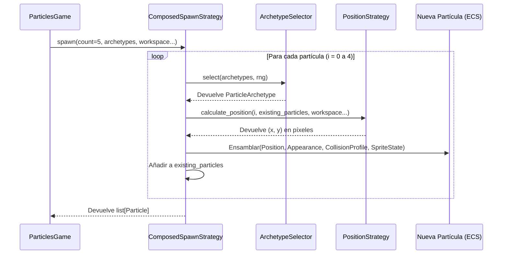

# Documentación del Sistema de Partículas ECS-lite

**Estado**: 🟢 Activo
**Versión**: 1.0
**Última actualización**: Octubre 2026
**Ubicación**: `docs/particles_ecs_system.md`

---

## 🎯 Visión General

El sistema de partículas de `pose_app` implementa un patrón **Entity Component System (ECS-lite)** sobre la arquitectura hexagonal del proyecto. Permite construir múltiples variantes de juegos de partículas (touch, raining, shooting, falling, memory) reutilizando los mismos componentes y sistemas, pero con **ensamblajes distintos**.

### Principio fundamental

> **La entidad es un contenedor de datos. La lógica vive en los sistemas. La presencia o ausencia de un componente define el comportamiento.**

---

## 🏛️ Arquitectura en capas

```
┌─────────────────────────────────────────────────────────┐
│  DOMINIO (sin dependencias externas)                    │
│  ├── components.py      → Position, Appearance, etc.    │
│  ├── systems.py         → MovementSystem, etc.          │
│  └── particle.py        → Entidad contenedora           │
├─────────────────────────────────────────────────────────┤
│  JUEGO (lógica de negocio específica)                   │
│  ├── spawn.py           → Generación con restricciones  │
│  ├── geometry.py        → Detección de colisiones       │
│  └── main.py            → Loop del juego                │
├─────────────────────────────────────────────────────────┤
│  INFRAESTRUCTURA (lectura de assets)                    │
│  ├── paths.py           → Rutas globales                │
│  ├── sprite_sheet_parser.py → Parseo de JSON            │
│  └── asset_loader.py    → Construye SpriteConfig        │
├─────────────────────────────────────────────────────────┤
│  ADAPTADOR (Pygame)                                     │
│  └── pygame_particles.py → Render círculos + sprites    │
└─────────────────────────────────────────────────────────┘
```

**Regla de oro**: El dominio nunca importa de adaptadores ni infraestructura.

---

## 🧩 Componentes

Los componentes son **dataclasses** que representan datos puros. Se dividen en inmutables (`frozen=True`) y mutables (solo cuando el rendimiento lo exige).

### Tabla de componentes

| Componente | Mutabilidad | Responsabilidad | Campos clave |
|---|---|---|---|
| `Position` | **Mutable** | Estado espacial y velocidad | `x, y, vx, vy` |
| `Appearance` | Frozen | Representación visual | `size, color, padding_x, padding_y` |
| `Lifespan` | Frozen | Ciclo de vida | `max_life, current_life` |
| `CollisionProfile` | Frozen | Interacción física | `radius, behavior` |
| `SpriteConfig` | Frozen | Receta del sprite | `path, frame_width, frame_height, frame_count, fps, animation_mode` |
| `SpriteState` | **Mutable** | Frame actual y tiempo acumulado | `current_frame, elapsed_time` |

### ¿Por qué algunos son mutables?

- **`Position`**: Se actualiza 60 veces por segundo por `MovementSystem`. Crear una nueva instancia en cada frame generaría presión innecesaria en el garbage collector.
- **`SpriteState`**: Misma razón para la animación en tiempo real.
- **Los demás**: Son "recetas" o configuraciones. No cambian durante la vida de la partícula.

### Ejemplo: crear una partícula

```python
from pose_app.domain.entities.particles.components import (
    Appearance,
    CollisionProfile,
    Lifespan,
    Position,
    SpriteConfig,
    SpriteState,
)
from pose_app.domain.entities.particle import Particle

# Partícula estática infinita (ej: juego de memoria)
particle = Particle(
    position=Position(x=400.0, y=300.0),
    appearance=Appearance(size=20.0, color=(255, 200, 50)),
    collision=CollisionProfile(radius=10.0, behavior="destroy"),
)

# Partícula con vida limitada y sprite animado
particle = Particle(
    position=Position(x=100.0, y=100.0, vx=2.0, vy=0.0),
    appearance=Appearance(size=20.0),
    lifespan=Lifespan.fresh(max_life=5.0),  # factory method
    collision=CollisionProfile(radius=10.0, behavior="destroy"),
    sprite_config=SpriteConfig(
        path="demo.png",
        frame_width=256.0,
        frame_height=256.0,
        frame_count=16,
        fps=12.0,
        animation_mode="loop",
    ),
    sprite_state=SpriteState(current_frame=0, elapsed_time=0.0),
)
```

### Factory method `Lifespan.fresh()`

```python
life = Lifespan.fresh(max_life=5.0)
# Equivale a: Lifespan(max_life=5.0, current_life=5.0)
```

Separa el concepto de "partícula recién nacida" de "partícula con vida parcial".

---

## 🎯 ParticleArchetype: El ADN de las partículas

Un `ParticleArchetype` es un **Value Object inmutable** que define las propiedades intrínsecas de un tipo de partícula. No contiene reglas de spawn (como `min_distance`), solo propiedades que definen "qué es" la partícula.

### Estructura

```python
@dataclass(frozen=True)
class ParticleArchetype:
    """ADN de un tipo de partícula."""

    name: str  # Identificador único
    weight: float = 1.0  # Peso para spawn aleatorio
    size: float = 20.0  # Tamaño visual en píxeles
    color: tuple[int, int, int] = (255, 200, 50)  # Color RGB
    sprite_config: SpriteConfig | None = None  # Sprite animado opcional
```

### Ejemplo de uso

```python
# Partícula de fuego con sprite animado
fire_archetype = ParticleArchetype(
    name="fire",
    weight=0.7,
    size=25.0,
    color=(255, 100, 0),
    sprite_config=SpriteConfig(
        path="fire.png",
        frame_width=64.0,
        frame_height=64.0,
        frame_count=8,
        fps=12.0,
        animation_mode="loop",
    ),
)

# Partícula de hielo simple (sin sprite)
ice_archetype = ParticleArchetype(
    name="ice",
    weight=0.3,
    size=20.0,
    color=(100, 200, 255),
)
```

### Principios de diseño

1. **Inmutabilidad**: `@dataclass(frozen=True)` garantiza que no puede modificarse después de creado.
2. **Validación estricta**: `__post_init__` valida que `name` no esté vacío, `weight >= 0`, `size > 0`, y `color` sea RGB válido (0-255).
3. **Separación de responsabilidades**: El archetype NO contiene reglas de spawn (como `min_distance`). Esas reglas viven en las estrategias de posicionamiento.
4. **Composición ECS**: El campo `sprite_config` es opcional. Si es `None`, la partícula se renderiza como círculo sólido.

---

## 🎲 Sistema de Spawn Data-Driven

El sistema de spawn permite generar partículas con comportamientos completamente configurables desde JSON, sin modificar código Python.

### Arquitectura de estrategias



### Protocolos (contratos)

#### `ArchetypeSelector`
Decide **QUÉ** tipo de partícula se genera.

```python
class ArchetypeSelector(Protocol):
    def select(
        self, archetypes: list[ParticleArchetype], rng: random.Random
    ) -> ParticleArchetype: ...
```

**Implementaciones:**
- `WeightedSelector`: Selección aleatoria ponderada por el campo `weight` del archetipo.
- `SequentialSelector`: Selección cíclica según una secuencia predefinida de nombres.

#### `PositionStrategy`
Decide **DÓNDE** se coloca la partícula.

```python
class PositionStrategy(Protocol):
    def calculate_position(
        self,
        index: int,
        existing_particles: list[Particle],
        workspace: Workspace,
        screen_w: int,
        screen_h: int,
        rng: random.Random,
    ) -> tuple[float, float]: ...
```

**Implementaciones:**
- `RandomPositionStrategy`: Posiciones aleatorias dentro del workspace, respetando `min_distance` entre partículas.
- `GridPositionStrategy`: Posiciones deterministas en una grilla de filas × columnas.

#### `SpawnStrategy`
Orquesta la creación completa de partículas.

```python
class SpawnStrategy(Protocol):
    def spawn(
        self,
        count: int,
        archetypes: list[ParticleArchetype],
        workspace: Workspace,
        screen_w: int,
        screen_h: int,
        rng: random.Random,
    ) -> list[Particle]: ...
```

**Implementación principal:**
- `ComposedSpawnStrategy`: Compone un `ArchetypeSelector` + `PositionStrategy` para generar el lote completo.

### Ejemplo: Estrategia compuesta

```python
from pose_app.domain.entities.particles.spawn.selectors import WeightedSelector
from pose_app.domain.entities.particles.spawn.positions import RandomPositionStrategy
from pose_app.domain.entities.particles.spawn.strategies import ComposedSpawnStrategy

# Crear estrategia: 70% fuego, 30% hielo, con distancia mínima de 0.15
spawn_strategy = ComposedSpawnStrategy(
    archetype_selector=WeightedSelector(),
    position_strategy=RandomPositionStrategy(min_distance=0.15),
)

# Definir archetypes
archetypes = [
    ParticleArchetype(name="fire", weight=0.7, size=25.0, color=(255, 100, 0)),
    ParticleArchetype(name="ice", weight=0.3, size=20.0, color=(100, 200, 255)),
]

# Generar 10 partículas
particles = spawn_strategy.spawn(
    count=10,
    archetypes=archetypes,
    workspace=Workspace(),
    screen_w=800,
    screen_h=600,
    rng=random.Random(42),
)
```

### Configuración JSON

El plugin lee la configuración de spawn desde el JSON:

```json
{
  "pose_smoothing_factor": 0.3,
  "game_options": {
    "max_score": 10,
    "time_per_round": 10.0,
    "hit_radius": 30.0,
    "particle_archetypes": [
      {
        "name": "fire",
        "weight": 0.7,
        "size": 25.0,
        "color": [255, 100, 0]
      },
      {
        "name": "ice",
        "weight": 0.3,
        "size": 20.0,
        "color": [100, 200, 255]
      }
    ],
    "spawn_config": {
      "archetype_selector": "weighted",
      "position_strategy": "random",
      "min_distance": 0.15,
      "max_attempts": 100
    }
  }
}
```

El plugin (`particles_plugin.py`) construye las estrategias automáticamente:

```python
# 1. Leer archetypes del JSON
archetypes = [
    ParticleArchetype(
        name=a["name"],
        weight=a.get("weight", 1.0),
        size=a.get("size", 20.0),
        color=tuple(a.get("color", [255, 200, 50])),
    )
    for a in opts.get("particle_archetypes", [])
]

# 2. Construir estrategia según spawn_config
spawn_cfg = opts.get("spawn_config", {})
selector = WeightedSelector()  # o SequentialSelector
positioner = RandomPositionStrategy(min_distance=spawn_cfg.get("min_distance", 0.15))
spawn_strategy = ComposedSpawnStrategy(selector, positioner)

# 3. Inyectar en el juego
return ParticlesGame(
    # ... otros parámetros ...
    spawn_strategy=spawn_strategy,
    archetypes=archetypes,
)
```

### Validación y Fail-Fast

Si el JSON tiene valores inválidos, el plugin lanza `ConfigurationError` con contexto detallado:

```python
# Ejemplo de error
ConfigurationError: "Unknown archetype_selector: 'mystery'. Supported values: weighted"
```

Esto permite detectar errores de configuración al arrancar la aplicación, no en medio del juego.

---

## ⚙️ Sistemas

Los sistemas son **clases frozen** que operan sobre listas de entidades. No mantienen estado entre llamadas.

### `MovementSystem`

Aplica gravedad y amortiguación a la posición.

```python
@dataclass(frozen=True)
class MovementSystem:
    gravity: float = 0.1
    damping: float = 0.99

    def update(self, particles: Sequence[Particle]) -> None:
        for particle in particles:
            position = particle.position
            position.vy += self.gravity
            position.vx *= self.damping
            position.vy *= self.damping
            position.x += position.vx
            position.y += position.vy
```

**Fórmula**: `vy = (vy + gravity) * damping` → luego integración de posición.

### `LifespanSystem`

Decae la vida de forma multiplicativa y retira entidades agotadas.

```python
@dataclass(frozen=True)
class LifespanSystem:
    decay: float = 0.995

    def update(self, particles: Sequence[Particle]) -> None:
        for particle in particles:
            if particle.lifespan is None:
                continue  # infinitas: ignoradas
            particle.lifespan = replace(
                particle.lifespan,
                current_life=particle.lifespan.current_life * self.decay,
            )

    def cull(self, particles: Sequence[Particle]) -> list[Particle]:
        return [p for p in particles if p.is_alive()]
```

**Umbral de vida**: `current_life >= 0.01` → viva. El decaimiento multiplicativo nunca llega a cero, por eso se usa un umbral.

### `AnimationSystem`

Avanza el frame del sprite según el tiempo transcurrido.

```python
@dataclass(frozen=True)
class AnimationSystem:
    def update(self, particles: Sequence[Particle], dt: float) -> None:
        for particle in particles:
            if particle.sprite_config is None or particle.sprite_state is None:
                continue
            config = particle.sprite_config
            state = particle.sprite_state
            if config.fps <= 0.0:
                continue

            frame_duration = 1.0 / config.fps
            state.elapsed_time += dt
            if state.elapsed_time >= frame_duration:
                frames_to_advance = int(state.elapsed_time / frame_duration)
                state.elapsed_time -= frames_to_advance * frame_duration

                if config.animation_mode == "loop":
                    state.current_frame = (
                        state.current_frame + frames_to_advance
                    ) % config.frame_count
                elif config.animation_mode == "one_shot":
                    state.current_frame = min(
                        state.current_frame + frames_to_advance,
                        config.frame_count - 1,
                    )
```

---

## 🔄 Flujo de datos en un frame

```
1. SPAWN (inicio de ronda)
    spawn_strategy.spawn(count, archetypes, workspace, screen_w, screen_h, rng)
    ├── ComposedSpawnStrategy orquesta la creación
    │   ├── ArchetypeSelector elige el tipo (weighted/sequential)
    │   └── PositionStrategy calcula la posición (random/grid)
    ├── Ensambla componentes ECS: Position, Appearance, CollisionProfile, SpriteState
    └── Retorna list[Particle] completamente configuradas

2. LOOP (cada frame, ~60 FPS)
   a. AnimationSystem.update(particles, dt)
      → Avanza frames de sprites animados

   b. MovementSystem.update(particles)  [opcional]
      → Aplica física (gravedad, velocidad)

   c. LifespanSystem.update(particles)  [opcional]
      → Decae la vida

   d. detect_collisions(particles, landmarks, ...)
      → Detecta tocos con landmarks de pose
      → Retorna (partículas_no_tocadas, hits)

   e. LifespanSystem.cull(particles)  [opcional]
      → Retira partículas muertas

   f. Render
      set_particles(particles)
      render_particles()
      ├── Si tiene sprite_config + sprite_state → dibuja sprite
      └── Si solo tiene appearance → dibuja círculo (fallback)
```

---

## 🎮 Variantes de juego

El poder del ECS-lite se manifiesta al configurar distintos juegos con los mismos componentes:

| Juego | Pipeline de sistemas | Configuración distintiva |
|---|---|---|
| **particles** (touch) | Animation → Collision → Lifespan | Vida finita, `behavior="destroy"`, spawn aleatorio |
| **raining_particles** | Animation → Movement(gravity=0.35) → Collision | Gravedad alta, spawn desde arriba |
| **shooting_particles** | Animation → Movement(gravity=0.0, damping=1.0) → Collision | Velocidad horizontal, sin gravedad |
| **falling_particle** (balón) | Animation → Movement(gravity=0.2) → Collision(bounce) | **Sin Lifespan**, `behavior="bounce"` |
| **memory_particles** | Animation → Sequence → Feedback | **Sin Movement**, posición estática, vida infinita |

**Ninguno de estos juegos necesita una subclase de `ParticlesGame`**. Solo cambia el ensamblaje.

---

## 🖼️ Render: círculos y sprites

### Fallback a círculos

Si una partícula **no tiene** `sprite_config` (o es `None`), el renderer dibuja un círculo:

```python
def _draw_circle(self, particle: Particle) -> None:
    if particle.appearance.size <= 0:
        return  # validación semántica

    visual_size = (
        particle.appearance.size
        + particle.appearance.padding_x
        + particle.appearance.padding_y
    )
    radius = int(visual_size / 2)
    # ... alpha basado en lifespan, color, culling ...
    pygame.draw.circle(self._particle_surface, color, (x, y), radius)
```

### Sprites animados

Si tiene `sprite_config` y `sprite_state`, se dibuja el frame actual del sprite sheet:

```python
def _draw_sprite(self, particle: Particle) -> None:
    # 1. Cargar sprite sheet (cacheado)
    cache = self._load_sprite(config)

    # 2. Obtener coordenadas del frame actual
    frame_coords = frames.get(state.current_frame)
    frame_surface = image.subsurface(frame_coords)

    # 3. Escalar al tamaño visual deseado
    target_width = int(particle.appearance.size + particle.appearance.padding_x)
    target_height = int(particle.appearance.size + particle.appearance.padding_y)
    frame_surface = pygame.transform.scale(frame_surface, (target_width, target_height))

    # 4. Centrar en la posición de la partícula
    x = int(particle.position.x - target_width / 2)
    y = int(particle.position.y - target_height / 2)

    # 5. Alpha basado en lifespan
    # 6. Blit sobre el buffer
```

### Padding visual

`Appearance.padding_x` y `padding_y` son **márgenes visuales** que no afectan la colisión:

```python
# Aparencia: 20px + 5px padding = 25px visuales
appearance = Appearance(size=20.0, padding_x=5.0, padding_y=5.0)

# Colisión: sigue siendo radius=10.0 (size/2)
collision = CollisionProfile(radius=10.0, behavior="destroy")
```

---

##  Assets y carga de sprites

### Estructura de archivos

```
assets/
└── particles/
    └── sprites/
        ├── demo.png          ← Sprite sheet (ej: 1024x1024, 4x4 frames)
        └── demo.json         ← Metadatos de frames (formato AutoSprite)
```

### Formato del JSON

```json
{
  "frames ": {
    "0 ": { "x ": 0, "y ": 0, "w ": 256, "h ": 256, "duration ": 1 },
    "1 ": { "x ": 256, "y ": 0, "w ": 256, "h ": 256, "duration ": 1 }
  },
  "meta ": {
    "size ": { "w ": 1024, "h ": 1024 },
    "frame_size ": { "w ": 256, "h ": 256 }
  }
}
```

**Nota**: Las claves pueden tener espacios (`"frames "`, `"0 "`). El `SpriteSheetParser` los limpia automáticamente.

### Flujo de carga

```
ParticlesPlugin.create_game()
  ↓
AssetLoader.load_sprite_config(category="particles", sprite_name="demo")
  ↓
Lee demo.json → SpriteSheetParser.parse() → dict[int, tuple[x,y,w,h]]
  ↓
Construye SpriteConfig(path="demo.png", frame_width=256, ...)
  ↓
Se inyecta al ParticlesGame → pasa al spawn → cada partícula recibe el config
  ↓
En runtime: PygameParticlesRenderer._load_sprite() carga la imagen y cachea
```

### Rutas globales

```python
# src/pose_app/infrastructure/paths.py
PROJECT_ROOT = Path(__file__).resolve().parents[3]
ASSETS_DIR = PROJECT_ROOT / "assets"
```

Evita el anti-patrón `Path(__file__).parent.parent.parent...`.

---

## 🧪 Testing

### Tests unitarios (TDD)

Cada componente y sistema tiene tests aislados:

```python
# tests/unit/test_particle_ecs_components.py
def test_lifespan_fresh_starts_at_max() -> None:
    life = Lifespan.fresh(8.0)
    assert life.current_life == life.max_life == 8.0


def test_lifespan_rejects_negative_current() -> None:
    with pytest.raises(ValueError, match="must be in"):
        Lifespan(max_life=1.0, current_life=-0.1)
```

### Tests de sistemas

```python
# tests/unit/test_particle_ecs_systems.py
def test_movement_system_applies_physics() -> None:
    pos = Position(x=0.0, y=0.0, vx=10.0, vy=0.0)
    particle = Particle(position=pos, appearance=Appearance())
    system = MovementSystem(gravity=0.0, damping=0.5)
    system.update([particle])
    assert particle.position.vx == pytest.approx(5.0)
```

### Property-based tests (Hypothesis)

```python
# tests/property/test_particle_ecs_properties.py
@given(
    pos=position_strategy,
    gravity=st.floats(min_value=0.0, max_value=1.0),
    damping=st.floats(min_value=0.5, max_value=1.0),
)
def test_movement_system_formula(pos, gravity, damping) -> None:
    particle = Particle(position=pos, appearance=Appearance())
    system = MovementSystem(gravity=gravity, damping=damping)
    original_vy = particle.position.vy
    system.update([particle])
    expected_vy = (original_vy + gravity) * damping
    assert particle.position.vy == pytest.approx(expected_vy)
```

---

## 📐 Decisiones de diseño

### 1. ¿Por qué ECS-lite y no ECS clásico?

| Aspecto | ECS-lite (elegido) | ECS clásico |
|---|---|---|
| Entidades | Objetos con componentes | IDs enteros |
| Componentes | Dataclasses en la entidad | Arrays paralelos |
| Sistemas | Funciones/clases | Iteradores sobre arrays |
| Compatibilidad con hexagonal | ✅ Natural |  Requiere motor externo |
| Legibilidad | ✅ Alta | ⚠️ Media |
| Rendimiento | ✅ Suficiente para decenas de partículas | ✅ Óptimo para miles |

### 2. ¿Por qué `replace()` en lugar de mutar `Lifespan`?

La inmutabilidad hace el flujo de datos **rastreable y testeable**. El costo de crear una nueva instancia por frame es aceptable para la escala del proyecto. Si el profiling lo exige, se puede cambiar a mutable **sin afectar la interfaz de `LifespanSystem`**.

### 3. ¿Por qué umbral `>= 0.01` en lugar de `> 0`?

El decaimiento multiplicativo (`life *= 0.995`) tiende asintóticamente a cero pero **nunca llega**. Un umbral `> 0` haría las partículas inmortales. El valor `0.01` es una ε de negocio.

### 4. ¿Por qué el padding no afecta la colisión?

Separación de responsabilidades: lo visual (`Appearance`) y lo físico (`CollisionProfile`) son independientes. Esto permite, por ejemplo, sprites con "halo" visual que no se tocan, o hitboxes más grandes que el sprite (útil para móviles).

### 5. ¿Por qué `animation_mode` es `Literal` y no `Enum`?

Más ligero, no requiere import, y los type-checkers lo tratan igual. Convención del proyecto para conjuntos cerrados pequeños.

---

## 🔮 Roadmap futuro

### Configuración driven por JSON

```json
{
  "game": "particles",
  "stage": {
    "duration": 10.0,
    "particles_per_round": 3
  },
  "particle": {
    "appearance": { "size": 20.0, "color": [255, 200, 50], "padding_x": 5.0 },
    "collision": { "radius": 12.0, "behavior": "destroy" },
    "lifespan": { "max_life": 5.0 },
    "sprite": { "path": "demo.png", "fps": 12.0, "animation_mode": "loop" }
  }
}
```

---

### ✅ Completado
- [x] Configuración driven por JSON (archetypes + spawn_config)
- [x] Sistema de estrategias de spawn (WeightedSelector, RandomPositionStrategy, etc.)
- [x] ComposedSpawnStrategy para composición flexible

### Próximas capacidades
- [ ] `FixedPositionStrategy`: posiciones fijas definidas en JSON (orquestación estricta).
- [ ] `SequentialSelector` integrado en el plugin para juegos de memoria.
- [ ] Soporte para `stages` en el JSON (secuencias de configuraciones de spawn).
- [ ] `OscillatingMovement`: movimiento senoidal.
- [ ] `BounceCollision`: rebote en bordes (para `falling_particle`).
- [ ] `SequenceFeedback`: para el juego de memoria.
- [ ] `ComboScoring`: multiplicadores por combos rápidos.

---

## 📚 Referencias

- **Arquitectura hexagonal**: `docs/ports_contract.md`
- **Arquitectura de render**: `docs/render_architecture.md`
- **Cómo añadir un juego**: `docs/adding_a_game_plugin.md`
- **Guía de estilos**: `docs/code_style.md`
- **Aprendizaje del sistema**: `docs/system_learning.md`
