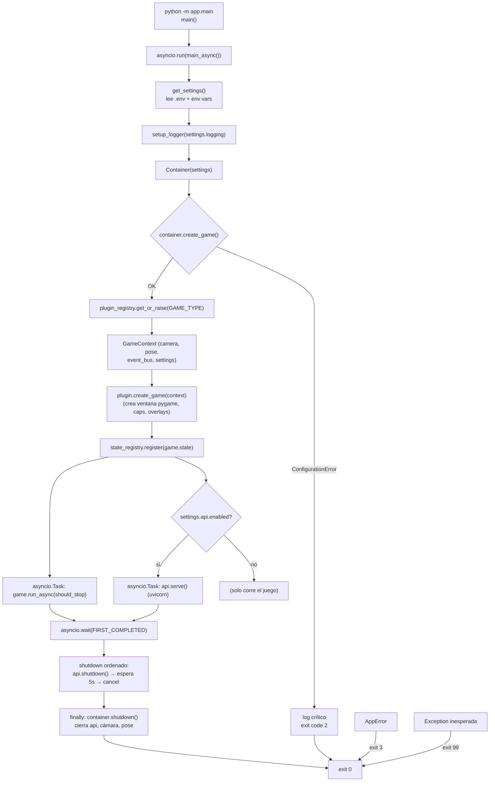
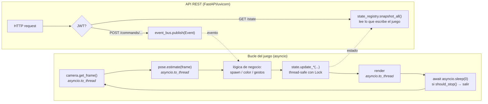
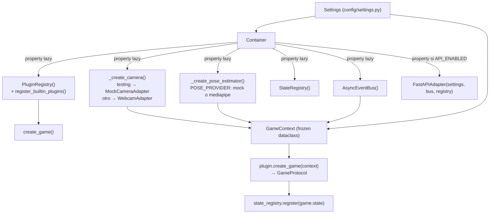
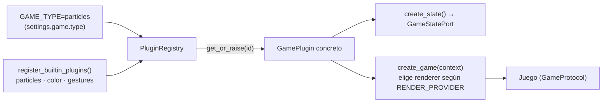
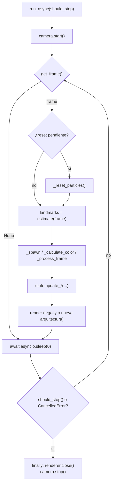
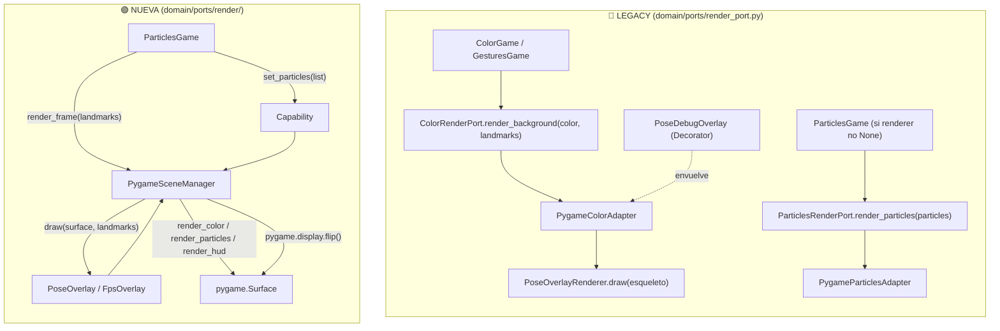
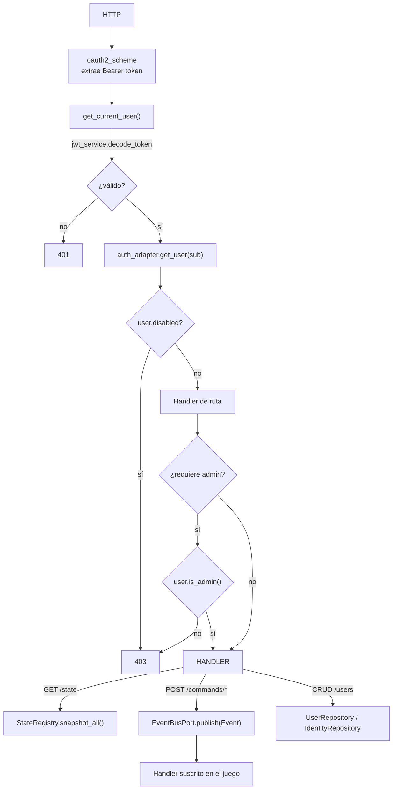
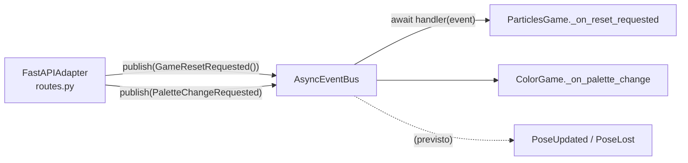

# Guía de Aprendizaje del Sistema — `system_learning.md`

> **Audiencia**: desarrollador nuevo integrado al proyecto.
> **Tono**: educativo. Este documento no sustituye a `AGENST.md` ni a `docs/ports_contract.md`: los **complementa** explicando *qué hace cada cosa y por qué*.
> **Regla de oro**: antes de escribir código, lee `AGENST.md` + `docs/ports_contract.md`. Si este documento contradice esos dos, **manda la documentación normativa** y avisa.

---

## 🧭 Cómo usar este documento

| Si quieres... | Ve a |
|---|---|
| Entender qué pasa cuando ejecuto `uv run python -m app.main` | §2 Diagrama de flujo general |
| Entender un módulo concreto (juego, API, render...) | §3 Diagramas por módulo |
| Saber dónde poner un archivo nuevo | §4 Guía por carpetas |
| Saber qué hace cada clase/método, con qué tipos y quién lo llama | §5 Catálogo por archivo |
| Recordar los patrones que usamos | §6 Glosario de patrones |

**Convenciones tipográficas de este doc**:

- 🟢 = en uso activo.
- 🟡 = definido pero sin invocadores aún (listo para el futuro / pendiente de migración).
- 🔴 = legacy/deprecado: no borrar sin consultar, pero no escribas código nuevo encima.

---

# 1. Panorama general

Pose AR App es una aplicación Python 3.11+ que captura video de la webcam, estima la pose humana y ejecuta **juegos en tiempo real** (partículas, color, gestos), exponiendo además una **API REST** para consultar estado y enviar comandos.

Está construida con **arquitectura hexagonal** (puertos y adaptadores) + **sistema de plugins** (cada juego es un plugin autocontenido).

### 1.1 Las cinco capas

```
┌─────────────────────────────────────────────────────────────────┐
│  config/            Settings (pydantic-settings, .env)         │
├─────────────────────────────────────────────────────────────────┤
│  app/               Composition root: main, Container,         │
│                     registries, plugins concretos              │
├─────────────────────────────────────────────────────────────────┤
│  adapters/          Detalles: FastAPI, pygame, OpenCV,          │
│                     Mediapipe, mocks, bcrypt, JWT               │
├─────────────────────────────────────────────────────────────────┤
│  infrastructure/    Servicios transversales: DI, event bus,     │
│                     logging, errores, JWT                       │
├─────────────────────────────────────────────────────────────────┤
│  domain/            Corazón: entidades, puertos, eventos,       │
│                     juegos, estados. NO importa frameworks.     │
└─────────────────────────────────────────────────────────────────┘
```

**Regla de dependencias** (la flecha "importa" apunta hacia abajo):

```
app ──► adapters ──► domain ◄── infrastructure
 │                     ▲
 └──► infrastructure ──┘
 └──► config
```

- `domain/` **jamás** importa `adapters/`, `app/`, pygame, cv2, fastapi (solo `numpy` en tipos y `abc`).
- `adapters/` implementa los puertos de `domain/`.
- `app/` es el *composition root*: es el único que sabe juntarlo todo.
- `infrastructure/` da servicios usados por todas las capas (logging, errores, bus, DI).

### 1.2 Vocabulario (sufijos del proyecto)

| Sufijo | Significado | Ejemplo |
|---|---|---|
| `*Port` | Interfaz abstracta (ABC) que el dominio **define** | `CameraPort` |
| `*Adapter` / `*Renderer` | Implementación concreta de un puerto | `WebcamAdapter` |
| `*Plugin` | Fábrica que construye un juego completo | `ParticlesPlugin` |
| `*State` | Estado consultable thread-safe de un juego | `ParticlesState` |
| `*Overlay` | Elemento visual superpuesto (debug/FPS) | `PoseOverlay` |
| `*Schema` / `*Response` / `*Request` | DTO pydantic de la API | `UserResponse` |
| `*Repository` | Almacén CRUD de una entidad | `InMemoryUserRepository` |
| `*Game` | Juego con su loop asíncrono | `GesturesGame` |

---

# 2. Diagrama de flujo general

## 2.1 Arranque y apagado (proceso completo)



**Códigos de salida** (memoriza: los usarás en CI):

| Código | Causa |
|---|---|
| `0` | Apagado limpio |
| `1` | `asyncio.run` ni siquiera arrancó / `KeyboardInterrupt` externo |
| `2` | `ConfigurationError` (config inválida, plugin desconocido, cámara no disponible) |
| `3` | Cualquier otro `AppError` |
| `130` | `KeyboardInterrupt` (128 + SIGINT) |
| `99` | Excepción inesperada (con stack trace) |

## 2.2 Bucle en tiempo real (runtime)

Un juego corriendo + la API atendiendo peticiones, en paralelo:



**Ideas clave de este diagrama**:

1. El juego escribe estado; la API lo lee. Por eso **todo estado es thread-safe** (`threading.Lock`).
2. La comunicación API → juego va por **eventos** (`EventBusPort`), nunca por llamadas directas: la API no conoce `ParticlesGame`.
3. Todo lo bloqueante (OpenCV, Mediapipe, pygame) se ejecuta en hilos con `asyncio.to_thread(...)`; el loop de asyncio nunca se bloquea.

---

# 3. Diagramas de flujo por módulo

## 3.1 Módulo: construcción / DI (`infrastructure/di/`, `app/`)



**Punto educativo**: el `Container` **no conoce juegos concretos**. Solo conoce adaptadores compartidos. Quien sabe construir un juego es el plugin. Así, añadir un juego no toca el Container.

## 3.2 Módulo: plugins (`app/plugins/`)



**Decisión de diseño**: el registro es **explícito y central** (no hay auto-discovery mágico). Añadir un juego = 1 carpeta nueva + 1 línea en `register_builtin_plugins`.

## 3.3 Módulo: bucle de juego (`domain/games/*/main.py`)



Los tres juegos comparten este esqueleto (**Template Method** implícito); cambian la caja "lógica" y el renderer.

## 3.4 Módulo: render — doble arquitectura 🔴/🟢



**Estado real hoy**: `ParticlesGame` usa la **nueva** arquitectura; `ColorGame` y `GesturesGame` siguen en **legacy**. Ambas conviven; por eso existen DOS `ColorRenderPort` y DOS `ParticlesRenderPort` (uno en `domain/ports/render_port.py` y otro en `domain/ports/render/`). **Importa siempre la ruta completa.**

## 3.5 Módulo: API + autenticación (`adapters/api/`, `adapters/auth/`, `infrastructure/auth/`)



**Flujo de login**: `POST /api/v1/auth/token` → `CredentialsAuthProvider.authenticate` (bcrypt + verificación dummy anti-timing) → `JWTService.create_access_token(user)` → `{access_token, token_type: bearer}`.

## 3.6 Módulo: eventos (`domain/events/` + `infrastructure/events/`)



**Patrón Observer asíncrono**: los handlers son `async def`, se ejecutan en orden de suscripción, y si uno falla se loggea y se continúa con el siguiente.

---

# 4. Guía por carpetas

Para cada carpeta: **propósito** y **consideraciones para agregar un archivo o módulo nuevo**.

## 4.1 `domain/` — el corazón 🧠

**Propósito**: TODO el conocimiento de negocio: entidades, contratos (puertos), eventos, estados y los juegos mismos. No depende de frameworks.

### `domain/entities/`
- **Propósito**: objetos de negocio puros. `RGBColor`, `Particle`, `PoseLandmark`, `User`, `Identity`, `Gesture`.
- **Al añadir archivo**:
  1. Si es inmutable → `@dataclass(frozen=True)`. Si necesita mutación deliberada (como `Particle`) → dataclass normal y documenta por qué.
  2. Valida en `__post_init__`, lanza `ValueError` (no `assert`).
  3. Usa patrón `with_*` para "copias modificadas" (`User.with_email(...)`), nunca mutar.
  4. Nada de pygame/cv2/pydantic aquí. Solo stdlib + tipos de dominio.

### `domain/ports/`
- **Propósito**: contratos (ABC) entre dominio y exterior. Son la **fuente de verdad** (ver `docs/ports_contract.md`).
- **Al añadir puerto**:
  1. Puerto **nuevo y pequeño** (una responsabilidad, ISP). No le agregues métodos a un puerto existente si puedes crear otro.
  2. Tipado estricto en cada `@abstractmethod`; docstring Google-style con Args/Returns/Raises.
  3. **Actualiza `docs/ports_contract.md`** (versión + changelog) — es obligatorio.
  4. Los `close()`/`start()`/`stop()` deben ser **idempotentes**.
  5. Un adaptador implementa **un** puerto, nunca varios a la vez.

### `domain/ports/render/`
- **Propósito**: **nueva** arquitectura de render (capacidades `set_*`+`render_*`, overlays, scene).
- **Al añadir capacidad**: crea `*_render_port.py` con `set_x()` / `render_x()` / `close()`, y añade su implementación Pygame en `adapters/render/`. Documenta en `docs/render_architecture.md`.

### `domain/events/`
- **Propósito**: hechos inmutables ya ocurridos (`DomainEvent` base con `occurred_at` automático).
- **Al añadir evento**: `@dataclass(frozen=True, kw_only=True)`, hereda de `DomainEvent`, nombre en pasado/sustantivo (`PaletteChangeRequested`). Registra quién lo publica y quién lo consume en `docs/ports_contract.md`.

### `domain/state/`
- **Propósito**: `GameStatePort` (qué expone cada juego a la API) y `AppSnapshot` (DTO agregado).
- **Al añadir estado**: implementa `game_id` + `snapshot()` (copia serializable, <1 ms) + `stats()`. **No devuelvas referencias mutables.**

### `domain/plugins/`
- **Propósito**: contrato `GamePlugin` (ABC factory) y `GameProtocol` (Protocol estructural del juego).
- **Al añadir**: casi nunca tocas esto. Si necesitas un método nuevo en el contrato, es una **modificación de interfaz pública → pregunta primero**.

### `domain/games/<juego>/`
- **Propósito**: un juego completo y autocontenido: `main.py` (lógica + loop), `state.py` (estado thread-safe).
- **Al añadir juego**:
  1. Crea `domain/games/<id>/` con `main.py`, `state.py`, `__init__.py`.
  2. `state.py` implementa `GameStatePort` y usa `threading.Lock` en cada mutación.
  3. `main.py` recibe TODO por constructor (DI) y solo conoce puertos.
  4. Loop: `run_async(should_stop)`, `asyncio.to_thread` para bloqueantes, cleanup en `finally`, re-lanzar `CancelledError`.
  5. Crea su plugin en `app/plugins/<id>_plugin.py` y regístralo en `app/plugins/__init__.py`.
  6. Guía completa: `docs/adding_a_game_plugin.md`.

### `domain/use_cases/`
- 🔴 **Carpeta residual/vacía** (los juegos migraron a `domain/games/`). No añadas nada aquí.

## 4.2 `app/` — composition root 🧩

**Propósito**: único lugar que sabe juntar dependencias concretas. Contiene entry point, contenedor DI, registries y plugins.

- **`app/main.py`**: entry point. **No pongas lógica de negocio aquí.**
- **`app/game_context.py`**: `GameContext` frozen. Si añades un campo, **no rompe** a los plugins existentes (por eso existe).
- **`app/plugin_registry.py` / `state_registry.py`**: registries thread-safe. Cualquier método nuevo debe usar `self._lock`.
- **`app/plugins/`**: aquí viven los plugins (construyen adaptadores concretos: pygame, mocks).

**Al añadir archivo en `app/`**:
1. Si es un plugin nuevo → `app/plugins/<id>_plugin.py` + 1 línea en `register_builtin_plugins`.
2. Si es una dependencia compartida nueva → agrégala al `Container` como `@property` **lazy** + al `GameContext` si los juegos la necesitan.
3. No importes `domain.games.*` desde `Container`: eso rompería la desacoplación.

## 4.3 `adapters/` — el exterior implementado 🔌

**Propósito**: traducir puertos del dominio a tecnologías reales (OpenCV, Mediapipe, pygame, FastAPI, bcrypt) y viceversa.

| Carpeta | Qué implementa |
|---|---|
| `adapters/camera/` | `CameraPort` con OpenCV (`WebcamAdapter`) |
| `adapters/pose/` | `PoseEstimatorPort` con MediaPipe (`MediapipeAdapter`) + modelo `.task` |
| `adapters/render/` | Puertos de render (legacy y nuevos) con pygame |
| `adapters/auth/` | `AuthPort`, `UserRepositoryPort`, `IdentityRepositoryPort` + bcrypt |
| `adapters/api/` | Routers FastAPI + DTOs (puertos de entrada HTTP) |
| `adapters/mock/` | Dobles de test: mocks y spies deterministas |

**Al añadir archivo**:
1. **Un adaptador = un puerto**. Si implementas dos, estás haciendo mal el diseño.
2. Los mocks van **siempre** en `adapters/mock/`, son deterministas (sin aleatoriedad real, sin cámara real) y exponen contadores/spies para asserts.
3. Si el adaptador falla, lanza la excepción del contrato (`CameraNotAvailableError`, `PoseEstimationError`, `ConfigurationError`), nunca `Exception` genérica.
4. `adapters/api/`: los DTO **nunca** exponen `password_hash`. Orden de rutas importante: `/me` antes de `/{user_id}`.
5. Carpetas sin `__init__.py` (`auth/`, `decorators/`) funcionan como namespace packages; si creas paquete nuevo, sigue el estilo de sus vecinas.

## 4.4 `infrastructure/` — servicios transversales 🛠️

**Propósito**: capacidades transversales usadas por todas las capas.

| Carpeta | Qué aporta |
|---|---|
| `di/` | `Container` (inversión de dependencias, factories) |
| `events/` | `AsyncEventBus` (Observer async thread-safe) |
| `errors/` | Jerarquía de excepciones + clasificador de acciones |
| `logging/` | Logger raíz `pose_ar` (consola JSON/color, `logs/app.log`, `logs/errors.log`) |
| `auth/` | `JWTService` (crear/decodificar tokens) |
| `lifecycle/` | 🔴 `AppRunner` huérfano (el ciclo real vive en `app/main.py`) |

**Al añadir archivo**: debe ser genérico (no saber de juegos concretos), usar `get_logger("infrastructure.<x>")`, y registrar su `ConfigurationError`/`InfrastructureError` correspondiente en `exceptions.py`.

## 4.5 `config/` ⚙️

- **Propósito**: `Settings` raíz con sub-configs (`camera`, `pose`, `render`, `game`, `logging`, `api`, `jwt`), cargadas de `.env` + env vars con prefijos (`CAMERA_`, `POSE_`, ...).
- **Al añadir setting**:
  1. Agrégalo a la sub-clase correspondiente con **default seguro** y validación (rango/`Literal`).
  2. Documenta el nombre en `.env.example` (¡sin valores secretos!).
  3. `JWT_SECRET_KEY` es **requerido** y secreto: jamás lo hardcodees ni lo commitees.
  4. Tras cambiar settings: `uv run pytest tests/unit/test_settings.py -v`.

## 4.6 `tests/` 🧪

- **Propósito**: `unit/` (una unidad aislada con mocks), `integration/` (componentes pegados + API), `property/` (hypothesis: invariantes), `manual/` (scripts con cámara física, excluidos de pytest).
- **Al añadir test**:
  1. Nombra `test_<archivo_bajo_prueba>.py`; fixtures **locales** en el archivo (no hay `conftest.py` global).
  2. Sin cámara real: usa `MockCameraAdapter`/`MockPoseAdapter`. Marca lo lento con `@pytest.mark.slow` (se excluyen por defecto).
  3. Tests async: `asyncio_mode=auto`, solo necesitas `async def test_...`.
  4. Cubre también invariantes con `@given` en `tests/property/` cuando la lógica es matemática (colores, distancias, CRUD).
  5. La cobertura mínima global es **60%** (`fail_under`) y hay umbrales **por capa** en `scripts/check_coverage.py`.

## 4.7 `scripts/`, raíz y `docs/`

- `scripts/check_coverage.py`: gate de cobertura por capa (pre-push).
- `check_structure.py`: fitness function de arquitectura (existe archivo X, importa clase Y, hay 3 plugins). **Ejecútalo tras mover/crear módulos estructurales.**
- `directory_tree_generator.py`: regenera `docs/directory_structure.md`.
- `debug_mediapipe_tasks.py`: repro de crashes de Mediapipe fuera de pytest.
- `AGENST.md`: reglas del proyecto (**obligatorio**). Ojo: el archivo real se llama `AGENST.md`.
- `docs/`: `ports_contract.md` (contratos), `render_architecture.md` (nueva arquitectura), `adding_a_game_plugin.md` (tutorial de juegos), `code_style.md` (estilo), `directory_structure.md` (árbol), `coverage_baseline.md`, y este `system_learning.md`.

---

# 5. Catálogo por archivo

Para cada archivo: **propósito**, **patrones de diseño**, y una tabla con **responsabilidades**, **tipado** y **valores clave que modifica + proveniencia** (quién lo invoca).

---

## 5.1 `domain/entities/`

### `domain/entities/__init__.py`
Paquete vacío (solo marca namespace). Los consumidores importan submódulos directamente.

### `domain/entities/color.py`
**Propósito**: `RGBColor`, value object inmutable de color con validación e interpolación.
**Patrones**: Dataclass `frozen=True`, Value Object, Factory method (`interpolate`), validación en `__post_init__`.

| Objeto / función | Firma (tipado) | Responsabilidad | Valores que modifica / proveniencia |
|---|---|---|---|
| `RGBColor` | `@dataclass(frozen=True) r:int, g:int, b:int` | Color RGB 0-255 inmutable | Creado por `ColorState._current_color`, paletas de `ColorGame.PALETTES`, `ParticlesPlugin.create_game`, adaptadores pygame y tests |
| `RGBColor.__post_init__` | `(self) -> None` | Lanza `ValueError` si un canal sale de 0-255 | Se ejecuta en cada construcción |
| `RGBColor.to_hex` | `(self) -> str` | `"#rrggbb"` | Invocado por `ColorState.snapshot()` → JSON `background_color` de `GET /state` |
| `RGBColor.to_rgb_tuple` | `(self) -> tuple[int,int,int]` | Tupla para `surface.fill()` | Invocado por `PygameColorRenderer.render_color`, `PygameParticlesRenderer`, versiones legacy |
| `RGBColor.interpolate` | `(cls, color1: RGBColor, color2: RGBColor, t: float) -> RGBColor` (classmethod) | Interpolación lineal con `t` acotado a [0,1] | Invocado por `ColorGame._calculate_color` (transiciones de fondo) y `tests/property/test_rgb_color_properties.py` |

### `domain/entities/gesture.py`
**Propósito**: catálogo cerrado de gestos reconocibles.
**Patrones**: `str, Enum` tipado (serializable a JSON), constantes con nombre.

| Objeto / función | Firma (tipado) | Responsabilidad | Valores que modifica / proveniencia |
|---|---|---|---|
| `Gesture` | `class Gesture(str, Enum)` | Valores: `hand_up`, `greeting`, `arms_crossed`, `t_pose`, `squat`, `one_leg_balance` | Claves del dict de detectores de `GesturesGame._detectors`, de `GesturesState._activation_counts` y de los tests |
| `Gesture.display_name` | `@property (self) -> str` | Nombre legible (`"Hand Up"`) para logs | Leído por `GesturesGame._on_gesture_activated/_deactivated` |

### `domain/entities/identity.py`
**Propósito**: vincula usuario + método de autenticación, separando credenciales del perfil.
**Patrones**: Dataclass `frozen=True`, patrón `with_*` (`dataclasses.replace`), helper `_now()`.

| Objeto / función | Firma (tipado) | Responsabilidad | Valores que modifica / proveniencia |
|---|---|---|---|
| `_now` | `() -> datetime` | UTC actual | `default_factory` de `created_at` |
| `Identity` | `frozen`: `user_id:str`, `provider:str`, `provider_user_id:str`, `password_hash:str\|None`, `created_at:datetime`, `last_login_at:datetime\|None` | Credencial inmutable | Creada en `json_bootstrap.py`, `user_routes.create_user`, persistida en `InMemoryIdentityRepository` |
| `Identity.is_password` | `@property (self) -> bool` | `provider == "password"` | Tests property; uso previsto en `CredentialsAuthProvider` 🟡 |
| `Identity.with_last_login` | `(self, when: datetime\|None = None) -> Identity` | Copia con `last_login_at` actualizado | Invocado por `CredentialsAuthProvider.authenticate` tras login exitoso |

### `domain/entities/particle.py`
**Propósito**: partícula **mutable** con física de dominio puro.
**Patrones**: Dataclass mutable (mutación intencional), Factory method, update in-place.

| Objeto / función | Firma (tipado) | Responsabilidad | Valores que modifica / proveniencia |
|---|---|---|---|
| `Particle` | `@dataclass x,y,vx,vy:float`, `size=5.0`, `life=1.0`, `color=(255,255,255)` | Estado de una partícula | Instanciada por `Particle.create_burst` y por tests |
| `Particle.update` | `(self, gravity: float = 0.1, damping: float = 0.99) -> None` | Integra física: `vy+=gravity`, amortigua, desplaza, `life*=0.995` | **Muta** `x,y,vx,vy,life`. Invocado por `ParticlesGame._update_particles` |
| `Particle.is_alive` | `(self) -> bool` | `life > 0.01` | Filtro de `ParticlesGame._update_particles` y del renderer |
| `Particle.create_burst` | `(cls, center_x: float, center_y: float, count: int = 20) -> list[Particle]` (classmethod) | `count` partículas aleatorias alrededor de un centro | Invocado por `ParticlesGame._spawn_particles_from_landmarks` con coordenadas de landmarks visibles |

### `domain/entities/pose_landmark.py`
**Propósito**: punto clave del esqueleto en coordenadas normalizadas 0-1.
**Patrones**: Dataclass `frozen=True`, Value Object.

| Objeto / función | Firma (tipado) | Responsabilidad | Valores que modifica / proveniencia |
|---|---|---|---|
| `PoseLandmark` | `frozen: x,y,z,visibility: float`, `name: str\|None` | Punto de pose | Creado por `MediapipeAdapter.estimate`, `MockPoseAdapter`, tests |
| `PoseLandmark.is_visible` | `(self) -> bool` | Regla: `visibility > 0.5` | Usado por los 3 juegos y por `MediapipeAdapter` para filtrar |
| `PoseLandmark.distance_to` | `(self, other: PoseLandmark) -> float` | Distancia euclidiana 2D (ignora `z`) | Usado por `GesturesGame._detect_greeting` y `_detect_arms_crossed` |

### `domain/entities/user.py`
**Propósito**: perfil de usuario inmutable **sin credenciales**.
**Patrones**: Dataclass `frozen=True`, patrón `with_*`, `default_factory` para id.

| Objeto / función | Firma (tipado) | Responsabilidad | Valores que modifica / proveniencia |
|---|---|---|---|
| `_generate_id` | `() -> str` | `str(uuid4())` | `default_factory` de `User.id` |
| `User` | `frozen: username:str`, `id:str`, `email/full_name:str\|None`, `roles:tuple[str,...]=("user",)`, `disabled:bool=False` | Perfil público | Creado en `json_bootstrap.py`, `user_routes.create_user`, repos |
| `User.has_role` | `(self, role: str) -> bool` | `role in self.roles` | Interno de `is_admin` |
| `User.is_admin` | `(self) -> bool` | `has_role("admin")` | **Guard de autorización**: `dependencies.require_admin` → 403 |
| `User.with_username / with_email / with_full_name / with_roles / with_disabled` | `(...) -> User` | Copias modificadas | Invocados por `user_routes` (PATCH `/users/me`, PATCH `/users/{id}`) |

---

## 5.2 `domain/events/`

### `domain/events/base.py`
**Propósito**: base de todos los eventos: hechos inmutables ya ocurridos.
**Patrones**: Dataclass `frozen=True, kw_only=True`, clase base / plantilla, timestamp automático.

| Objeto / función | Firma (tipado) | Responsabilidad | Valores que modifica / proveniencia |
|---|---|---|---|
| `DomainEvent` | `@dataclass(frozen=True, kw_only=True)` con `occurred_at: datetime` (auto) | Base de eventos; `kw_only` permite añadir campos sin defaults | Heredado por todos los eventos |
| `DomainEvent.event_name` | `@property (self) -> str` | `type(self).__name__` para logging | Leído por `AsyncEventBus.publish` en sus logs |

### `domain/events/game_events.py`
**Propósito**: comandos que van de la API hacia los juegos.

| Objeto / función | Firma (tipado) | Responsabilidad | Valores que modifica / proveniencia |
|---|---|---|---|
| `GameCommand` | `frozen: action:str`, `payload:dict[str, Any]` | Comando genérico | 🟡 sin invocadores aún |
| `GameResetRequested` | `frozen` (solo `occurred_at`) | Pide reset de partículas | 🟢 Publicado por `POST /api/v1/commands/reset-particles` → consumido por `ParticlesGame._on_reset_requested` (fija `_reset_requested=True`) |
| `PaletteChangeRequested` | `frozen: palette_name:str` | Pide cambio de paleta | 🟢 Publicado por `POST /api/v1/commands/change-palette` → consumido por `ColorGame._on_palette_change` (fija `_pending_palette`) |

### `domain/events/pose_events.py`
**Propósito**: resultado de la estimación de pose.

| Objeto / función | Firma (tipado) | Responsabilidad | Valores que modifica / proveniencia |
|---|---|---|---|
| `PoseUpdated` | `frozen: landmarks: tuple[PoseLandmark, ...]`, `frame_id:int=0` | Notifica landmarks detectados | 🟡 previsto por los juegos según `docs/ports_contract.md` |
| `PoseLost` | `frozen: frame_id:int=0` | Notifica ausencia de persona | 🟡 igual que `PoseUpdated` |

---

## 5.3 `domain/ports/`

### `domain/ports/__init__.py`
Reexporta `BaseRenderPort`, `CameraPort`, `ColorRenderPort`, `ParticlesRenderPort`, `PoseEstimatorPort` (los tres primeros, legacy). `__all__` controla la API pública.

### `domain/ports/camera_port.py`
**Propósito**: obtener frames sin saber la fuente (webcam, mock, archivo).
**Patrones**: Puerto (ABC), Context Manager.

| Objeto / función | Firma (tipado) | Responsabilidad | Valores que modifica / proveniencia |
|---|---|---|---|
| `CameraPort` | `ABC` | Contrato de cámara | Implementado por `WebcamAdapter`, `MockCameraAdapter`; inyectado vía `GameContext` |
| `CameraPort.start` | `(self) -> None` | Inicia captura | Invocado por los 3 juegos: `await asyncio.to_thread(self._camera.start)` |
| `CameraPort.stop` | `(self) -> None` | Libera recursos (idempotente) | `finally` de los juegos + `Container.shutdown()` |
| `CameraPort.get_frame` | `(self) -> np.ndarray \| None` | Frame BGR `(H,W,3)` o `None` | Bucle de los juegos (`asyncio.to_thread`) |
| `CameraPort.is_running` | `(self) -> bool` | Estado de la cámara | 🟡 sin invocadores en producción |
| `CameraPort.__enter__ / __exit__` | `(self) -> Self` / `(...) -> None` | `with` → `start()`/`stop()` | Tests manuales |

### `domain/ports/pose_estimator_port.py`
**Propósito**: extraer landmarks de un frame sin conocer el modelo.
**Patrones**: Puerto (ABC), Context Manager, `close()` con default (hook no abstracto).

| Objeto / función | Firma (tipado) | Responsabilidad | Valores que modifica / proveniencia |
|---|---|---|---|
| `PoseEstimatorPort.estimate` | `(self, frame: np.ndarray) -> list[PoseLandmark]` | Landmarks 0-1; `[]` si no hay persona (no es error) | Los 3 juegos: `await asyncio.to_thread(self._pose_estimator.estimate, frame)` |
| `PoseEstimatorPort.get_landmark_names` | `(self) -> list[str]` | Nombres soportados | 🟡 introspección/debug |
| `PoseEstimatorPort.close` | `(self) -> None` | Libera modelo (no abstracto) | `__exit__` y `Container.shutdown()` |

### `domain/ports/event_bus_port.py`
**Propósito**: comunicación desacoplada por eventos.
**Patrones**: Puerto (ABC), Observer pub/sub async, alias `EventHandler`.

| Objeto / función | Firma (tipado) | Responsabilidad | Valores que modifica / proveniencia |
|---|---|---|---|
| `EventHandler` | `= Callable[[Any], Awaitable[None]]` | Firma de handler async | Usado por `AsyncEventBus` y por el `cast(...)` en `ParticlesGame.__init__` |
| `EventBusPort.subscribe` | `(self, event_type: type[DomainEvent], handler: EventHandler) -> None` | Suscribe sin duplicar | `ParticlesGame.__init__` (`GameResetRequested`), `ColorGame.__init__` (`PaletteChangeRequested`) |
| `EventBusPort.unsubscribe` | `(self, event_type, handler) -> None` | Desuscribe | 🟡 teardown/tests |
| `EventBusPort.publish` | `async (self, event: DomainEvent) -> None` | Ejecuta handlers en orden; errores loggeados y continúa | 🟢 `adapters/api/routes.py` (reset + paleta) |
| `EventBusPort.clear` | `(self) -> None` | Borra suscriptores | 🟡 tests |

### `domain/ports/auth_port.py`
**Propósito**: validar credenciales → `User`.

| Objeto / función | Firma (tipado) | Responsabilidad | Valores que modifica / proveniencia |
|---|---|---|---|
| `AuthPort.authenticate` | `(self, username: str, password: str) -> User \| None` | `User` si válidas, `None` si no | Invocado por `POST /api/v1/auth/token` (`auth_routes.login`) |
| `AuthPort.get_user` | `(self, username: str) -> User \| None` | Usuario sin validar password | Invocado por `dependencies.get_current_user` (usa el `sub` del JWT) |

### `domain/ports/user_repository_port.py` / `identity_repository_port.py`
**Propósito**: CRUD separado de **perfiles** (`User`) y **credenciales** (`Identity`) — ISP.
**Patrones**: Puerto (ABC), Repository.

| Objeto / función | Firma (tipado) | Responsabilidad | Valores que modifica / proveniencia |
|---|---|---|---|
| `UserRepositoryPort.get_by_id / get_by_username` | `(self, id\|username: str) -> User \| None` | Búsquedas | `user_routes` (GET/PUT/DELETE), `CredentialsAuthProvider` |
| `UserRepositoryPort.create` | `(self, user: User) -> User` | `ValueError` si username duplicado | `json_bootstrap`, `POST /users` |
| `UserRepositoryPort.update` | `(self, user: User) -> User` | `ValueError` si no existe | `PATCH /users/me`, `PATCH /users/{id}` |
| `UserRepositoryPort.delete / list_all` | `(self, user_id: str) -> None` / `(self) -> list[User]` | Borrado idempotente / listado | `DELETE /users/{id}`, `GET /users` |
| `IdentityRepositoryPort.get_by_provider` | `(self, provider: str, provider_user_id: str) -> Identity \| None` | Busca credencial | `CredentialsAuthProvider.authenticate` con `("password", username)` |
| `IdentityRepositoryPort.get_by_user_id` | `(self, user_id: str) -> list[Identity]` | Credenciales de un usuario | `DELETE /users/{id}` |
| `IdentityRepositoryPort.create / update / delete` | como arriba | CRUD de credenciales | `json_bootstrap`, `change_my_password`, `authenticate` (last_login) |

### 🔴 `domain/ports/render_port.py` (LEGACY)
**Propósito**: puertos de render antiguos segregados por juego. Sustituidos por `domain/ports/render/`.

| Objeto / función | Firma (tipado) | Responsabilidad | Valores que modifica / proveniencia |
|---|---|---|---|
| `BaseRenderPort.show / close` | `(self) -> None` | Mantener ventana / liberar | `close()` llamado en `finally` de los 3 juegos |
| `ParticlesRenderPort.render_particles` | `(self, particles: list[Particle]) -> None` | Dibujar partículas | `ParticlesGame._render_legacy` (solo si `renderer is not None`; el plugin actual pasa `None`) 🟡 |
| `ColorRenderPort.render_background` | `(self, color: RGBColor, landmarks: list[PoseLandmark]) -> None` | Fondo + esqueleto | 🟢 `ColorGame.run_async` y `GesturesGame.run_async` |
| `LandmarkAwareRenderPort.update_landmarks` | `(self, landmarks: list[PoseLandmark]) -> None` | Guarda landmarks para el próximo render | `ParticlesGame._render_legacy` vía `isinstance(...)` |

### 🟢 `domain/ports/render/` (nueva arquitectura)

| Archivo | Objetos | Firmas clave | Quién lo invoca |
|---|---|---|---|
| `color_render_port.py` | `ColorRenderPort` | `set_color(color: RGBColor)`, `render_color()`, `close()` | `render_color` por `PygameSceneManager.render_frame`; `set_color` 🟡 |
| `particles_render_port.py` | `ParticlesRenderPort` | `set_particles(particles: list[Particle])`, `render_particles()`, `close()` | `set_particles` por `ParticlesGame._render_new`; `render_particles` por el SceneManager |
| `hud_render_port.py` | `HudRenderPort` | `set_hud(score:int, rounds:int, timer:float, extra:dict[str,str]\|None)`, `render_hud()`, `close()` | `render_hud` por SceneManager; `set_hud` 🟡 (juegos futuros) |
| `overlay_port.py` | `OverlayPort` | `draw(surface: Any, landmarks: list[PoseLandmark]\|None)`, `close()` | `PygameSceneManager.render_frame`; implementado por `PoseOverlay`, `FpsOverlay` |
| `scene_port.py` | `ScenePort` | `add_capability(object)`, `add_overlay(OverlayPort)`, `render_frame(landmarks: list[PoseLandmark])`, `close()` | `render_frame` por `ParticlesGame._render_new`; registros en `app/plugins/particles.py` |
| `__init__.py` | reexports | `__all__` con los 5 | `from domain.ports.render import ...` |

**Patrones comunes**: puerto (ABC), capacidad componible, patrón declarar→ejecutar (`set_*` + `render_*`), Composite (SceneManager).

---

## 5.4 `domain/state/` y `domain/plugins/`

### `domain/state/game_state_port.py`
**Propósito**: contrato de estado consultable de cada juego (API/monitoring), thread-safe.

| Objeto / función | Firma (tipado) | Responsabilidad | Valores que modifica / proveniencia |
|---|---|---|---|
| `GameStatePort.game_id` | `@property @abstractmethod (self) -> str` | Id snake_case único | Leído por `StateRegistry.register` y `Container` |
| `GameStatePort.snapshot` | `@abstractmethod (self) -> dict[str, Any]` | Copia serializable JSON | `StateRegistry.snapshot_all()` → `GET /api/v1/state` |
| `GameStatePort.stats` | `@abstractmethod (self) -> dict[str, Any]` | Estadísticas ligeras | `StateRegistry.stats_all()` → `GET /api/v1/stats` |

### `domain/state/snapshot.py`
`AppSnapshot` (dataclass mutable, DTO) con `games`, `active_games`, `captured_at` y `to_dict() -> dict[str, Any]`. 🟡 El agregado real lo arma `StateRegistry.snapshot_all()`.

### `domain/plugins/game_plugin.py`
**Propósito**: contrato de plugin (fábrica) y contrato estructural del juego.
**Patrones**: ABC (`GamePlugin`), **Protocol** (`GameProtocol`), Abstract Factory, `TYPE_CHECKING` para evitar ciclos.

| Objeto / función | Firma (tipado) | Responsabilidad | Valores que modifica / proveniencia |
|---|---|---|---|
| `GameProtocol.state` | `@property (self) -> GameStatePort` | Estado del juego | Leído por `Container.create_game` → `state_registry.register(game.state)` |
| `GameProtocol.run_async` | `async (self, should_stop: Callable[[], bool] \| None = None) -> None` | Loop principal | Ejecutado por `app/main.py` (`asyncio.create_task`) |
| `GamePlugin.game_id / display_name` | `@property @abstractmethod -> str` | Clave del registro / nombre legible | Clave de `PluginRegistry._plugins`, logs |
| `GamePlugin.description` | `@property (self) -> str` | Default `""` (no abstracto) | 🟡 informativo |
| `GamePlugin.create_state` | `@abstractmethod (self) -> GameStatePort` | Crea estado inicial | Tests (`test_builtin_plugins`) |
| `GamePlugin.create_game` | `@abstractmethod (self, context: GameContext) -> GameProtocol` | Construye el juego completo | 🟢 `Container.create_game()` |

---

## 5.5 `domain/games/`

### `domain/games/particles/state.py` — `ParticlesState`
**Patrones**: implementa `GameStatePort`, thread-safe (`Lock`), snapshot DTO.

| Método | Firma | Responsabilidad | Valores / proveniencia |
|---|---|---|---|
| `__init__` | `(self) -> None` | `_lock`, `_particles`, `_last_pose`, `_frame_count` | Creado por `ParticlesPlugin.create_state` / `ParticlesGame` |
| `game_id` | `@property -> str` | `"particles"` | Leído por `StateRegistry` |
| `update_particles` | `(self, particles: list[Particle]) -> None` | Copia defensiva bajo Lock | 🟢 `ParticlesGame.run_async` tras spawn+update |
| `update_pose` | `(self, landmarks: list[PoseLandmark]) -> None` | Guarda última pose | 🟢 `ParticlesGame.run_async` |
| `increment_frames` | `(self) -> None` | `+1` a `_frame_count` | 🟢 `ParticlesGame.run_async` |
| `snapshot` | `(self) -> dict[str, Any]` | `particles_count`, `particles_sample` (máx 10), `frame_count`, `landmarks_count` | 🟢 `GET /api/v1/state` |
| `stats` | `(self) -> dict[str, Any]` | `particles_active`, `frames_processed` | 🟢 `GET /api/v1/stats` |

### `domain/games/particles/main.py` — `ParticlesGame`
**Patrones**: Observer (EventBus), Strategy (ruta legacy vs nueva), DI, Template Method (loop async).

| Método | Firma (tipado) | Responsabilidad | Valores / proveniencia |
|---|---|---|---|
| `__init__` | `(self, camera: CameraPort, pose_estimator: PoseEstimatorPort, state: ParticlesState, event_bus: EventBusPort, renderer: legacy.ParticlesRenderPort\|None = None, scene: ScenePort\|None = None, particles_capability: new.ParticlesRenderPort\|None = None, gravity: float = 0.1, burst_count: int = 5, max_particles: int = 2000) -> None` | Inyecta dependencias, decide ruta (`_use_new_render = scene is not None`), suscribe `GameResetRequested` | Creado por `ParticlesPlugin.create_game` |
| `state` | `@property -> ParticlesState` | Estado | `GameProtocol.state` |
| `_on_reset_requested` | `async (self, event: GameResetRequested) -> None` | `_reset_requested = True` | Invocado por `AsyncEventBus.publish` |
| `run_async` | `(self, should_stop: Callable[[], bool] \| None = None) -> Awaitable[None]` | Loop: reset → frame → pose → spawn → update → render → sleep | 🟢 `app/main.py` (`asyncio.create_task`) |
| `reset` | `(self) -> None` | Reinicio público | 🟡 comandos/tests |
| `_render_new` | `async (self, landmarks) -> bool` | `set_particles` + `scene.render_frame(landmarks)` | Por `run_async` si `_use_new_render` |
| `_render_legacy` | `async (self, landmarks) -> bool` | `update_landmarks` (si aplica) + `render_particles` | Por `run_async` si no |
| `_spawn_particles_from_landmarks` | `(self, landmarks: list[PoseLandmark]) -> None` | **Muta** `_particles` (extiende y recorta a `max_particles*0.75`) | Por `run_async` |
| `_update_particles` | `(self) -> None` | **Muta** `_particles` (`update` + filtra `is_alive`) | Por `run_async` |
| `_reset_particles` | `(self) -> None` | `_particles.clear()` | Por `run_async` y `reset()` |

### `domain/games/color/state.py` — `ColorState`
Thread-safe. Métodos: `game_id -> "color"`, `update_color(color: RGBColor)` (por `_calculate_color`), `update_palette(str)` (por el handler de evento), `update_pose(list[PoseLandmark])`, `increment_frames()`, `snapshot()` (`background_color` hex, `current_palette`, `frame_count`, `landmarks_count`), `stats()`.

### `domain/games/color/main.py` — `ColorGame`
**Patrones**: Strategy (paletas), Observer, DI, Template Method.

| Elemento | Detalle | Proveniencia |
|---|---|---|
| `PALETTES: dict[str, list[RGBColor]]` | `fire`, `ocean`, `forest`, `neon` | Constante de clase; usada por `__init__` y `_on_palette_change` |
| `__init__(camera, pose_estimator, renderer: ColorRenderPort, state, event_bus, palette_name="fire")` | Valida paleta, **suscribe** `PaletteChangeRequested` | `ColorPlugin.create_game` |
| `_on_palette_change(event)` | **Modifica** `_pending_palette` si es válida | `AsyncEventBus.publish` |
| `run_async(should_stop)` | **Modifica** `_palette_name`, `_palette`, `_frame_count`; llama `state.update_pose/increment_frames/update_color` y `renderer.render_background(color, landmarks)` | `app/main.py` |
| `_calculate_color(landmarks) -> RGBColor` | Interpola según posición de muñeca/nariz | Por `run_async` |
| `_find(landmarks, name) -> PoseLandmark \| None` | Búsqueda case-insensitive | Por `_calculate_color` |

### `domain/games/gestures/state.py` — `GesturesState`
Thread-safe. `update_active_gestures(newly_activated: set[Gesture], currently_active: set[Gesture])` **muta** `_active_gestures` e **incrementa** `_activation_counts[g]` (invocado por `GesturesGame._process_frame`); `increment_frames()`; `snapshot()` (`active_gestures`, `activation_counts`, `frame_count`); `stats()`.

### `domain/games/gestures/main.py` — `GesturesGame`
**Patrones**: Strategy (mapa de detectores), **máquina de estados** (frames consecutivos + activo), Template Method, DI.

| Elemento | Detalle | Proveniencia |
|---|---|---|
| Constantes | `MIN_FRAMES_TO_ACTIVATE=8`, `UP_MARGIN=0.05`, `GREETING_MAX_DISTANCE=0.15`, `CROSSED_ARMS_MAX_DISTANCE=0.2`, `SQUAT_MAX_KNEE_ANGLE=130.0`, `ONE_LEG_MARGIN=0.03` | Reglas de negocio; usadas por los `_detect_*` |
| `__init__(camera, pose_estimator, renderer: ColorRenderPort, state, event_bus)` | Inyecta; crea `_consecutive_frames: dict[Gesture,int]` y `_active: set[Gesture]` | `GesturesPlugin.create_game` |
| `run_async(should_stop)` | Loop + `state.increment_frames()` + `render_background(RGBColor(20,20,30), landmarks)` | `app/main.py` |
| `_process_frame(landmarks)` | **Muta** `_consecutive_frames` y `_active`; genera `newly_activated` → `state.update_active_gestures(...)` | Por `run_async` |
| `_detectors` | `dict[Gesture, Callable[[list[PoseLandmark]], bool]]` con 6 detectores | Por `_process_frame` |
| `_detect_hand_up / _detect_greeting / _detect_arms_crossed / _detect_t_pose / _detect_squat / _detect_one_leg_balance` | `(self, landmarks: list[PoseLandmark]) -> bool` — reglas geométricas | Por `_detectors` |
| `_find(landmarks, name)` | Búsqueda case-insensitive | Por todos los detectores |
| `_angle_at(a, vertex, b) -> float` (staticmethod) | Ángulo en grados en `vertex` | Por `_detect_squat` |
| `_on_gesture_activated / _on_gesture_deactivated(gesture)` | Solo logging (hooks ampliables) | Por `_process_frame` |

---

## 5.6 `app/`

### `app/main.py`
**Propósito**: entry point async; orquesta arranco, tareas y shutdown ordenado.
**Patrones**: Entry Point, Composition Root, Graceful Shutdown, mapeo de errores → exit codes.

| Objeto / función | Firma (tipado) | Responsabilidad | Valores / proveniencia |
|---|---|---|---|
| `SHUTDOWN_TIMEOUT` | `float = 5.0` | Espera máxima antes de cancelar tareas | Constante usada en `main_async` |
| `main_async` | `() -> Awaitable[int]` | Settings → logger → `Container` → señales → juego/API → shutdown; devuelve código de salida | Llamado por `main()` vía `asyncio.run` |
| `main` | `() -> int` | Captura `KeyboardInterrupt` (130) y fallos fatales (1) | `sys.exit(main())` en `__main__` |

### `app/game_context.py`
`@dataclass(frozen=True) GameContext` con `camera: CameraPort`, `pose_estimator: PoseEstimatorPort`, `event_bus: EventBusPort`, `settings: Settings`.
**Patrones**: Context Object (DI), dataclass inmutable.
Creado por `Container.create_game()`; consumido por `GamePlugin.create_game(context)`.

### `app/plugin_registry.py`
**Patrones**: Registry, thread-safe (`Lock`), Factory Lookup.

| Método | Firma | Responsabilidad | Proveniencia |
|---|---|---|---|
| `register` | `(self, plugin: GamePlugin) -> None` | Alta por `game_id`; `ConfigurationError` si duplicado | `register_builtin_plugins()` |
| `get` | `(self, game_id: str) -> GamePlugin \| None` | Lookup o `None` | `get_or_raise` |
| `get_or_raise` | `(self, game_id: str) -> GamePlugin` | Lookup o `ConfigurationError` con lista de disponibles | `Container.create_game()` |
| `list_ids` | `(self) -> list[str]` | Ids registrados | Logs, mensajes de error |
| `all` | `(self) -> dict[str, GamePlugin]` | Copia segura | 🟡 |
| `clear` | `(self) -> None` | Vacia (tests) | 🟡 |

### `app/state_registry.py`
**Patrones**: Registry thread-safe, read-model/projection.

| Método | Firma | Responsabilidad | Proveniencia |
|---|---|---|---|
| `register` | `(self, state: GameStatePort) -> None` | `state.game_id → state` | `Container.create_game()` |
| `unregister / get / all` | como corresponde | Baja/lookup/copia | 🟡 API/shutdown |
| `snapshot_all` | `(self) -> dict[str, Any]` | `{"games": {...}, "active_games": [...]}` | 🟢 `GET /api/v1/state` |
| `stats_all` | `(self) -> dict[str, Any]` | `id → stats()` | 🟢 `GET /api/v1/stats` |
| `clear` | `(self) -> None` | Tests | 🟡 |

### `app/state_contract.py`
Documento vivo (sin código ejecutable) que lista qué keys publica cada juego y qué comandos soporta. Referencia, no se importa.

### `app/plugins/game_plugin.py` — eliminado (nota histórica)
Los plugins importan de `domain/plugins/game_plugin.py`, que es la **única fuente del contrato**. La copia `app/plugins/game_plugin.py` fue eliminada por ser huérfana (0 imports).

### `app/plugins/__init__.py`
`register_builtin_plugins(registry: PluginRegistry) -> None`: registra `ColorPlugin`, `GesturesPlugin`, `ParticlesPlugin` (imports locales para evitar ciclos). Invocado por `Container.plugin_registry` (lazy, primera vez).

### `app/plugins/particles.py` — `ParticlesPlugin` 🟢 nueva arquitectura
**Patrones**: Plugin, Factory Method, Composition (capacidades + overlays).

| Método | Firma | Responsabilidad | Proveniencia |
|---|---|---|---|
| `game_id / display_name / description` | `@property -> str` | `"particles"`, `"Particles Game"`, texto | `PluginRegistry` |
| `create_state` | `(self) -> GameStatePort` | `ParticlesState()` | Contrato/tests |
| `create_game` | `(self, context: GameContext) -> GameProtocol` | Crea `PygameParticlesRenderer` (+`_initialize` con try/except), overlays si `RENDER_DEBUG_OVERLAY` (`PoseOverlay`, `FpsOverlay`), `PygameSceneManager(surface, capabilities, overlays)`, y devuelve `ParticlesGame(renderer=None, scene=..., particles_capability=..., gravity=..., burst_count=..., max_particles=...)` desde `settings.game.*` | 🟢 `Container.create_game()` |

### `app/plugins/color_plugin.py` — `ColorPlugin` 🔴 legacy
`create_game(context)` → `_create_renderer(context)`: `RENDER_PROVIDER=mock` → `MockColorRenderAdapter`, `pygame` → `PygameColorAdapter`; si `debug_overlay` y es `PygameBaseAdapter`, envuelve con **`PoseDebugOverlay`** (Decorator). `ConfigurationError` si proveedor desconocido. Devuelve `ColorGame(...)`.

### `app/plugins/gestures_plugin.py` — `GesturesPlugin` 🔴 legacy
Igual que `ColorPlugin` pero sin overlay: `mock` → `MockColorRenderAdapter`, `pygame` → `PygameColorAdapter(title="Gestures Game")`. Devuelve `GesturesGame(camera, pose_estimator, renderer, state, event_bus)`.

---

## 5.7 `config/`

### `config/settings.py`
**Propósito**: configuración central con `pydantic-settings` (`.env` + env vars con prefijos).
**Patrones**: Singleton (`get_settings`), Configuration Object, validación Pydantic, Environment-based Config.

| Clase | Prefijo | Campos (tipo, default, rango) |
|---|---|---|
| `CameraSettings` | `CAMERA_` | `id:int=0` (≥0), `width:int=640` (160-1920), `height:int=480` (120-1080), `fps:int=30` (1-120) |
| `PoseSettings` | `POSE_` | `provider: Literal["mediapipe","mock"]="mediapipe"`, `model_complexity:int=1` (0-2), `min_detection_confidence/float=0.5`, `min_tracking_confidence/float=0.5` |
| `RenderSettings` | `RENDER_` | `provider: Literal["pygame","mock"]="pygame"`, `debug_overlay:bool=False`, `width=800`, `height=600`, `title:str`, `target_fps:int=60` (15-144) |
| `GameSettings` | `GAME_` | `type:str="particles"` (snake_case), `gravity:float=0.08`, `burst_count:int=5`, `max_particles:int=2000`, `palette:str="fire"` |
| `LoggingSettings` | `LOG_` | `level: Literal["DEBUG".."CRITICAL"]="INFO"`, `format: Literal["json","console"]`, `file:bool=False`, `directory:str="logs"` |
| `APISettings` | `API_` | `enabled:bool=True`, `host:str="0.0.0.0"`, `port:int=8000` (1024-65535), `cors_origins:list[str]=["*"]` |
| `JWTSettings` | `JWT_` | `secret_key:str` (requerido, ≥32), `algorithm:str="HS256"`, `access_token_expire_minutes:int=60` |
| `Settings` | (global) | `app_name`, `environment: Literal["development","production","testing"]="development"`, `debug:bool` + sub-configs anidadas |

| Función | Firma | Responsabilidad | Proveniencia |
|---|---|---|---|
| `get_settings` | `() -> Settings` | Singleton (crea `Settings()` la primera vez) | `app/main.py`, y cualquier módulo que necesite config |
| `reset_settings` | `() -> None` | `_settings = None` | 🟡 tests |
| `_settings` | `Settings \| None` | Estado global del singleton | Escrito por los dos anteriores |

---

## 5.8 `adapters/api/`

### `adapters/api/fastapi_adapter.py` — `FastAPIAdapter`
**Patrones**: Adapter, Composition Root (`app.state` como contenedor), Facade.

| Método | Firma | Responsabilidad | Proveniencia |
|---|---|---|---|
| `__init__` | `(self, settings: Settings, event_bus: EventBusPort, registry: StateRegistry) -> None` | Guarda deps y llama `_build_app()` | `Container.api` (lazy) y tests con `TestClient` |
| `_build_app` | `(self) -> FastAPI` | CORS, **pobla `app.state`** (`settings`, `user_repository`, `identity_repository`, `auth_adapter`, `jwt_service`) con `bootstrap_from_json("data/users.json")`, monta routers | Por `__init__` |
| `app` | `@property -> FastAPI` | Expone la app | `TestClient(adapter.app)`, `uvicorn` |
| `serve` | `async (self) -> None` | `uvicorn.Server` con host/puerto de settings | `app/main.py` (task `api`) |
| `shutdown` | `async (self) -> None` | `server.should_exit = True` | `main_async` y `Container.shutdown` |
| `root` | handler `GET /` | `{"name","docs"}` (oculto de OpenAPI) | curl |

### `adapters/api/routes.py`
**Patrones**: Adapter de entrada (HTTP → dominio), factory de router, Publisher de eventos.

| Handler | Firma | Ruta HTTP | Valores / proveniencia |
|---|---|---|---|
| `create_router` | `(event_bus: EventBusPort, registry: StateRegistry) -> APIRouter` | — | Por `_build_app` |
| `health` | `async () -> HealthSchema` | `GET /api/v1/health` (público) | `APP_VERSION="0.5.0"`, `_start_time` |
| `get_state` | `async (current_user: CurrentUser) -> dict` | `GET /api/v1/state` (JWT) | Lee `registry.snapshot_all()` |
| `get_game_state` | `async (game_id: str) -> dict` | `GET /api/v1/state/{game_id}` | `registry.get().snapshot()` o 404 |
| `get_stats` | `async () -> dict` | `GET /api/v1/stats` | `registry.stats_all()` |
| `reset_particles` | `async () -> CommandResponse` | `POST /api/v1/commands/reset-particles` | `event_bus.publish(GameResetRequested())` → juego |
| `change_palette` | `async (request: ChangePaletteRequest) -> CommandResponse` | `POST /api/v1/commands/change-palette` | `event_bus.publish(PaletteChangeRequested(palette_name=...))` → juego |

### `adapters/api/dependencies.py`
**Patrones**: Dependency Injection (FastAPI `Depends`), Guard de autorización, Facade sobre `app.state`.

| Objeto | Firma | Responsabilidad | Proveniencia |
|---|---|---|---|
| `oauth2_scheme` | `OAuth2PasswordBearer(tokenUrl="/api/v1/auth/token")` | Extrae Bearer | `get_current_user` |
| `get_settings_dep / get_auth_adapter_dep / get_jwt_service_dep / get_user_repository_dep / get_identity_repository_dep` | `(request: Request) -> T` | Leen `request.app.state.*` | Aliases `*Dep` |
| `get_current_user` | `async (request, token) -> User` | Decodifica JWT → 401 inválido; busca usuario → 401; `disabled` → 403 | FastAPI en rutas protegidas |
| `CurrentUser` | `Annotated[User, Depends(get_current_user)]` | Alias inyectable | `GET /state`, `/me` |
| `require_admin / AdminUser` | `(user: CurrentUser) -> User` | 403 si `not user.is_admin()` | CRUD `/users` |

### `adapters/api/auth_routes.py`
| Handler | Ruta | Responsabilidad |
|---|---|---|
| `login` | `POST /api/v1/auth/token` (form OAuth2) | `auth.authenticate(...)` → 401 o `jwt_service.create_access_token(user)` → `{access_token, token_type: "bearer"}` |
| `read_current_user` | `GET /api/v1/auth/me` (JWT) | `{username, full_name, roles}` |

### `adapters/api/user_routes.py`
**Patrones**: DTO mapping (`_user_to_response`), guard admin, `with_*` sobre entidades inmutables.
**Orden importante**: los handlers `/me` van **antes** de `/{user_id}`.

| Handler | Ruta | Valores que modifica / proveniencia |
|---|---|---|
| `_user_to_response(user) -> UserResponse` | — | Mapea entidad → DTO (nunca expone hashes) |
| `get_me` | `GET /api/v1/users/me` (JWT) | Lee perfil |
| `update_me` | `PATCH /api/v1/users/me` | `user.with_email/with_full_name` → `user_repo.update` |
| `change_my_password` | `POST /api/v1/users/me/password` | `verify_password` + `hash_password` → `identity_repo.update` |
| `create_user` | `POST /api/v1/users` (admin, 201) | 409 si existe; crea `User` + `Identity(password)` |
| `list_users` | `GET /api/v1/users` (admin) | `user_repo.list_all()` |
| `get_user` | `GET /api/v1/users/{user_id}` (admin) | 404 si no existe |
| `update_user` | `PATCH /api/v1/users/{user_id}` (admin) | 400 si se auto-quita `admin`/se deshabilita |
| `delete_user` | `DELETE /api/v1/users/{user_id}` (admin, 204) | Borra identidades y luego usuario |

### `adapters/api/user_schemas.py`
DTOs pydantic: `UserCreateRequest` (username `^[a-z][a-z0-9_]*$` 3-50, password 8-128), `UserUpdateRequest`, `PasswordChangeRequest`, `UserResponse`, `MessageResponse`.

### `adapters/api/schemas.py`
DTOs de estado/health: `LandmarkSchema`, `ParticleSchema`, `StatsSchema`, `PoseSchema`, `ParticlesSchema`, `StateSnapshotSchema`, `HealthSchema`, `ChangePaletteRequest` (`Literal["fire","ocean","forest","neon"]`), `CommandResponse`.

*(Existe `adapters/api/fastapi_adapter.back.py` 🔴: backup ignorado por git, no importar.)*

---

## 5.9 `adapters/auth/`

### `credentials_auth_provider.py` — `CredentialsAuthProvider(AuthPort)`
**Patrones**: Adapter, Strategy (proveedor intercambiable), inyección de repositorios.

| Método | Firma | Responsabilidad | Proveniencia |
|---|---|---|---|
| `__init__` | `(self, user_repository: UserRepositoryPort, identity_repository: IdentityRepositoryPort) -> None` | Guarda puertos | `_build_app` (`app.state.auth_adapter`) |
| `authenticate` | `(self, username: str, password: str) -> User \| None` | lookup → **dummy hash si falla** (anti-timing) → `verify_password` → `identity.with_last_login()` + `update` | `POST /auth/token` |
| `get_user` | `(self, username: str) -> User \| None` | Delega a `user_repository.get_by_username` | `get_current_user` (JWT `sub`) |

### `password_hasher.py`
| Objeto | Firma | Responsabilidad | Proveniencia |
|---|---|---|---|
| `BCRYPT_MAX_BYTES` | `int = 72` | Límite de bcrypt | `hash_password`, `verify_password` |
| `_DUMMY_HASH` | `str` | Hash precargado al importar | `verify_dummy_password` |
| `hash_password` | `(password: str) -> str` | `bcrypt.hashpw` con salt | `json_bootstrap`, `create_user`, `change_my_password` |
| `verify_password` | `(password: str, password_hash: str) -> bool` | `bcrypt.checkpw` | `authenticate`, `change_my_password` |
| `verify_dummy_password` | `(password: str) -> None` | Tiempo constante, resultado descartado | `authenticate` (3 ramas de fallo) |

### `in_memory_user_repository.py` — `InMemoryUserRepository(UserRepositoryPort)`
Thread-safe con `Lock`; índices `_users_by_id` y `_id_by_username`. `create` lanza `ValueError` si duplica username; `update` reindexa si cambió; `delete` idempotente. Invocado por `json_bootstrap` y `user_routes`.

### `in_memory_identity_repository.py` — `InMemoryIdentityRepository(IdentityRepositoryPort)`
Thread-safe; doble índice `_by_provider[(provider, id)]` y `_by_user_id`. Mismas semánticas de error. Invocado por `json_bootstrap`, `authenticate` (update last_login), `change_my_password`, `delete_user`.

### `json_bootstrap.py`
`bootstrap_from_json(json_path: str | Path) -> tuple[UserRepositoryPort, IdentityRepositoryPort]`: lee `data/users.json`, hashea passwords y crea `User`+`Identity`. Si no hay archivo, repos vacíos. Invocado por `FastAPIAdapter._build_app`. ⚠️ `data/` es **zona prohibida** de edición.

---

## 5.10 `adapters/camera/`, `adapters/pose/`, `adapters/mock/`

### `camera/webcam_adapter.py` — `WebcamAdapter(CameraPort)`
**Patrones**: Adapter, Context Manager, RAII (`__del__`), `Lock` para el buffer.

| Método | Firma | Responsabilidad | Proveniencia |
|---|---|---|---|
| `__init__` | `(self, camera_id: int = 0, width: int = 640, height: int = 480, fps: int = 30) -> None` | Guarda config; `_latest_frame`, `_lock`, `_running=False` | `Container._create_camera` |
| `start` | `(self) -> None` | Abre `cv2.VideoCapture`, aplica resolución/FPS, `RuntimeError` si falla | `CameraPort.start` desde los juegos |
| `stop` | `(self) -> None` | Libera captura (idempotente) | `finally` de juegos, `Container.shutdown` |
| `get_frame` | `(self) -> np.ndarray \| None` | `_read_frame()` + **copia** bajo `_lock` | Bucle de juegos |
| `is_running` | `(self) -> bool` | `_running` | 🟡 |
| `get_fps` | `(self) -> float` | FPS real (fuera del puerto) | Debug |
| `_read_frame` | `(self) -> None` | `cap.read()` → buffer; log FPS cada 30 frames | `start` y `get_frame` |
| `__enter__/__exit__/__del__` | context manager | `start`/`stop`/`stop` | Tests manuales |

### `pose/mediapipe_adapter.py` — `MediapipeAdapter(PoseEstimatorPort)`
**Patrones**: Adapter, Context Manager, cache de nombres, factory `_ensure_model` (descarga el `.task`).

| Elemento | Detalle | Proveniencia |
|---|---|---|
| `MODEL_URL` | URL de descarga de `pose_landmarker_full.task` | `_ensure_model` |
| `LANDMARK_NAMES` | `dict[int,str]` con los 33 nombres | Cache → `estimate`, `get_landmark_names` |
| `__init__(min_detection_confidence=0.5, min_tracking_confidence=0.5, model_complexity=1)` | `_ensure_model()` + crea `PoseLandmarker` | `Container._create_pose_estimator` |
| `estimate(frame: np.ndarray) -> list[PoseLandmark]` | Valida frame (vacío/shape/≥64px) → BGR→RGB → detect → **omite `visibility<0.5`** | Juegos (puerto) |
| `get_landmark_names() -> list[str]` | 33 nombres | 🟡 |
| `draw_landmarks(frame, landmarks) -> np.ndarray` | Debug visual con OpenCV | `debug_mediapipe_tasks.py` |
| `close()` | Cierra el landmarker | `Container.shutdown`, `__exit__`, `__del__` |

### `mock/mock_camera.py` — `MockCameraAdapter(CameraPort)`
Frames negros con círculo animado (sin cámara real). `get_frame()` devuelve `None` si no corre. Seleccionado por `Container._create_camera` cuando `ENVIRONMENT=testing`.

### `mock/mock_pose.py` — `MockPoseAdapter(PoseEstimatorPort)`
Devuelve **siempre** la misma pose en "T" (7 landmarks: nariz, hombros, muñecas, caderas). Determinista → tests reproducibles. Seleccionado con `POSE_PROVIDER=mock`.

### `mock/mock_render.py` — spies de render
**Patrones**: Mock/Spy, herencia múltiple de puertos legacy.

| Clase | Implementa | Qué captura |
|---|---|---|
| `MockParticlesRenderAdapter` | `ParticlesRenderPort` + `LandmarkAwareRenderPort` | `last_particles`, `last_landmarks`, contadores `render_count`, `update_landmarks_count`, `show_count`, `close_count`, `is_closed`; `reset()` limpia |
| `MockColorRenderAdapter` | `ColorRenderPort` + `LandmarkAwareRenderPort` | `last_color`, `last_landmarks`, mismos contadores |

Usados por `RENDER_PROVIDER=mock` (plugins color/gestures) y por tests de integración.

---

## 5.11 `adapters/render/`

### 🔴 `pygame_base.py` — `PygameBaseAdapter`
**Propósito**: base común de ventana pygame (no es un puerto; es detalle).
**Patrones**: Template Method (`_handle_events`, `_on_resize`), Context Manager, lazy `_initialize()`.

| Método / propiedad | Firma | Responsabilidad | Proveniencia |
|---|---|---|---|
| `__init__` | `(self, width=800, height=600, title="Pose AR", target_fps=60)` | Config ventana | Subclases |
| `_initialize` | `(self) -> None` | Idempotente: crea `_screen`, `_clock` | `show`, `render_*` de subclases, `ParticlesPlugin` |
| `show` | `(self) -> None` | Bucle bloqueante de ventana | 🟡 (los juegos no lo usan; renderon por frame) |
| `close` | `(self) -> None` | Idempotente; `pygame.quit()` | `finally` de juegos |
| `screen / width / height / is_running` | `@property` | Acceso a estado | Renderers, overlays, plugins |
| `flush` | `(self) -> None` | `display.flip()` + `tick` | Adaptadores legacy, `PoseDebugOverlay` |
| `_handle_events / _on_resize` | `(self, ...) -> None` | QUIT / VIDEORESIZE | `show` y `render_*` |
| `__enter__ / __exit__` | — | `with` → init/close | Tests |

### 🟢 `pygame_color.py` — `PygameColorRenderer(ColorRenderPort)`
Capacidad: `set_color(color: RGBColor)` (asigna `_color`; 🟡 sin invocadores aún) y `render_color()` (fill de pantalla; invocado por `PygameSceneManager.render_frame`). `close()` hereda de la base.

### 🔴 `pygame_color_adapter.py` — `PygameColorAdapter(ColorRenderPort legacy)`
`__init__(width, height, title, target_fps, pose_overlay: PoseOverlayRenderer | None = None)` y `render_background(color: RGBColor, landmarks: list[PoseLandmark]) -> None` (fill + esqueleto + flush + eventos).
Invocado por `ColorGame.run_async` y `GesturesGame.run_async` (vía `asyncio.to_thread`); creado por `ColorPlugin`/`GesturesPlugin`.

### 🟢 `pygame_particles.py` — `PygameParticlesRenderer(ParticlesRenderPort nuevo)`
| Método | Firma | Responsabilidad | Proveniencia |
|---|---|---|---|
| `__init__` | `(..., background_color: RGBColor \| None = None)` | Default `RGBColor(20,20,30)` | `ParticlesPlugin.create_game` |
| `set_particles` | `(self, particles: list[Particle]) -> None` | Copia a `_particles` | 🟢 `ParticlesGame._render_new` |
| `render_particles` | `(self) -> None` | Fondo + buffer SRCALPHA + blit | `PygameSceneManager.render_frame` |
| `close` | `(self) -> None` | Libera buffer + cierra pygame | `PygameSceneManager.close` |
| `_ensure_particle_surface / _draw_particles / _on_resize` | privados | Buffer, dibujo con alpha por `life`, culling | Internos |

### 🔴 `pygame_particles_adapter.py` — `PygameParticlesAdapter(ParticlesRenderPort legacy)`
Misma lógica pero en un solo `render_particles(particles)`. 🟡 Sin invocadores en producción (solo `tests/unit/test_render_adapters.py`).

### 🟢 `pygame_hud.py` — `PygameHudRenderer(HudRenderPort)`
`set_hud(score:int, rounds:int, timer:float, extra:dict[str,str]|None=None)` (🟡) y `render_hud()` (fuente lazy + panel translúcido; invocado por el SceneManager). Listo para juegos con puntuación.

### 🟢 `pygame_scene.py` — `PygameSceneManager(ScenePort)`
**Patrón**: Composite/SceneManager.

| Método | Firma | Responsabilidad | Proveniencia |
|---|---|---|---|
| `__init__` | `(self, surface: Any, capabilities: Iterable[object] \| None = None, overlays: Iterable[OverlayPort] \| None = None, target_fps: int = 60) -> None` | Registra todo | `ParticlesPlugin.create_game` |
| `add_capability` | `(self, capability: object) -> None` | Append preservando orden | Constructor y plugin |
| `add_overlay` | `(self, overlay: OverlayPort) -> None` | Append | Constructor y plugin |
| `render_frame` | `(self, landmarks: list[PoseLandmark]) -> None` | Por `isinstance` llama `render_color/render_particles/render_hud`, luego `ov.draw(surface, landmarks)`, luego `flip`+`tick` | 🟢 `ParticlesGame._render_new` |
| `close` | `(self) -> None` | Cierra capacidades y overlays (idempotente) | `ParticlesGame.run_async` `finally` |

### 🔴 `decorators/pose_debug_overlay.py` — `PoseDebugOverlay`
**Patrón**: **Decorator** (+ `Protocol` `PygameRenderable`).
`__init__(wrapped: PygameRenderable, pose_overlay: PoseOverlayRenderer | None = None)`.
Métodos: `update_landmarks(landmarks)`, `render_particles(particles)`, `render_background(color, landmarks)`, `show()`, `close()` — todos **delegan** al wrapped y luego `_draw_overlay_if_any()`.
Creado por `ColorPlugin._create_renderer` cuando `RENDER_DEBUG_OVERLAY=true`.

### 🟢 `overlays/pose_overlay.py`
- `PoseOverlayRenderer`: `DEFAULT_CONNECTIONS` (tuplas de nombres), `__init__(connections, line_color, line_width, joint_color, joint_radius, min_visibility=0.5)`, `draw(surface, landmarks, window_size)`, `_to_pixels(landmark, width, height) -> tuple[int,int]` (staticmethod). Invocado por `PygameColorAdapter`, `PoseDebugOverlay`, `PoseOverlay`.
- `PoseOverlay(OverlayPort)`: `draw(surface, landmarks|None)` delegando a su renderer; creado por `ParticlesPlugin` y registrado en el SceneManager.

### 🟢 `overlays/fps_overlay.py` — `FpsOverlay(OverlayPort)`
`__init__(font_size, text_color, background_alpha, position)`, `draw(surface, landmarks|None)` (mide FPS con `perf_counter` en ventanas de 1 s), `close()`, `_ensure_font()`. Creado por `ParticlesPlugin` si `RENDER_DEBUG_OVERLAY`.

---

## 5.12 `infrastructure/`

### `di/container.py` — `Container`
**Patrones**: DI Container / Service Locator, Factory Method, Lazy Initialization, Context Manager.

| Miembro | Firma | Responsabilidad | Proveniencia |
|---|---|---|---|
| `__init__` | `(self, settings: Settings) -> None` | Slots a `None` | `app/main.py` |
| `camera / pose_estimator / event_bus / state_registry / plugin_registry / api` | `@property` lazy | Construyen en primera acceso | `create_game()`, `main_async` |
| `_create_camera` | `(self) -> CameraPort` | `ENVIRONMENT=testing` → Mock; si no `WebcamAdapter`; `ConfigurationError` si falla | por `camera` |
| `_create_pose_estimator` | `(self) -> PoseEstimatorPort` | `POSE_PROVIDER` → Mock/Mediapipe; `ConfigurationError` si desconocido | por `pose_estimator` |
| `create_game` | `(self) -> GameProtocol` | plugin → `GameContext` → `plugin.create_game` → `state_registry.register(game.state)` | 🟢 `app/main.py` |
| `shutdown` | `async (self) -> None` | api → cámara → pose (con try/except y log) | `finally` de `main_async` |
| `__enter__ / __exit__` | — | `with Container(...)` → shutdown | Tests |

### `errors/exceptions.py` — jerarquía

```
AppError(Exception)                     ← message + context
├── ConfigurationError                  ← exit 2 · ERROR_ACTIONS → FATAL
├── InfrastructureError
│   ├── CameraError                     ← FATAL
│   │   └── CameraNotAvailableError
│   ├── PoseEstimationError             ← SKIP (omite frame)
│   └── RenderError                     ← FATAL
└── DomainError                         ← reglas de negocio
TokenError(AppError)  (definida en infrastructure/auth/jwt_service.py)
```

`AppError.__init__(message, *, context: dict | None = None)` y `__str__` → `"msg | context={...}"`.

### `errors/error_handler.py`
| Objeto | Firma | Responsabilidad | Proveniencia |
|---|---|---|---|
| `ErrorAction(Enum)` | `FATAL/RETRY/SKIP/DEGRADE` | Acción ante error | Lectura interna |
| `ERROR_ACTIONS` | `dict[type[Exception], ErrorAction]` | Mapeo clase→acción | `handle_error` |
| `handle_error` | `(error: Exception, context: dict[str,Any] \| None = None) -> ErrorAction` | Clasifica + loggea | 🟡 `safe_execute` |
| `safe_execute` | `(func: Callable[...,Any], *args, context=None, **kwargs) -> tuple[bool, Any]` | Ejecuta seguro; FATAL re-lanza | 🟡 sin invocadores |

### `events/async_event_bus.py` — `AsyncEventBus(EventBusPort)`
**Patrón**: Observer + `Lock` solo en registro (la publicación es lock-free).

| Método | Firma | Responsabilidad | Proveniencia |
|---|---|---|---|
| `subscribe` | `(self, event_type: type[DomainEvent], handler: EventHandler) -> None` | Sin duplicados | `ParticlesGame.__init__`, `ColorGame.__init__` |
| `unsubscribe` | `(...) -> None` | Remueve | 🟡 |
| `publish` | `async (self, event: DomainEvent) -> None` | Copia lista bajo lock; `await handler(event)` con try/except (log y sigue) | 🟢 `routes.py` |
| `clear` | `(self) -> None` | Vacia | Tests |

### `lifecycle/app_runner.py` — `AppRunner` 🔴 huérfano
`_setup_signal_handlers`, `_handle_signal`, `should_shutdown()`, `run(target: Callable[[], None]) -> int`. **Nadie lo instancia**: el ciclo de vida real está en `app/main.py`.

### `logging/logger.py`
| Objeto | Firma | Responsabilidad | Proveniencia |
|---|---|---|---|
| `JSONFormatter.format` | `(self, record) -> str` | Log JSON (para `LOG_FORMAT=json`) | `setup_logger` |
| `ConsoleFormatter.format` | `(self, record) -> str` | `[HH:MM:SS.mmm] LEVEL logger \| msg` con color ANSI | `setup_logger` |
| `MaxLevelFilter / MinLevelFilter` | `.filter(record) -> bool` | Filtran por nivel (Min se usa en `errors.log`) | `setup_logger` |
| `setup_logger` | `(settings: LoggingSettings) -> logging.Logger` | Configura raíz `pose_ar`, handlers consola+archivos, crea `logs/` | 🟢 `app/main.py` |
| `get_logger` | `(name: str) -> logging.Logger` | Logger hijo `pose_ar.<name>` | 🟢 casi todos los módulos |

### `auth/jwt_service.py` — `JWTService`
| Método | Firma | Responsabilidad | Proveniencia |
|---|---|---|---|
| `__init__` | `(self, settings: JWTSettings) -> None` | Guarda secret/algorithm | `_build_app` (`app.state.jwt_service`) |
| `create_access_token` | `(self, user: User, expires_delta: timedelta \| None = None) -> str` | Payload `sub`=username, `roles`, `full_name`, `iat`, `exp` | `auth_routes.login` |
| `decode_token` | `(self, token: str) -> dict` | `jwt.decode`; lanza `TokenError` | `dependencies.get_current_user` |

---

## 5.13 `tests/`

**Organización**: `unit/` (unidad aislada), `integration/` (componentes + API), `property/` (hypothesis), `manual/` (excluido de pytest).
**No hay `conftest.py`**: cada archivo define sus fixtures (`game`, `color_game`, `client`, `admin_token`, ...).
**Frameworks**: pytest + pytest-asyncio (`asyncio_mode=auto`) + pytest-cov + hypothesis.
**Markers**: `slow` (excluido por defecto con `-m 'not slow'`), `requires_mediapipe`.

| Archivo | Qué verifica |
|---|---|
| `unit/test_builtin_plugins.py` | Registro y metadatos de los 3 plugins + `create_state` |
| `unit/test_color_game.py` | Cálculo de color con manos arriba/abajo |
| `unit/test_credentials_auth_provider.py` | Login válido/inválido, disabled, `last_login`, `get_user` |
| `unit/test_debug_overlay_decorator.py` | El Decorator delega y dibuja overlay |
| `unit/test_game_context.py` | `GameContext` es frozen y guarda campos |
| `unit/test_gestures_detection.py` | Los 6 detectores + activación anti-ruido por frames consecutivos |
| `unit/test_gestures_state.py` | Estado inicial, contadores, `stats`, `game_id` |
| `unit/test_identity_repository.py` | CRUD de identidades, duplicados, delete idempotente |
| `unit/test_jwt_service.py` | Token válido/expirado/inválido/secret incorrecto |
| `unit/test_mock_render.py` | Spies: copias defensivas, contadores, `close` idempotente |
| `unit/test_particles_game.py` | Spawn, update+muerte, reset |
| `unit/test_particles_game_integration.py` | `run_async` genera partículas y llama al renderer |
| `unit/test_plugin_registry.py` | Register/get/duplicado/`get_or_raise`/`clear`/`all` |
| `unit/test_pose_debug_overlay_with_mocks.py` | Loop async con renderer mock, con y sin landmarks |
| `unit/test_render_adapters.py` | Adaptadores pygame cumplen puertos; conversión a píxeles |
| `unit/test_settings.py` | `Settings` carga desde entorno |
| `unit/test_user_repository.py` | CRUD de usuarios, índices, idempotencia |
| `integration/test_auth_endpoints.py` | Login, `/me`, 401/403, `/health` público, aislamiento de secrets |
| `integration/test_user_endpoints.py` | CRUD `/users` completo + guardas de seguridad admin |
| `integration/test_plugin_system_e2e.py` | Container crea Particles/ColorGame; error si juego desconocido |
| `integration/test_gestures_plugin_e2e.py` | GesturesGame + snapshot inicial |
| `integration/test_webcam_with_mediapipe.py` | E2E webcam + mediapipe (cámara real) |
| `integration/test_webcam_with_mock_pose.py` | Webcam + pose mock (`skip`: requiere cámara) |
| `integration/pose/test_mediapipe_adapter.py` | Validación de frames y resultados (`@pytest.mark.slow`) |
| `property/test_rgb_color_properties.py` | Canales, hex, `interpolate` acotado y simétrico |
| `property/test_pose_landmark_properties.py` | Distancia: simétrica, no negativa, cota; visibilidad |
| `property/test_particle_properties.py` | `update` baja `life`; `create_burst` produce N |
| `property/test_user_properties.py` | `with_*` inmutables; `has_role`/`is_admin` consistentes |
| `property/test_identity_properties.py` | `is_password`, `with_last_login` inmutable |
| `property/test_password_hasher_properties.py` | Roundtrip hash/verify, unicidad, bcrypt 72 bytes |
| `property/test_plugin_registry_properties.py` | Invariantes del registry |
| `manual/test_webcam.py` | ⚠️ No es test pytest: smoke de 100 frames con `cv2.imshow` |

## 5.14 `scripts/` y archivos de raíz

### `scripts/check_coverage.py`
**Propósito**: gate de cobertura **por capa** sobre `coverage.xml`.
- `COVERAGE_THRESHOLDS: dict[str, float]` → `domain/entities` 90, `domain/state` 90, `config` 90, `domain/games` 70, `domain/ports` 70, `domain/plugins` 70, `adapters/mock` 75, `domain/events` 60, `app` 55, `adapters/{camera,pose,api}` 55, `infrastructure` 45, `adapters/render` 40.
- `GLOBAL_THRESHOLD = 60.0` (coincide con `fail_under` de `pyproject.toml`).
- Funciones: `parse_coverage_xml(xml_path: Path) -> dict[str, dict[str, float]]`, `check_thresholds(folder_stats) -> int`, `main() -> int`. Se ejecuta en el hook **pre-push**.

### `check_structure.py`
Fitness function de arquitectura (se corre a mano, no con pytest):
- `REQUIRED_FILES: list[str]` (46 rutas) → `check_structure() -> bool`.
- 17 pares `(módulo, clase)` → `check_imports() -> bool`.
- `check_plugin_registry() -> bool` → comprueba `{"particles","color","gestures"}`.
- Sale con `sys.exit(0/1)`. **Ejecútalo si creas/mueves módulos estructurales.**

### `directory_tree_generator.py`
Genera `<dir>_directory_structure.md`. `DirectoryTreeGenerator(root_dir, output_file)`, `generate_tree()`, `_generate_tree_recursive(...)`, `main()`. Sirve para regenerar `docs/directory_structure.md`.

### `debug_mediapipe_tasks.py`
Script de reproducción de crashes de Mediapipe **fuera de pytest**: crea `MediapipeAdapter`, llama `estimate()` con frames sintéticos e imprime en qué paso falla. Excluido de coverage.

### `architecture.md`
Croquis inicial (16 líneas) de puertos/adaptadores/casos de uso. **Está desactualizado**: la fuente de verdad es `docs/ports_contract.md`.

### `pyproject.toml`
- `[project]` `pose-app` v0.5.0, Python ≥3.11, ~50 deps runtime.
- `[tool.pytest.ini_options]`: `testpaths=["tests"]`, `asyncio_mode="auto"`, `addopts="-m 'not slow' --strict-markers --strict-config -ra"`, markers `slow` y `requires_mediapipe`.
- `[tool.coverage.run/report]`: `omit` tests/scripts/debug, `fail_under=60`.
- `[tool.hypothesis]`: `max_examples=100`, `deadline=1000`.
- Sin secciones `[tool.ruff]`/`[tool.mypy]`: se invocan por CLI/pre-commit.

### `.pre-commit-config.yaml`
| Etapa | Hooks |
|---|---|
| commit | `ruff`, `ruff-format`, trailing-whitespace, end-of-file-fixer, check-yaml/toml/json, check-added-large-files (500KB), detect-private-key |
| cualquier etapa | `mypy --ignore-missing-imports domain app adapters infrastructure config` |
| **pre-push** | `pytest --cov --cov-report=xml` + `scripts/check_coverage.py` |

### `.env.example`
Lista de nombres (sin valores): `APP_NAME`, `ENVIRONMENT`, `DEBUG`, `CAMERA_*`, `POSE_*`, `RENDER_*`, `API_*`, `GAME_*`, `LOG_*`, `JWT_*`.

### `requirements.txt` / `requirements-dev.txt`
Pinning para instalación sin `uv` (generados con `uv export`). `requirements-dev.txt` añade pytest, hypothesis, mypy, ruff. Recomendado: usar `uv sync`.

### `opencode.json`
Config del agente opencode: `instructions` (docs inyectados) + matriz de permisos (`deny` para `rm`, `git reset`, `git push`; `ask` para `git commit`, `mv`, `cp`).

### `AGENST.md` ⚠️ (nombre real del archivo)
Reglas del proyecto. Resumen: leer docs obligatorias antes de tocar código; **zonas prohibidas** (`data/`, `.env`, `logs/`, coverage, `uv.lock`, `*.back`); **zonas restringidas** (renombrar/eliminar, romper interfaces, añadir deps → preguntar); flujo obligatorio de 6 pasos para tareas multi-archivo (resumir → listar ≤4 archivos → pasos → dudas → **detenerse**); tipado estricto moderno; pytest antes y después de cada cambio.

---

# 6. Glosario de patrones de diseño aplicados

| Patrón | Dónde vive | En una frase |
|---|---|---|
| **Puerto / Adaptador** (Hexagonal) | `domain/ports/*` ↔ `adapters/*` | El dominio define interfaces; el exterior las implementa. |
| **Dependency Injection** | `Container`, `GameContext`, constructores de juegos | Nadie instancia sus dependencias: se las entregan. |
| **Composition Root** | `app/main.py`, `FastAPIAdapter._build_app`, plugins | Un único lugar ensambla todo. |
| **Abstract Factory** | `GamePlugin.create_game/create_state` | Una fábrica que crea familias completas (juego + estado). |
| **Strategy** | `_create_renderer` (elige mock/pygame), `_detectors` (elige regla de gesto) | El algoritmo se intercambia en tiempo de construcción. |
| **Observer / Pub-Sub** | `EventBusPort` + `AsyncEventBus` | API y juegos no se conocen: hablan por eventos. |
| **Decorator** | `PoseDebugOverlay` | Añade el esqueleto de debug sin que el renderer lo sepa. |
| **Composite / SceneManager** | `ScenePort` + `PygameSceneManager` | Muchas capacidades y overlays actuando como una sola escena. |
| **Registry** | `PluginRegistry`, `StateRegistry` | Diccionarios thread-safe de cosas registrables. |
| **Repository** | `InMemoryUserRepository`, `InMemoryIdentityRepository` | Acceso a datos escondido detrás de un puerto CRUD. |
| **Template Method** | `run_async` de los juegos, `PygameBaseAdapter` | Esqueleto fijo, pasos concretos en subclases. |
| **Value Object / Dataclass frozen** | `RGBColor`, `PoseLandmark`, `User`, `Identity`, eventos | Inmutabilidad por defecto; copias con `with_*`. |
| **Singleton** | `get_settings()` | Una única instancia de configuración por proceso. |
| **DTO / Anti-corruption layer** | `*_schemas.py`, `_user_to_response` | Los tipos HTTP nunca se cuelan en el dominio. |
| **Protocol (duck typing tipado)** | `GameProtocol`, `PygameRenderable` | Contrato estructural sin herencia. |
| **Spy / Mock (Test Double)** | `adapters/mock/*` | Dobles deterministas con contadores para asserts. |
| **Context Manager** | Cámaras, renderers, `Container` | `with X()` garantiza `start/stop` o `close`. |
| **Graceful Shutdown** | `app/main.py` | Señales → espera 5 s → cancel → `finally` cleanup. |

---

# 7. Checklist del desarrollador nuevo

**Primer día**:
1. `uv sync --extra dev` y luego `uv run pytest -v` (debe estar verde).
2. Lee `AGENST.md`, `docs/ports_contract.md`, `docs/directory_structure.md`.
3. Levanta un juego demo: `GAME_TYPE=particles POSE_PROVIDER=mock RENDER_PROVIDER=mock uv run python -m app.main`.
4. Consulta el estado: `curl http://localhost:8000/api/v1/state`.

**Antes de cada tarea**: pytest verde → leer docs → resumir → tocar ≤4 archivos → pytest + `ruff` + `mypy` al final.

**Cuando añadas algo nuevo**:

| Qué añades | Qué debes tocar |
|---|---|
| Archivo en una carpeta existente | Solo el archivo + sus tests (verifica con `check_structure.py` si es estructural) |
| Puerto nuevo | `domain/ports/...` + `docs/ports_contract.md` (versión/changelog) + adaptador + tests |
| Juego nuevo | `domain/games/<id>/` + `app/plugins/<id>_plugin.py` + `register_builtin_plugins` + tests + `docs/adding_a_game_plugin.md` |
| Setting nuevo | sub-clase de `Settings` + `.env.example` + `tests/unit/test_settings.py` |
| Evento nuevo | `domain/events/...` + publicador + suscriptor + `docs/ports_contract.md` |
| Endpoint nuevo | router + schema + (¿auth?) + test de integración |

**Errores más comunes al empezar**:
1. Importar el `ColorRenderPort`/`ParticlesRenderPort` equivocado (hay dos: legacy en `domain/ports/render_port.py`, nuevo en `domain/ports/render/`).
2. Mutar el estado sin el `Lock` (rompe `GET /state`).
3. Llamar código bloqueante (pygame/cv2/mediapipe) sin `asyncio.to_thread`.
4. Olvidar el `finally` con `close()`/`stop()` en un loop nuevo.
5. Asumir que `domain/` puede importar de `adapters/` (no puede).

---

> **Mantenimiento de este documento**: si añades una carpeta, archivo, puerto o endpoint nuevo, actualiza la sección correspondiente. Última actualización: v1.0.
