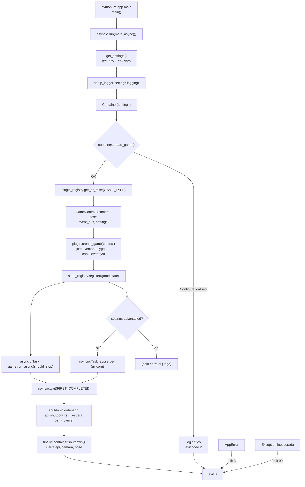
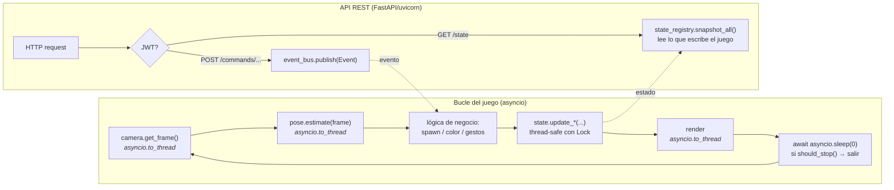
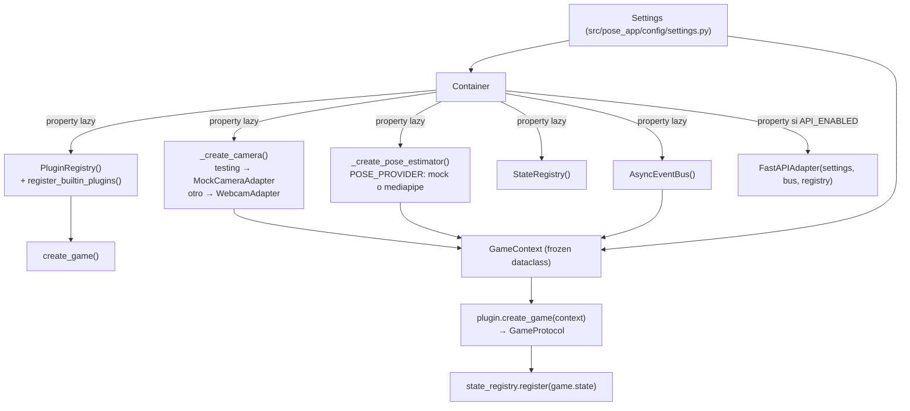
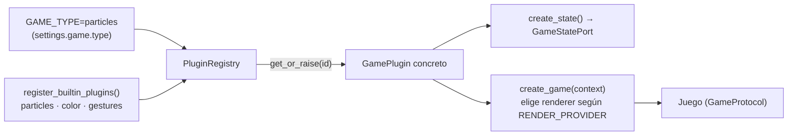
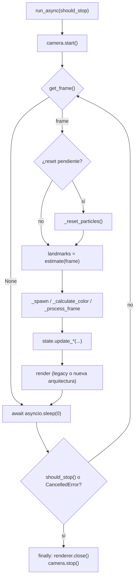
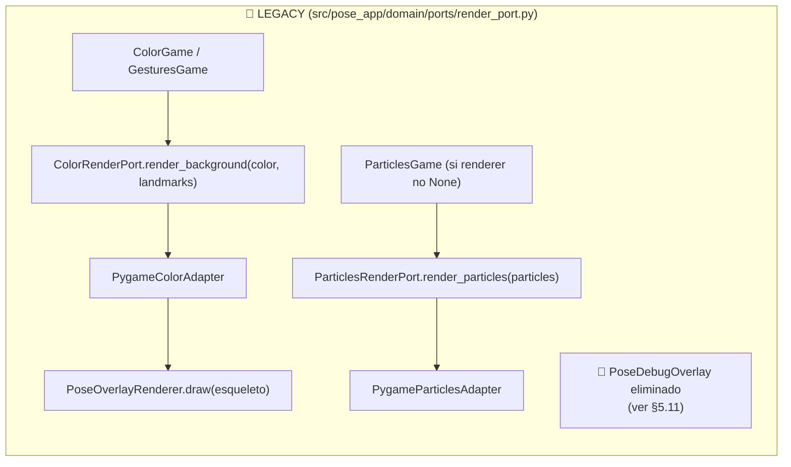
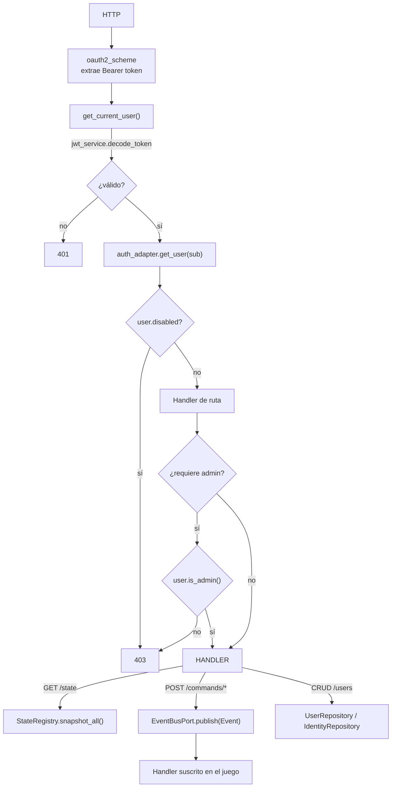
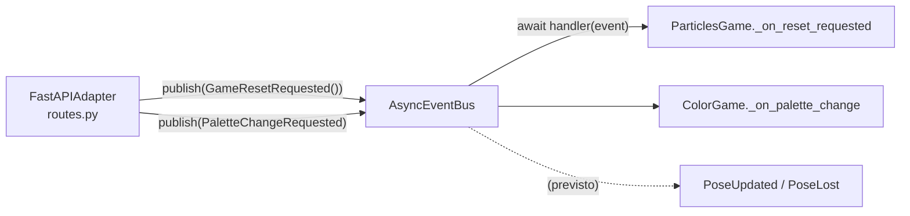

# Guía de Aprendizaje del Sistema — `system_learning.md`

> **Audiencia**: desarrollador nuevo integrado al proyecto.
> **Tono**: educativo. Este documento no sustituye a `AGENTS.md` ni a `docs/ports_contract.md`: los **complementa** explicando *qué hace cada cosa y por qué*.
> **Regla de oro**: antes de escribir código, lee `AGENTS.md` + `docs/ports_contract.md`. Si este documento contradice esos dos, **manda la documentación normativa** y avisa.

---

## 🧭 Cómo usar este documento

| Si quieres... | Ve a |
|---|---|
| Entender qué pasa cuando ejecuto `uv run python -m app.main` | §2 Diagrama de flujo general |
| Entender un módulo concreto (juego, API, render...) | §3 Diagramas por módulo |
| Saber dónde poner un archivo nuevo | §4 Guía por carpetas |
| Saber qué hace cada clase/método, con qué tipos y quién lo llama | §5 Catálogo por archivo |
| Recordar los patrones que usamos | §6 Glosario de patrones |

**Convenciones tipográficas de este doc**:

- 🟢 = en uso activo.
- 🟡 = definido pero sin invocadores aún (listo para el futuro / pendiente de migración).
- 🔴 = legacy/deprecado: no borrar sin consultar, pero no escribas código nuevo encima.

---

# 1. Panorama general

Pose AR App es una aplicación Python 3.11+ que captura video de la webcam, estima la pose humana y ejecuta **juegos en tiempo real** (partículas, color, gestos), exponiendo además una **API REST** para consultar estado y enviar comandos.

Está construida con **arquitectura hexagonal** (puertos y adaptadores) + **sistema de plugins** (cada juego es un plugin autocontenido).

### 1.1 Las cinco capas

```
┌──────────────────────────────────────────────────────────────────────────────┐
│  src/pose_app/config/            Settings (pydantic-settings, .env)          │
├──────────────────────────────────────────────────────────────────────────────┤
│  src/pose_app/app/               Composition root: main, Container,          │
│                     registries, plugins concretos                            │
├──────────────────────────────────────────────────────────────────────────────┤
│  src/pose_app/adapters/          Detalles: FastAPI, pygame, OpenCV,          │
│                     Mediapipe, mocks, bcrypt, JWT                            │
├──────────────────────────────────────────────────────────────────────────────┤
│  src/pose_app/infrastructure/    Servicios transversales: DI, event bus,     │
│                     logging, errores, JWT                                    │
├──────────────────────────────────────────────────────────────────────────────┤
│  src/pose_app/domain/            Corazón: entidades, puertos, eventos,       │
│                     juegos, estados. NO importa frameworks.                  │
└──────────────────────────────────────────────────────────────────────────────┘
```

**Regla de dependencias** (la flecha "importa" apunta hacia abajo):

```
app ──► adapters ──► domain ◄── infrastructure
 │                     ▲
 └──► infrastructure ──┘
 └──► config
```

- `src/pose_app/domain/` **jamás** importa `src/pose_app/adapters/`, `src/pose_app/app/`, pygame, cv2, fastapi (solo `numpy` en tipos y `abc`).
- `src/pose_app/adapters/` implementa los puertos de `src/pose_app/domain/`.
- `src/pose_app/app/` es el *composition root*: es el único que sabe juntarlo todo.
- `src/pose_app/infrastructure/` da servicios usados por todas las capas (logging, errores, bus, DI).

### 1.2 Vocabulario (sufijos del proyecto)

| Sufijo | Significado | Ejemplo |
|---|---|---|
| `*Port` | Interfaz abstracta (ABC o Protocol) que el dominio **define** | `CameraPort`, `SpawnStrategy` |
| `*Adapter` / `*Renderer` | Implementación concreta de un puerto | `WebcamAdapter`, `PygameSceneManager` |
| `*Plugin` | Fábrica que construye un juego completo | `ParticlesPlugin` |
| `*State` | Estado consultable thread-safe de un juego | `ParticlesState` |
| `*Overlay` | Elemento visual superpuesto (debug/FPS) | `PoseOverlay`, `FpsOverlay` |
| `*Schema` / `*Response` / `*Request` | DTO pydantic de la API | `UserResponse` |
| `*Repository` | Almacén CRUD de una entidad | `InMemoryUserRepository` |
| `*Game` | Juego con su loop asíncrono | `GesturesGame` |
| `*Facade` | Fachada que simplifica varios subsistemas detrás de una API | `PoseInteractionFacade` |
| `*Handler` | Estrategia sin estado que resuelve un cálculo concreto | `CentroidCollisionHandler` |
| `*System` | Sistema ECS que muta componentes por tick | `MovementSystem`, `LifespanSystem` |
| `*Strategy` | Algoritmo intercambiable inyectado | `ComposedSpawnStrategy` |
| `*Selector` | Estrategia de selección entre opciones | `WeightedSelector`, `SequentialSelector` |
| `*Config` | Configuración inmutable (VO o Pydantic) | `HandLandmarkConfig`, `GameProfileConfig` |
| `*Capability` | Capacidad ECS (lifespan, colisión, render) | `LifespanCapability`, `RenderCapability` |
| `*Protocol` | Protocolo estructural (`typing.Protocol`) | `GameProtocol`, `SpawnStrategy` |
| `*Manager` | Coordinador de un conjunto de capacidades/overlays | `PygameSceneManager` |

---

# 2. Diagrama de flujo general

## 2.1 Arranque y apagado (proceso completo)



**Códigos de salida** (memoriza: los usarás en CI):

| Código | Causa |
|---|---|
| `0` | Apagado limpio |
| `1` | `asyncio.run` ni siquiera arrancó / `KeyboardInterrupt` externo |
| `2` | `ConfigurationError` (config inválida, plugin desconocido, cámara no disponible) |
| `3` | Cualquier otro `AppError` |
| `130` | `KeyboardInterrupt` (128 + SIGINT) |
| `99` | Excepción inesperada (con stack trace) |

## 2.2 Bucle en tiempo real (runtime)

Un juego corriendo + la API atendiendo peticiones, en paralelo:



**Ideas clave de este diagrama**:

1. El juego escribe estado; la API lo lee. Por eso **todo estado es thread-safe** (`threading.Lock`).
2. La comunicación API → juego va por **eventos** (`EventBusPort`), nunca por llamadas directas: la API no conoce `ParticlesGame`.
3. Todo lo bloqueante (OpenCV, Mediapipe, pygame) se ejecuta en hilos con `asyncio.to_thread(...)`; el loop de asyncio nunca se bloquea.

---

# 3. Diagramas de flujo por módulo

## 3.1 Módulo: construcción / DI (`src/pose_app/infrastructure/di/`, `src/pose_app/app/`)



**Punto educativo**: el `Container` **no conoce juegos concretos**. Solo conoce adaptadores compartidos. Quien sabe construir un juego es el plugin. Así, añadir un juego no toca el Container.

## 3.2 Módulo: plugins (`src/pose_app/app/plugins/`)



**Decisión de diseño**: el registro es **explícito y central** (no hay auto-discovery mágico). Añadir un juego = 1 carpeta nueva + 1 línea en `register_builtin_plugins`.

## 3.3 Módulo: bucle de juego (`src/pose_app/domain/games/*/main.py`)



Los tres juegos comparten este esqueleto (**Template Method** implícito); cambian la caja "lógica" y el renderer.

## 3.4 Módulo: render — doble arquitectura 🔴/🟢



**Estado real hoy**: `ParticlesGame` usa la **nueva** arquitectura; `ColorGame` y `GesturesGame` siguen en **legacy**. Ambas conviven; por eso existen DOS `ColorRenderPort` y DOS `ParticlesRenderPort` (uno en `src/pose_app/domain/ports/render_port.py` y otro en `src/pose_app/domain/ports/render/`). **Importa siempre la ruta completa.**

## 3.5 Módulo: API + autenticación (`src/pose_app/adapters/api/`, `src/pose_app/adapters/auth/`, `src/pose_app/infrastructure/auth/`)



**Flujo de login**: `POST /api/v1/auth/token` → `CredentialsAuthProvider.authenticate` (bcrypt + verificación dummy anti-timing) → `JWTService.create_access_token(user)` → `{access_token, token_type: bearer}`.

## 3.6 Módulo: eventos (`src/pose_app/domain/events/` + `src/pose_app/infrastructure/events/`)



**Patrón Observer asíncrono**: los handlers son `async def`, se ejecutan en orden de suscripción, y si uno falla se loggea y se continúa con el siguiente.

---

# 4. Guía por carpetas

Para cada carpeta: **propósito** y **consideraciones para agregar un archivo o módulo nuevo**.

## 4.1 `src/pose_app/domain/` — el corazón 🧠

**Propósito**: TODO el conocimiento de negocio: entidades, contratos (puertos), eventos, servicios, estados y los juegos mismos. No depende de frameworks.

### `src/pose_app/domain/entities/`
- **Propósito**: objetos de negocio puros. `RGBColor`, `PoseLandmark`, `User`, `Identity`, `Gesture`, `InputCursor`, `HandLandmarkConfig`. El subpaquete `particles/` contiene la entidad `Particle` en formato ECS (componentes + sistemas).
- **Al añadir archivo**:
  1. Si es inmutable → `@dataclass(frozen=True)`. Si necesita mutación deliberada (como `Particle` o `InputCursor`) → dataclass normal y documenta por qué.
  2. Valida en `__post_init__`, lanza `ValueError` (no `assert`).
  3. Usa patrón `with_*` para "copias modificadas" (`User.with_email(...)`), nunca mutar.
  4. Nada de pygame/cv2/pydantic aquí. Solo stdlib + tipos de dominio.

### `src/pose_app/domain/entities/particles/` — ECS-lite
- **Propósito**: la entidad `Particle` vive aquí como **composición de componentes**. El paquete se divide en:
  - `archetype.py`: `ParticleArchetype` (plantilla para spawn: nombre, peso, `Appearance` compuesto, sprite opcional).
  - `components.py`: `Position`, `Appearance`, `Lifespan`, `SpriteConfig`, `SpriteState`, `CollisionProfile`, `Particle`.
  - `lifespan.py`: `LifespanCapability` (ABC), `InfiniteLifespan`, `TimedLifespan`.
  - `systems.py`: `MovementSystem`, `LifespanSystem`, `AnimationSystem` (mutan componentes por tick).
  - `spawn/`: subpaquete con `ports.py` (Protocols), `positions.py` (estrategias), `selectors.py` (selectores), `strategies.py` (composición).
- **Al añadir componente**: `@dataclass(frozen=True)` para inmutables (`Appearance`, `Lifespan`); `@dataclass` para mutables (`Position`, `SpriteState`). Documenta qué `System` lo muta.
- **Al añadir sistema**: clase con `update(particles: list[Particle], dt: float) -> None`. Sin estado acumulado entre llamadas.
- **Nota histórica**: hasta v0.4 existió `domain/capabilities/particles/` con los componentes y sistemas. Fue movido a `entities/particles/` para alinear "componentes de una entidad" con la entidad misma. No reintroduzcas `capabilities/`.

### `src/pose_app/domain/entities/input_cursor.py`
- **Propósito**: cursor de interacción (mano, pie, cadera) con estado mutable + componentes visuales (`CursorAppearance`, `CursorCollision`) inmutables. **No es una entidad ECS**: es una herramienta de interacción.
- **Nota**: a diferencia de `Particle`, `InputCursor` **muta directamente** (`position`, `is_visible`, `last_seen`) porque su ciclo de vida está atado a `PoseInteractionFacade`, no a un sistema ECS.

### `src/pose_app/domain/entities/hand_landmark_config.py`
- **Propósito**: `HandLandmarkConfig` inmutable: qué nombres de landmarks alimentan un cursor + offsets normalizados. Valida lista no vacía y offsets en `[-1.0, 1.0]`.
- **Consumido por**: `CentroidCollisionHandler` (calcula centroide) y `PoseInteractionFacade` (configuración por cursor).

### `src/pose_app/domain/services/`
- **Propósito**: lógica de dominio **sin estado** que no cabe en una entidad ni en un puerto.
  - `collision_handler.py`: `CollisionHandler` (Protocol) + `CentroidCollisionHandler` (promedia landmarks visibles + offset).
  - `pose_interaction_facade.py`: `PoseInteractionFacade` (implementa `PoseInteractionPort`) — gestiona N cursores, aplica EMA y timeout.
- **Al añadir archivo**:
  1. Si es **sin estado y resuelve un cálculo** → `*Handler` con un método único.
  2. Si **coordina varios objetos de dominio** detrás de una API simple → `*Facade`.
  3. Si **orquesta sistemas ECS** → no va aquí, va en `entities/particles/systems.py`.
  4. Tipado estricto y docstrings Google-style (es lógica de negocio crítica).

### `src/pose_app/domain/ports/`
- **Propósito**: contratos (ABC o Protocol) entre dominio y exterior. Son la **fuente de verdad** (ver `docs/ports_contract.md`).
- **Puertos destacados**:
  - `camera_port.py`, `pose_estimator_port.py`: entrada de infraestructura.
  - `pose_interaction_port.py`: `PoseInteractionPort` — interacción multi-cursor (implementado por `PoseInteractionFacade`).
  - `event_bus_port.py`: comunicación pub/sub.
  - `auth_port.py`, `user_repository_port.py`, `identity_repository_port.py`: auth.
  - `render_port.py` (legacy) y `render/` (nuevo): render.
- **Al añadir puerto**:
  1. Puerto **nuevo y pequeño** (una responsabilidad, ISP). No le agregues métodos a un puerto existente si puedes crear otro.
  2. Tipado estricto en cada `@abstractmethod`; docstring Google-style con Args/Returns/Raises.
  3. **Actualiza `docs/ports_contract.md`** (versión + changelog) — es obligatorio.
  4. Los `close()`/`start()`/`stop()` deben ser **idempotentes**.
  5. Un adaptador implementa **un** puerto, nunca varios a la vez.

### `src/pose_app/domain/ports/render/`
- **Propósito**: **nueva** arquitectura de render (capacidades `set_*`+`render_*`, overlays, scene).
- **Archivos**:
  - `color_render_port.py`, `particles_render_port.py`, `hud_render_port.py`: capacidades visuales.
  - `overlay_port.py`: elementos superpuestos (debug/FPS).
  - `scene_port.py`: `ScenePort` — orquesta capacidades + overlays.
  - `input_cursor_render_port.py`: `InputCursorRenderPort` — capacidad de dibujar cursores.
  - `render_capability.py`: `RenderCapability` (ABC) — contrato mínimo `render()` que el `SceneManager` invoca.
- **Al añadir capacidad**: crea `*_render_port.py` con `set_x()` / `render_x()` / `close()`, y añade su implementación Pygame en `src/pose_app/adapters/render/`. Documenta en `docs/render_architecture.md`.

### `src/pose_app/domain/events/`
- **Propósito**: hechos inmutables ya ocurridos (`DomainEvent` base con `occurred_at` automático).
- **Al añadir evento**: `@dataclass(frozen=True, kw_only=True)`, hereda de `DomainEvent`, nombre en pasado/sustantivo (`PaletteChangeRequested`). Registra quién lo publica y quién lo consume en `docs/ports_contract.md`.

### `src/pose_app/domain/state/`
- **Propósito**: `GameStatePort` (qué expone cada juego a la API) y `AppSnapshot` (DTO agregado).
- **Al añadir estado**: implementa `game_id` + `snapshot()` (copia serializable, <1 ms) + `stats()`. **No devuelvas referencias mutables.**

### `src/pose_app/domain/plugins/`
- **Propósito**: contrato `GamePlugin` (ABC factory) y `GameProtocol` (Protocol estructural del juego).
- **Al añadir**: casi nunca tocas esto. Si necesitas un método nuevo en el contrato, es una **modificación de interfaz pública → pregunta primero**.

### `src/pose_app/domain/games/<juego>/`
- **Propósito**: un juego completo y autocontenido: `main.py` (lógica + loop), `state.py` (estado thread-safe).
- **Al añadir juego**:
  1. Crea `src/pose_app/domain/games/<id>/` con `main.py`, `state.py`, `__init__.py`.
  2. `state.py` implementa `GameStatePort` y usa `threading.Lock` en cada mutación.
  3. `main.py` recibe TODO por constructor (DI) y solo conoce puertos.
  4. Loop: `run_async(should_stop)`, `asyncio.to_thread` para bloqueantes, cleanup en `finally`, re-lanzar `CancelledError`.
  5. Crea su plugin en `src/pose_app/app/plugins/<id>_plugin.py` y regístralo en `src/pose_app/app/plugins/__init__.py`.
  6. Guía completa: `docs/adding_a_game_plugin.md`.

### 🔴 `src/pose_app/domain/use_cases/` — eliminada (nota histórica)
- Hasta v0.4 existió como carpeta residual vacía (los juegos migraron a `src/pose_app/domain/games/`). **Fue eliminada en v0.5** junto con `capabilities/`. No la reintroduzcas: los juegos viven en `games/` y los servicios en `services/`.

## 4.2 `src/pose_app/app/` — composition root 🧩

**Propósito**: único lugar que sabe juntar dependencias concretas. Contiene entry point, contenedor DI, registries y plugins.

- **`src/pose_app/app/main.py`**: entry point. **No pongas lógica de negocio aquí.**
- **`src/pose_app/app/game_context.py`**: `GameContext` frozen. Si añades un campo, **no rompe** a los plugins existentes (por eso existe).
- **`src/pose_app/app/plugin_registry.py` / `state_registry.py`**: registries thread-safe. Cualquier método nuevo debe usar `self._lock`.
- **`src/pose_app/app/plugins/`**: aquí viven los plugins (construyen adaptadores concretos: pygame, mocks).

**Al añadir archivo en `src/pose_app/app/`**:
1. Si es un plugin nuevo → `src/pose_app/app/plugins/<id>_plugin.py` + 1 línea en `register_builtin_plugins`.
2. Si es una dependencia compartida nueva → agrégala al `Container` como `@property` **lazy** + al `GameContext` si los juegos la necesitan.
3. No importes `domain.games.*` desde `Container`: eso rompería la desacoplación.

## 4.3 `src/pose_app/adapters/` — el exterior implementado 🔌

**Propósito**: traducir puertos del dominio a tecnologías reales (OpenCV, Mediapipe, pygame, FastAPI, bcrypt) y viceversa.

| Carpeta | Qué implementa |
|---|---|
| `src/pose_app/adapters/camera/` | `CameraPort` con OpenCV (`WebcamAdapter`: captura en hilo + FourCC configurable) |
| `src/pose_app/adapters/pose/` | `PoseEstimatorPort` con MediaPipe (`MediapipeAdapter`) + modelo `.task` |
| `src/pose_app/adapters/render/` | Puertos de render (legacy y nuevos) con pygame: `PygameColorRenderer`, `PygameParticlesRenderer`, `PygameHudRenderer`, `PygameSceneManager`, `PygameInputCursorRenderer`, `PygameColorAdapter` (legacy), overlays (`PoseOverlay`, `FpsOverlay`) |
| `src/pose_app/adapters/render/overlays/` | `PoseOverlay` (esqueleto) y `FpsOverlay` (contador FPS), ambos implementan `OverlayPort` |
| ~~`src/pose_app/adapters/render/decorators/`~~ | 🔴 **Eliminado** en `feature/fix#pygame-single-window`. `PoseOverlay` (`OverlayPort`) reemplaza al `PoseDebugOverlay`. Ver §5.11. |
| `src/pose_app/adapters/auth/` | `AuthPort`, `UserRepositoryPort`, `IdentityRepositoryPort` + bcrypt |
| `src/pose_app/adapters/api/` | Routers FastAPI + DTOs (puertos de entrada HTTP) |
| `src/pose_app/adapters/mock/` | Dobles de test: mocks y spies deterministas |

**Al añadir archivo**:
1. **Un adaptador = un puerto**. Si implementas dos, estás haciendo mal el diseño.
2. Los mocks van **siempre** en `src/pose_app/adapters/mock/`, son deterministas (sin aleatoriedad real, sin cámara real) y exponen contadores/spies para asserts.
3. Si el adaptador falla, lanza la excepción del contrato (`CameraNotAvailableError`, `PoseEstimationError`, `ConfigurationError`), nunca `Exception` genérica.
4. `src/pose_app/adapters/api/`: los DTO **nunca** exponen `password_hash`. Orden de rutas importante: `/me` antes de `/{user_id}`.
5. Carpetas sin `__init__.py` (`auth/`, `decorators/`) funcionan como namespace packages; si creas paquete nuevo, sigue el estilo de sus vecinas.
6. **Renderers Pygame**: heredan de `PygameBaseAdapter` (infraestructura de ventana) + implementan **un** puerto de render. `PygameInputCursorRenderer` es el caso paradigmático: hereda `PygameBaseAdapter` + implementa `InputCursorRenderPort` (no hereda de un puerto, lo implementa). No importes `PygameBaseAdapter` desde el dominio: solo se usa en `adapters/render/`.

## 4.4 `src/pose_app/infrastructure/` — servicios transversales 🛠️

**Propósito**: capacidades transversales usadas por todas las capas.

| Carpeta | Qué aporta |
|---|---|
| `di/` | `Container` (inversión de dependencias, factories) |
| `events/` | `AsyncEventBus` (Observer async thread-safe) |
| `errors/` | Jerarquía de excepciones + clasificador de acciones |
| `logging/` | Logger raíz `pose_ar` (consola JSON/color, `logs/app.log`, `logs/errors.log`) |
| `auth/` | `JWTService` (crear/decodificar tokens) |
| `assets/` | `AssetLoader` (carga sprites y configs) + `SpriteSheetParser` (JSON de sprites → dict de coordenadas) |
| `paths.py` | Rutas del proyecto: `PROJECT_ROOT`, `ASSETS_DIR`, `DATA_DIR`, `GAME_PROFILES_DIR` |
| `lifecycle/` | 🔴 `AppRunner` huérfano (el ciclo real vive en `src/pose_app/app/main.py`) |

**Al añadir archivo**: debe ser genérico (no saber de juegos concretos), usar `get_logger("infrastructure.<x>")`, y registrar su `ConfigurationError`/`InfrastructureError` correspondiente en `exceptions.py`.

- **Servicios transversales** (`di/`, `events/`, `errors/`, `logging/`, `auth/`): API estable, usada por múltiples capas.
- **Assets** (`assets/`): `AssetLoader` carga configs JSON de sprites y delega el parseo a `SpriteSheetParser`. `AssetLoader` es agnóstico al consumidor (no sabe de pygame); devuelve dicts/tuplas. Si el consumidor necesita cargar una imagen de pygame, lo hace su adaptador, no `AssetLoader`.
- **`paths.py`**: constantes de rutas (`PROJECT_ROOT`, `ASSETS_DIR`, `DATA_DIR`, `GAME_PROFILES_DIR`). Si necesitas una ruta nueva, añádela aquí, no la hardcodees en el adaptador. `PROJECT_ROOT` se calcula desde `Path(__file__).resolve().parents[3]` (ajusta si mueves `paths.py`).

## 4.5 `src/pose_app/config/` ⚙️

- **Propósito**: `Settings` raíz con sub-configs (`camera`, `pose`, `render`, `game`, `logging`, `api`, `jwt`), cargadas de `.env` + env vars con prefijos (`CAMERA_`, `POSE_`, ...). Además, el modelo unificado de perfiles de juego (`GameProfileConfig`).

### `src/pose_app/config/settings.py`
- `Settings` raíz + subclases Pydantic (`CameraSettings`, `PoseSettings`, `RenderSettings`, `GameSettings`, `LoggingSettings`, `APISettings`, `JWTSettings`).
- **Al añadir setting**:
  1. Agrégalo a la sub-clase correspondiente con **default seguro** y validación (rango/`Literal`).
  2. Documenta el nombre en `.env.example` (¡sin valores secretos!).
  3. `JWT_SECRET_KEY` es **requerido** y secreto: jamás lo hardcodees ni lo commitees.
  4. Tras cambiar settings: `uv run pytest tests/unit/config/test_settings.py -v`.

### `src/pose_app/config/game_profile.py`
- **Propósito**: unificar la configuración de jugabilidad **de cualquier juego** en un JSON, sin tocar código Python.
- **Modelo**: `GameProfileConfig` (Pydantic):
  - `pose_smoothing_factor: float = 0.3` — común a todos los juegos AR (EMA de los cursores). Valida `0.0 < v <= 1.0`.
  - `game_options: dict[str, Any] = {}` — específico de cada juego (p. ej. `hit_radius`, `max_score`, `time_per_round` para partículas).
  - `model_config = ConfigDict(extra="allow")` — permite campos extra sin cambiar el modelo.
- **Loader**: `load_game_profile(config_path: Path) -> GameProfileConfig` — lee un JSON y valida. Lanza `FileNotFoundError` o `ValueError`.
- **Dónde viven los JSON**: `game_profiles/<game_id>/<profile_name>.json` (p. ej. `game_profiles/particles/normal.json`). `GameSettings` tiene `profile_name: str = "normal"`; `ParticlesPlugin` resuelve la ruta vía `paths.GAME_PROFILES_DIR`.
- **Al añadir un campo**:
  1. Si es **común a todos los juegos** → campo de primer nivel en `GameProfileConfig` + validación Pydantic.
  2. Si es **específico de un juego** → `game_options["<mi_juego>"]` (dict anidado); documenta el schema en `docs/adding_a_game_plugin.md`.
  3. Actualiza `game_profiles/<game_id>/normal.json` de ejemplo.
- **Al añadir un juego con perfiles**: crea `game_profiles/<game_id>/` con al menos `normal.json`; en el plugin, resuelve la ruta con `load_game_profile(GAME_PROFILES_DIR / "<game_id>" / f"{profile_name}.json")`.

## 4.6 `tests/` 🧪

- **Propósito**: `unit/` (una unidad aislada con mocks), `integration/` (componentes pegados + API), `property/` (hypothesis: invariantes), `manual/` (scripts con cámara física, excluidos de pytest).
- **Al añadir test**:
  1. Nombra `test_<archivo_bajo_prueba>.py`; fixtures **locales** en el archivo (no hay `conftest.py` global).
  2. Sin cámara real: usa `MockCameraAdapter`/`MockPoseAdapter`. Marca lo lento con `@pytest.mark.slow` (se excluyen por defecto).
  3. Tests async: `asyncio_mode=auto`, solo necesitas `async def test_...`.
  4. Cubre también invariantes con `@given` en `tests/property/` cuando la lógica es matemática (colores, distancias, CRUD).
  5. La cobertura mínima global es **60%** (`fail_under`) y hay umbrales **por capa** en `scripts/check_coverage.py`.

## 4.7 `scripts/`, raíz y `docs/`

- `scripts/check_coverage.py`: gate de cobertura por capa (pre-push).
- `check_structure.py`: fitness function de arquitectura (existe archivo X, importa clase Y, hay 3 plugins). **Ejecútalo tras mover/crear módulos estructurales.**
- `directory_tree_generator.py`: regenera `docs/directory_structure.md`.
- `debug_mediapipe_tasks.py`: repro de crashes de Mediapipe fuera de pytest.
- `AGENTS.md`: reglas del proyecto (**obligatorio**).
- `docs/`: `ports_contract.md` (contratos), `render_architecture.md` (nueva arquitectura), `adding_a_game_plugin.md` (tutorial de juegos), `code_style.md` (estilo), `directory_structure.md` (árbol), `coverage_baseline.md`, y este `system_learning.md`.

---

# 5. Catálogo por archivo

Para cada archivo: **propósito**, **patrones de diseño**, y una tabla con **responsabilidades**, **tipado** y **valores clave que modifica + proveniencia** (quién lo invoca).

---

## 5.1 `src/pose_app/domain/entities/`

### `src/pose_app/domain/entities/__init__.py`
Paquete vacío (solo marca namespace). Los consumidores importan submódulos directamente.

### `src/pose_app/domain/entities/color.py`
**Propósito**: `RGBColor`, value object inmutable de color con validación e interpolación.
**Patrones**: Dataclass `frozen=True`, Value Object, Factory method (`interpolate`), validación en `__post_init__`.

| Objeto / función | Firma (tipado) | Responsabilidad | Valores que modifica / proveniencia |
|---|---|---|---|
| `RGBColor` | `@dataclass(frozen=True) r:int, g:int, b:int` | Color RGB 0-255 inmutable | Creado por `ColorState._current_color`, paletas de `ColorGame.PALETTES`, `ParticlesPlugin.create_game`, adaptadores pygame y tests |
| `RGBColor.__post_init__` | `(self) -> None` | Lanza `ValueError` si un canal sale de 0-255 | Se ejecuta en cada construcción |
| `RGBColor.to_hex` | `(self) -> str` | `"#rrggbb"` | Invocado por `ColorState.snapshot()` → JSON `background_color` de `GET /state` |
| `RGBColor.to_rgb_tuple` | `(self) -> tuple[int,int,int]` | Tupla para `surface.fill()` | Invocado por `PygameColorRenderer.render_color`, `PygameParticlesRenderer`, versiones legacy |
| `RGBColor.interpolate` | `(cls, color1: RGBColor, color2: RGBColor, t: float) -> RGBColor` (classmethod) | Interpolación lineal con `t` acotado a [0,1] | Invocado por `ColorGame._calculate_color` (transiciones de fondo) y `tests/property/test_rgb_color_properties.py` |

### `src/pose_app/domain/entities/gesture.py`
**Propósito**: catálogo cerrado de gestos reconocibles.
**Patrones**: `str, Enum` tipado (serializable a JSON), constantes con nombre.

| Objeto / función | Firma (tipado) | Responsabilidad | Valores que modifica / proveniencia |
|---|---|---|---|
| `Gesture` | `class Gesture(str, Enum)` | Valores: `hand_up`, `greeting`, `arms_crossed`, `t_pose`, `squat`, `one_leg_balance` | Claves del dict de detectores de `GesturesGame._detectors`, de `GesturesState._activation_counts` y de los tests |
| `Gesture.display_name` | `@property (self) -> str` | Nombre legible (`"Hand Up"`) para logs | Leído por `GesturesGame._on_gesture_activated/_deactivated` |

### `src/pose_app/domain/entities/identity.py`
**Propósito**: vincula usuario + método de autenticación, separando credenciales del perfil.
**Patrones**: Dataclass `frozen=True`, patrón `with_*` (`dataclasses.replace`), helper `_now()`.

| Objeto / función | Firma (tipado) | Responsabilidad | Valores que modifica / proveniencia |
|---|---|---|---|
| `_now` | `() -> datetime` | UTC actual | `default_factory` de `created_at` |
| `Identity` | `frozen`: `user_id:str`, `provider:str`, `provider_user_id:str`, `password_hash:str\|None`, `created_at:datetime`, `last_login_at:datetime\|None` | Credencial inmutable | Creada en `json_bootstrap.py`, `user_routes.create_user`, persistida en `InMemoryIdentityRepository` |
| `Identity.is_password` | `@property (self) -> bool` | `provider == "password"` | Tests property; uso previsto en `CredentialsAuthProvider` 🟡 |
| `Identity.with_last_login` | `(self, when: datetime\|None = None) -> Identity` | Copia con `last_login_at` actualizado | Invocado por `CredentialsAuthProvider.authenticate` tras login exitoso |

### `src/pose_app/domain/entities/pose_landmark.py`
**Propósito**: punto clave del esqueleto en coordenadas normalizadas 0-1.
**Patrones**: Dataclass `frozen=True`, Value Object.

| Objeto / función | Firma (tipado) | Responsabilidad | Valores que modifica / proveniencia |
|---|---|---|---|
| `PoseLandmark` | `frozen: x,y,z,visibility: float`, `name: str\|None` | Punto de pose | Creado por `MediapipeAdapter.estimate`, `MockPoseAdapter`, tests |
| `PoseLandmark.is_visible` | `(self) -> bool` | Regla: `visibility > 0.5` | Usado por los 3 juegos y por `MediapipeAdapter` para filtrar |
| `PoseLandmark.distance_to` | `(self, other: PoseLandmark) -> float` | Distancia euclidiana 2D (ignora `z`) | Usado por `GesturesGame._detect_greeting` y `_detect_arms_crossed` |

### `src/pose_app/domain/entities/input_cursor.py`
**Propósito**: cursor de interacción (mano, pie, cadera, etc.) con estado mutable y componentes visuales/de colisión inmutables. **No es una entidad ECS**: es una herramienta de interacción.
**Patrones**: Dataclass mutable (estado), dataclasses `frozen=True` (componentes), validación en `__post_init__`.

| Objeto / función | Firma (tipado) | Responsabilidad | Valores que modifica / proveniencia |
|---|---|---|---|
| `CursorAppearance` | `frozen: size:float=40.0`, `color:tuple[int,int,int]=(255,255,0)`, `padding_x:float=0.0`, `padding_y:float=0.0` | Config visual; valida `size > 0` y color 0-255 | Construido por `ParticlesPlugin._build_cursors` desde JSON |
| `CursorCollision` | `frozen: radius:float=20.0` | Radio como % del mínimo de pantalla; valida `radius > 0` | Construido por `ParticlesPlugin._build_cursors` |
| `InputCursor` | `@dataclass cursor_id:str`, `position:tuple[float,float]\|None=None`, `is_visible:bool=False`, `last_seen:float=0.0`, `appearance:CursorAppearance`, `collision:CursorCollision`, `sprite_config:SpriteConfig\|None=None`, `sprite_state:SpriteState\|None=None` | Estado + configuración de un cursor | Creado por `ParticlesPlugin._build_cursors` y por `PoseInteractionFacade` (fallback) |
| `InputCursor.update` | `(self, new_position: tuple[float,float]\|None, current_time:float, timeout:float) -> None` | Actualiza posición/visibilidad; si supera `timeout` marca invisible | **Muta** `position`, `is_visible`, `last_seen`. Invocado por `PoseInteractionFacade.update` |
| `InputCursor.get_position_pixels` | `(self, screen_w:int, screen_h:int) -> tuple[float,float]\|None` | Convierte posición normalizada a píxeles | Renderer y `PoseInteractionFacade.is_touching` |
| `InputCursor.get_collision_radius_pixels` | `(self, screen_w:int, screen_h:int) -> float` | `radius * min(screen_w, screen_h) / 100` | `PoseInteractionFacade._check_cursor_touching` |

### `src/pose_app/domain/entities/hand_landmark_config.py`
**Propósito**: configuración inmutable de qué landmarks alimentan un cursor y el offset aplicado.
**Patrones**: Dataclass `frozen=True`, validación en `__post_init__`.

| Objeto / función | Firma (tipado) | Responsabilidad | Valores que modifica / proveniencia |
|---|---|---|---|
| `HandLandmarkConfig` | `frozen: landmark_names:tuple[str,...]`, `offset_x:float=0.0`, `offset_y:float=0.0` | Valida lista no vacía y offsets en `[-1.0, 1.0]` | Construido por `ParticlesPlugin._build_cursors`; consumido por `CentroidCollisionHandler` |

### `src/pose_app/domain/entities/user.py`
**Propósito**: perfil de usuario inmutable **sin credenciales**.
**Patrones**: Dataclass `frozen=True`, patrón `with_*`, `default_factory` para id.

| Objeto / función | Firma (tipado) | Responsabilidad | Valores que modifica / proveniencia |
|---|---|---|---|
| `_generate_id` | `() -> str` | `str(uuid4())` | `default_factory` de `User.id` |
| `User` | `frozen: username:str`, `id:str`, `email/full_name:str\|None`, `roles:tuple[str,...]=("user",)`, `disabled:bool=False` | Perfil público | Creado en `json_bootstrap.py`, `user_routes.create_user`, repos |
| `User.has_role` | `(self, role: str) -> bool` | `role in self.roles` | Interno de `is_admin` |
| `User.is_admin` | `(self) -> bool` | `has_role("admin")` | **Guard de autorización**: `dependencies.require_admin` → 403 |
| `User.with_username / with_email / with_full_name / with_roles / with_disabled` | `(...) -> User` | Copias modificadas | Invocados por `user_routes` (PATCH `/users/me`, PATCH `/users/{id}`) |

### `src/pose_app/domain/entities/particle.py` — entidad ECS-lite
**Propósito**: entidad `Particle` como **contenedor de componentes**. No tiene lógica de física ni de render; delega en los sistemas (`MovementSystem`, `LifespanSystem`, `AnimationSystem`) y en el renderer.
**Patrones**: Dataclass mutable (composición), `field(default_factory=...)` para `id`.

| Objeto / función | Firma (tipado) | Responsabilidad | Valores que modifica / proveniencia |
|---|---|---|---|
| `Particle` | `@dataclass position: Position`, `appearance: Appearance`, `id: str = field(default_factory=lambda: str(uuid.uuid4()))`, `lifespan: Lifespan \| None = None`, `collision: CollisionProfile \| None = None`, `sprite_config: SpriteConfig \| None = None`, `sprite_state: SpriteState \| None = None` | Entidad compuesta. La **presencia o ausencia de un componente** define su comportamiento (ECS-lite) | Creado por `ComposedSpawnStrategy.spawn`; mutado por `MovementSystem` (vía `Position`), `LifespanSystem` (reemplaza `Lifespan` con `replace`), `AnimationSystem` (vía `SpriteState`) |
| `Particle.is_alive` | `(self) -> bool` | Si `lifespan is None` → `True` (infinita). Si `lifespan` existe → `lifespan.current_life >= 0.01` | Filtro de `ParticlesGame._update_logic` y `LifespanCull` |

### `src/pose_app/domain/entities/particles/` — ECS-lite (subpaquete)

**Propósito**: la entidad `Particle` vive en `entities/particle.py` (archivo suelto, ver arriba). Este **subpaquete** contiene los **componentes** (datos puros), los **sistemas** (lógica por tick) y las **estrategias de spawn**. Es la separación clásica ECS: `entity` (id + componentes) ≠ `component` (datos) ≠ `system` (lógica).

#### `particles/archetype.py` — `ParticleArchetype`
**Propósito**: plantilla para spawn. **Compone un `Appearance`** completo (frozen, compartible entre todas las partículas del mismo arquetipo) en lugar de duplicar `size`/`color` como campos top-level.
**Patrones**: Dataclass `frozen=True`, composición, validación en `__post_init__`.

| Objeto / función | Firma (tipado) | Responsabilidad | Valores que modifica / proveniencia |
|---|---|---|---|
| `ParticleArchetype` | `frozen: name:str`, `weight:float=1.0`, `appearance:Appearance=field(default_factory=Appearance)`, `sprite_config:SpriteConfig\|None=None` | Valida `name` no vacío y `weight>=0` (el resto lo valida `Appearance`). Comparte `appearance` entre todas las partículas que salgan de este archetype | Creado por `ParticlesPlugin._build_archetypes` desde `game_options.particle_archetypes` (JSON); consumido por `WeightedSelector` y `ComposedSpawnStrategy.spawn` |
| `__post_init__` | `(self) -> None` | `ValueError` si `name` vacío o `weight < 0` | Se ejecuta en cada construcción |

**Nota de diseño**: la composición de `Appearance` (en lugar de duplicar `size`/`color`) evita el problema clásico de "olvidé cablear `padding_x` en el spawn". Añadir un campo nuevo a `Appearance` (e.g. `border_radius`) **no requiere tocar `ParticleArchetype` ni `ComposedSpawnStrategy`**.

#### `particles/components.py` — componentes ECS
**Propósito**: componentes puros. La inmutabilidad (`frozen=True`) se usa siempre que sea posible; los mutables (`Position`, `SpriteState`) existen por rendimiento en tiempo real.
**Patrones**: Dataclass `frozen=True` (Appearance, Lifespan, CollisionProfile, SpriteConfig), dataclass mutable (Position, SpriteState).

| Objeto / función | Firma (tipado) | Responsabilidad | Valores que modifica / proveniencia |
|---|---|---|---|
| `Position` | `@dataclass x:float`, `y:float`, `vx:float=0.0`, `vy:float=0.0` | Estado espacial (mutable). Único componente mutado in-place por `MovementSystem` | **Muta** `x`, `y`, `vx`, `vy`. Creado por `ComposedSpawnStrategy`; mutado por `MovementSystem.update` |
| `Appearance` | `frozen: size:float=5.0`, `color:tuple[int,int,int]=(255,255,255)`, `padding_x:float=0.0`, `padding_y:float=0.0` | Config visual inmutable | Construido por `ComposedSpawnStrategy`; leído por `PygameParticlesRenderer` |
| `Lifespan` | `frozen: max_life:float`, `current_life:float` | Ciclo de vida. `__post_init__` valida `max_life > 0` y `0 <= current_life <= max_life`. `fresh(max_life)` crea `current_life=max_life` | Inicializado por `ComposedSpawnStrategy` (vía `Lifespan.fresh`); **reemplazado** por `LifespanSystem.update` (con `dataclasses.replace`, porque es frozen) |
| `Lifespan.fresh` | `(cls, max_life: float) -> Lifespan` (classmethod) | Crea `current_life=max_life` | Constructor canónico de `ComposedSpawnStrategy` |
| `CollisionProfile` | `frozen: radius:float`, `behavior:Literal["destroy","bounce"]="destroy"` | Comportamiento de colisión | Construido por `ComposedSpawnStrategy`; leído por `ParticlesGame._update_logic` |
| `SpriteConfig` | `frozen: path:str`, `frame_width:float`, `frame_height:float`, `frame_count:int=1`, `fps:float=0.0`, `animation_mode:Literal["loop","one_shot"]="loop"` | "Receta" del sprite; puede ser compartida por muchas partículas. `__post_init__` valida `frame_count>=1`, `fps>=0`, `animation_mode` válido | Construido por `AssetLoader`/`SpriteSheetParser` desde JSON; consumido por `PygameParticlesRenderer` y `AnimationSystem` |
| `SpriteState` | `@dataclass current_frame:int=0`, `elapsed_time:float=0.0` | Estado mutable de animación | **Muta** `current_frame`, `elapsed_time`. Invocado por `AnimationSystem.update` |

#### `particles/lifespan.py` — `LifespanCapability`
**Propósito**: contrato de vida útil.
**Patrones**: ABC, Strategy.

| Objeto / función | Firma (tipado) | Responsabilidad | Valores que modifica / proveniencia |
|---|---|---|---|
| `LifespanCapability` | `ABC` | Contrato: `max_life: float`, `current_life: float`, `decay(dt)`, `is_expired` | Implementado por `InfiniteLifespan`, `TimedLifespan` |
| `InfiniteLifespan` | `class InfiniteLifespan(LifespanCapability)` | Nunca expira (partículas decorativas) | Inicializado por `ComposedSpawnStrategy` cuando el archetype no tiene `lifespan` |
| `TimedLifespan` | `class TimedLifespan(LifespanCapability)` | Expira tras `max_life` segundos | Inicializado por `ComposedSpawnStrategy` cuando el archetype tiene `lifespan` |

#### `particles/systems.py` — sistemas ECS
**Propósito**: sistemas sin estado que mutan componentes por tick.
**Patrones**: Strategy, sistemas puros.

| Objeto / función | Firma (tipado) | Responsabilidad | Valores que modifica / proveniencia |
|---|---|---|---|
| `MovementSystem` | `class MovementSystem(gravity: float = 0.1, damping: float = 0.99)` | `update(particles, dt)`: aplica gravedad (`vy += gravity * dt`), damping (`vx *= damping`, `vy *= damping`), integra posición (`x += vx * dt`, `y += vy * dt`) | **Muta** `Position.x/y/vx/vy`. Invocado por `ParticlesGame._update_logic` |
| `LifespanSystem` | `class LifespanSystem()` | `update(particles, dt)`: decrementa `current_life` (multiplicativo), **reemplaza** `Lifespan` con `dataclasses.replace` | **Reemplaza** `Particle.lifespan` (frozen) |
| `LifespanCull` | (método estático / función auxiliar de `LifespanSystem`) | Filtra partículas con `Particle.is_alive() == True` | Devuelve nueva lista; no muta la original |
| `AnimationSystem` | `class AnimationSystem()` | `update(particles, dt)`: avanza `SpriteState.current_frame` según `SpriteConfig.fps` y `animation_mode` | **Muta** `SpriteState.current_frame` / `elapsed_time`. Invocado por `ParticlesGame._update_logic` |

#### `particles/spawn/` — estrategias de generación (subpaquete)

**Propósito**: composición de estrategias para spawnear partículas.
**Patrones**: Strategy, Protocol `@runtime_checkable`, composición.

| Archivo | Objeto | Firma clave | Proveniencia |
|---|---|---|---|
| `spawn/ports.py` | `ArchetypeSelector` (Protocol `@runtime_checkable`) | `select(archetypes, rng) -> ParticleArchetype` | Inyectado en `ComposedSpawnStrategy` |
| `spawn/ports.py` | `PositionStrategy` (Protocol `@runtime_checkable`) | `generate(workspace, existing, count, rng) -> list[tuple[float,float]]` | Inyectado en `ComposedSpawnStrategy` |
| `spawn/ports.py` | `SpawnStrategy` (Protocol `@runtime_checkable`) | `spawn(archetypes, workspace, existing, count, rng) -> list[Particle]` | Inyectado en `ParticlesGame` |
| `spawn/positions.py` | `RandomPositionStrategy(min_distance: float)` | Posiciones aleatorias con separación mínima; reintenta hasta `max_attempts` | Construido por `ParticlesPlugin._build_spawn_strategy` según `game_options.positioner` |
| `spawn/positions.py` | `GridPositionStrategy()` | Posiciones en grid uniforme (predecible) | Idem |
| `spawn/selectors.py` | `WeightedSelector()` | Selecciona archetype por peso (respeta `weight`); valida suma > 0 | Construido por `ParticlesPlugin._build_spawn_strategy` según `game_options.selector` |
| `spawn/selectors.py` | `SequentialSelector(sequence: list[str])` | Recorre archetypes en orden cíclico; valida nombres existentes | Idem |
| `spawn/strategies.py` | `ComposedSpawnStrategy(archetype_selector, position_strategy)` | Combina selector + positioner; transfiere `archetype.appearance` **directo a `Particle`** (sin copiar campo a campo); valida `count >= 0`, `screen_w > 0`, `screen_h > 0` (`ValueError`) | Inyectado en `ParticlesGame.__init__` |

---

## 5.2 `src/pose_app/domain/events/`

### `src/pose_app/domain/events/base.py`
**Propósito**: base de todos los eventos: hechos inmutables ya ocurridos.
**Patrones**: Dataclass `frozen=True, kw_only=True`, clase base / plantilla, timestamp automático.

| Objeto / función | Firma (tipado) | Responsabilidad | Valores que modifica / proveniencia |
|---|---|---|---|
| `DomainEvent` | `@dataclass(frozen=True, kw_only=True)` con `occurred_at: datetime` (auto) | Base de eventos; `kw_only` permite añadir campos sin defaults | Heredado por todos los eventos |
| `DomainEvent.event_name` | `@property (self) -> str` | `type(self).__name__` para logging | Leído por `AsyncEventBus.publish` en sus logs |

### `src/pose_app/domain/events/game_events.py`
**Propósito**: comandos que van de la API hacia los juegos.

| Objeto / función | Firma (tipado) | Responsabilidad | Valores que modifica / proveniencia |
|---|---|---|---|
| `GameCommand` | `frozen: action:str`, `payload:dict[str, Any]` | Comando genérico | 🟡 sin invocadores aún |
| `GameResetRequested` | `frozen` (solo `occurred_at`) | Pide reset de partículas | 🟢 Publicado por `POST /api/v1/commands/reset-particles` → consumido por `ParticlesGame._on_reset_requested` (fija `_reset_requested=True`) |
| `PaletteChangeRequested` | `frozen: palette_name:str` | Pide cambio de paleta | 🟢 Publicado por `POST /api/v1/commands/change-palette` → consumido por `ColorGame._on_palette_change` (fija `_pending_palette`) |

### `src/pose_app/domain/events/pose_events.py`
**Propósito**: resultado de la estimación de pose.

| Objeto / función | Firma (tipado) | Responsabilidad | Valores que modifica / proveniencia |
|---|---|---|---|
| `PoseUpdated` | `frozen: landmarks: tuple[PoseLandmark, ...]`, `frame_id:int=0` | Notifica landmarks detectados | 🟡 previsto por los juegos según `docs/ports_contract.md` |
| `PoseLost` | `frozen: frame_id:int=0` | Notifica ausencia de persona | 🟡 igual que `PoseUpdated` |

---

## 5.3 `src/pose_app/domain/ports/`

### `src/pose_app/domain/ports/__init__.py`
Reexporta `BaseRenderPort`, `CameraPort`, `ColorRenderPort`, `ParticlesRenderPort`, `PoseEstimatorPort` (los tres primeros, legacy). `__all__` controla la API pública.

### `src/pose_app/domain/ports/camera_port.py`
**Propósito**: obtener frames sin saber la fuente (webcam, mock, archivo).
**Patrones**: Puerto (ABC), Protocol opcional, Context Manager.

| Objeto / función | Firma (tipado) | Responsabilidad | Valores que modifica / proveniencia |
|---|---|---|---|
| `CameraPort` | `ABC` | Contrato de cámara | Implementado por `WebcamAdapter`, `MockCameraAdapter`; inyectado vía `GameContext` |
| `CameraPort.start` | `(self) -> None` | Inicia captura (en `WebcamAdapter` arranca un hilo) | Invocado por los 3 juegos: `await asyncio.to_thread(self._camera.start)` |
| `CameraPort.stop` | `(self) -> None` | Libera recursos (idempotente; espera al hilo si existe) | `finally` de los juegos + `Container.shutdown()` |
| `CameraPort.get_frame` | `(self) -> np.ndarray \| None` | Frame BGR `(H,W,3)` o `None`; no bloquea | Bucle de los juegos (`asyncio.to_thread`) |
| `CameraPort.is_running` | `(self) -> bool` | Estado de la cámara | 🟡 sin invocadores en producción |
| `CameraPort.__enter__ / __exit__` | `(self) -> Self` / `(...) -> None` | `with` → `start()`/`stop()` | Tests manuales |
| `CameraStatsPort` | `Protocol @runtime_checkable` | Métricas opcionales de captura | Implementado por `WebcamAdapter`; detectado con `isinstance` |

### `src/pose_app/domain/ports/pose_estimator_port.py`
**Propósito**: extraer landmarks de un frame sin conocer el modelo.
**Patrones**: Puerto (ABC), Context Manager, `close()` con default (hook no abstracto).

| Objeto / función | Firma (tipado) | Responsabilidad | Valores que modifica / proveniencia |
|---|---|---|---|
| `PoseEstimatorPort.estimate` | `(self, frame: np.ndarray) -> list[PoseLandmark]` | Landmarks 0-1; `[]` si no hay persona (no es error) | Los 3 juegos: `await asyncio.to_thread(self._pose_estimator.estimate, frame)` |
| `PoseEstimatorPort.get_landmark_names` | `(self) -> list[str]` | Nombres soportados | 🟡 introspección/debug |
| `PoseEstimatorPort.close` | `(self) -> None` | Libera modelo (no abstracto) | `__exit__` y `Container.shutdown()` |

### `src/pose_app/domain/ports/pose_interaction_port.py`
**Propósito**: contrato de interacción multi-cursor (lo que un juego necesita de `PoseInteractionFacade`).
**Patrones**: Puerto (ABC), Facade del lado del consumidor.

| Objeto / función | Firma (tipado) | Responsabilidad | Valores que modifica / proveniencia |
|---|---|---|---|
| `PoseInteractionPort.update` | `(self, landmarks: list[PoseLandmark], current_time: float \| None = None) -> None` | Actualiza todos los cursores (EMA + timeout) | `ParticlesGame._update_logic` (vía `run_async`) |
| `PoseInteractionPort.is_touching` | `(self, target_x, target_y, radius, screen_w, screen_h, cursor_id: str \| None = None) -> bool` | ¿Algún cursor (o uno específico) toca el objetivo? | `ParticlesGame._check_collisions` |
| `PoseInteractionPort.get_cursor` | `(self, cursor_id: str) -> InputCursor \| None` | Cursor por id | 🟡 usado por tests |
| `PoseInteractionPort.get_all_cursors` | `(self) -> list[InputCursor]` | Todos los cursores | `ParticlesGame._render_frame` (sincroniza con el renderer) |
| `PoseInteractionPort.get_hand_position` | `(self, hand: Literal["left","right"], screen_w, screen_h) -> tuple[float,float] \| None` | Backward compat con el API de una sola mano | 🟡 legado |

### `src/pose_app/domain/ports/event_bus_port.py`
**Propósito**: comunicación desacoplada por eventos.
**Patrones**: Puerto (ABC), Observer pub/sub async, alias `EventHandler`.

| Objeto / función | Firma (tipado) | Responsabilidad | Valores que modifica / proveniencia |
|---|---|---|---|
| `EventHandler` | `= Callable[[Any], Awaitable[None]]` | Firma de handler async | Usado por `AsyncEventBus` y por el `cast(...)` en `ParticlesGame.__init__` |
| `EventBusPort.subscribe` | `(self, event_type: type[DomainEvent], handler: EventHandler) -> None` | Suscribe sin duplicar | `ParticlesGame.__init__` (`GameResetRequested`), `ColorGame.__init__` (`PaletteChangeRequested`) |
| `EventBusPort.unsubscribe` | `(self, event_type, handler) -> None` | Desuscribe | 🟡 teardown/tests |
| `EventBusPort.publish` | `async (self, event: DomainEvent) -> None` | Ejecuta handlers en orden; errores loggeados y continúa | 🟢 `src/pose_app/adapters/api/routes.py` (reset + paleta) |
| `EventBusPort.clear` | `(self) -> None` | Borra suscriptores | 🟡 tests |

### `src/pose_app/domain/ports/auth_port.py`
**Propósito**: validar credenciales → `User`.

| Objeto / función | Firma (tipado) | Responsabilidad | Valores que modifica / proveniencia |
|---|---|---|---|
| `AuthPort.authenticate` | `(self, username: str, password: str) -> User \| None` | `User` si válidas, `None` si no | Invocado por `POST /api/v1/auth/token` (`auth_routes.login`) |
| `AuthPort.get_user` | `(self, username: str) -> User \| None` | Usuario sin validar password | Invocado por `dependencies.get_current_user` (usa el `sub` del JWT) |

### `src/pose_app/domain/ports/user_repository_port.py` / `identity_repository_port.py`
**Propósito**: CRUD separado de **perfiles** (`User`) y **credenciales** (`Identity`) — ISP.
**Patrones**: Puerto (ABC), Repository.

| Objeto / función | Firma (tipado) | Responsabilidad | Valores que modifica / proveniencia |
|---|---|---|---|
| `UserRepositoryPort.get_by_id / get_by_username` | `(self, id\|username: str) -> User \| None` | Búsquedas | `user_routes` (GET/PUT/DELETE), `CredentialsAuthProvider` |
| `UserRepositoryPort.create` | `(self, user: User) -> User` | `ValueError` si username duplicado | `json_bootstrap`, `POST /users` |
| `UserRepositoryPort.update` | `(self, user: User) -> User` | `ValueError` si no existe | `PATCH /users/me`, `PATCH /users/{id}` |
| `UserRepositoryPort.delete / list_all` | `(self, user_id: str) -> None` / `(self) -> list[User]` | Borrado idempotente / listado | `DELETE /users/{id}`, `GET /users` |
| `IdentityRepositoryPort.get_by_provider` | `(self, provider: str, provider_user_id: str) -> Identity \| None` | Busca credencial | `CredentialsAuthProvider.authenticate` con `("password", username)` |
| `IdentityRepositoryPort.get_by_user_id` | `(self, user_id: str) -> list[Identity]` | Credenciales de un usuario | `DELETE /users/{id}` |
| `IdentityRepositoryPort.create / update / delete` | como arriba | CRUD de credenciales | `json_bootstrap`, `change_my_password`, `authenticate` (last_login) |

### 🔴 `src/pose_app/domain/ports/render_port.py` (LEGACY)
**Propósito**: puertos de render antiguos segregados por juego. Sustituidos por `src/pose_app/domain/ports/render/`.

**Nota post-refactor (feature/fix#pygame-single-window)**: `BaseRenderPort.show()` fue eliminado. Nadie lo llamaba en producción (el ciclo de vida lo gestiona el `SceneManager`). El contrato ahora solo exige `close()`.

| Objeto / función | Firma (tipado) | Responsabilidad | Valores que modifica / proveniencia |
|---|---|---|---|
| `BaseRenderPort.close` | `(self) -> None` | Liberar recursos del renderer. Idempotente | `finally` de los 3 juegos |
| `BaseRenderPort.__enter__ / __exit__` | `(self) -> Self` / `(...) -> None` | `with renderer: ...` → `close()` al salir | Tests manuales |
| `ParticlesRenderPort.render_particles` | `(self, particles: list[Particle]) -> None` | Dibujar partículas | `ParticlesGame._render_legacy` (solo si `renderer is not None`; el plugin actual pasa `None`) 🟡 |
| `ColorRenderPort.render_background` | `(self, color: RGBColor, landmarks: list[PoseLandmark]) -> None` | Fondo + esqueleto | 🟢 `ColorGame.run_async` y `GesturesGame.run_async` |
| `LandmarkAwareRenderPort.update_landmarks` | `(self, landmarks: list[PoseLandmark]) -> None` | Guarda landmarks para el próximo render | `ParticlesGame._render_legacy` vía `isinstance(...)` |

### 🟢 `src/pose_app/domain/ports/render/` (nueva arquitectura)

| Archivo | Objetos | Firmas clave | Quién lo invoca |
|---|---|---|---|
| `color_render_port.py` | `ColorRenderPort` | `set_color(color: RGBColor)`, `render_color()`, `close()` | `render_color` por `PygameSceneManager.render_frame`; `set_color` 🟡 |
| `particles_render_port.py` | `ParticlesRenderPort` | `set_particles(particles: list[Particle])`, `render_particles()`, `close()` | `set_particles` por `ParticlesGame._render_frame`; `render_particles` por el SceneManager |
| `hud_render_port.py` | `HudRenderPort` | `set_hud(score:int, rounds:int, timer:float, extra:dict[str,str]\|None)`, `render_hud()`, `close()` | `render_hud` por SceneManager; `set_hud` 🟡 (juegos futuros) |
| `overlay_port.py` | `OverlayPort` | `draw(surface: Any, landmarks: list[PoseLandmark]\|None)`, `close()` | `PygameSceneManager.render_frame`; implementado por `PoseOverlay`, `FpsOverlay` |
| `scene_port.py` | `ScenePort` | `add_capability(object)`, `add_overlay(OverlayPort)`, `render_frame(landmarks: list[PoseLandmark])`, `close()` | `render_frame` por `ParticlesGame._render_frame`; registros en `src/pose_app/app/plugins/particles_plugin.py` |
| `input_cursor_render_port.py` | `InputCursorRenderPort` | `set_cursors(cursors: list[InputCursor])`, `render_cursors()`, `render()`, `close()` | `set_cursors` por `ParticlesPlugin` y `ParticlesGame._render_frame`; `render` por `PygameSceneManager` |
| `render_capability.py` | `RenderCapability` (ABC) | `render() -> None` | `PygameSceneManager.render_frame` (invoca `cap.render()` para cada capability) |
| `__init__.py` | reexports | `__all__` con los 7 | `from domain.ports.render import ...` |

**Patrones comunes**: puerto (ABC), capacidad componible, patrón declarar→ejecutar (`set_*` + `render_*`), Composite (SceneManager), Protocol `@runtime_checkable` (para validación estructural).

---

## 5.4 `src/pose_app/domain/state/` y `src/pose_app/domain/plugins/`

### `src/pose_app/domain/state/game_state_port.py`
**Propósito**: contrato de estado consultable de cada juego (API/monitoring), thread-safe.

| Objeto / función | Firma (tipado) | Responsabilidad | Valores que modifica / proveniencia |
|---|---|---|---|
| `GameStatePort.game_id` | `@property @abstractmethod (self) -> str` | Id snake_case único | Leído por `StateRegistry.register` y `Container` |
| `GameStatePort.snapshot` | `@abstractmethod (self) -> dict[str, Any]` | Copia serializable JSON | `StateRegistry.snapshot_all()` → `GET /api/v1/state` |
| `GameStatePort.stats` | `@abstractmethod (self) -> dict[str, Any]` | Estadísticas ligeras | `StateRegistry.stats_all()` → `GET /api/v1/stats` |

### `src/pose_app/domain/state/snapshot.py`
`AppSnapshot` (dataclass mutable, DTO) con `games`, `active_games`, `captured_at` y `to_dict() -> dict[str, Any]`. 🟡 El agregado real lo arma `StateRegistry.snapshot_all()`.

### `src/pose_app/domain/plugins/game_plugin.py`
**Propósito**: contrato de plugin (fábrica) y contrato estructural del juego.
**Patrones**: ABC (`GamePlugin`), **Protocol** (`GameProtocol`), Abstract Factory, `TYPE_CHECKING` para evitar ciclos.

| Objeto / función | Firma (tipado) | Responsabilidad | Valores que modifica / proveniencia |
|---|---|---|---|
| `GameProtocol.state` | `@property (self) -> GameStatePort` | Estado del juego | Leído por `Container.create_game` → `state_registry.register(game.state)` |
| `GameProtocol.run_async` | `async (self, should_stop: Callable[[], bool] \| None = None) -> None` | Loop principal | Ejecutado por `src/pose_app/app/main.py` (`asyncio.create_task`) |
| `GamePlugin.game_id / display_name` | `@property @abstractmethod -> str` | Clave del registro / nombre legible | Clave de `PluginRegistry._plugins`, logs |
| `GamePlugin.description` | `@property (self) -> str` | Default `""` (no abstracto) | 🟡 informativo |
| `GamePlugin.create_state` | `@abstractmethod (self) -> GameStatePort` | Crea estado inicial | Tests (`test_builtin_plugins`) |
| `GamePlugin.create_game` | `@abstractmethod (self, context: GameContext) -> GameProtocol` | Construye el juego completo | 🟢 `Container.create_game()` |

---

## 5.5 `src/pose_app/domain/games/`

### `src/pose_app/domain/games/particles/main.py` — `ParticlesGame` 🟢 nueva arquitectura

**Patrones**: Observer (EventBus), Strategy (spawn), DI, Template Method (loop async).

| Método | Firma (tipado) | Responsabilidad | Valores / proveniencia |
|---|---|---|---|
| `__init__` | `(self, camera: CameraPort, pose_estimator: PoseEstimatorPort, pose_interaction: PoseInteractionPort, scene: ScenePort, particles_capability: ParticlesRenderPort, color_capability: ColorRenderPort, hud_capability: HudRenderPort, state: ParticlesState, event_bus: EventBusPort, spawn_strategy: SpawnStrategy, archetypes: list[ParticleArchetype], screen_width: int = 800, screen_height: int = 600, rng: random.Random \| None = None, max_score: int = 10, time_per_round: float = 10.0, hit_radius: float = 30.0, workspace: Workspace \| None = None, animation_system: AnimationSystem \| None = None) -> None` | Inyecta dependencias + estrategia de spawn + archetypes, decide ruta de render (siempre nueva), suscribe `GameResetRequested` | Creado por `ParticlesPlugin.create_game` |
| `state` | `@property -> ParticlesState` | Estado | `GameProtocol.state` |
| `_on_reset_requested` | `async (self, event: GameResetRequested) -> None` | `_reset_requested = True` | Invocado por `AsyncEventBus.publish` |
| `run_async` | `(self, should_stop: Callable[[], bool] \| None = None) -> Awaitable[None]` | Loop: reset → frame → pose → spawn → update → render → sleep | 🟢 `src/pose_app/app/main.py` (`asyncio.create_task`) |
| `_start_new_round` | `(self) -> None` | Usa `spawn_strategy.spawn()` para generar partículas con los `archetypes` inyectados | Muta `_particles`. Invocado por `run_async` y `_complete_round` |
| `_update_logic` | `(self, dt: float) -> None` | Actualiza `pose_interaction` con landmarks; aplica `MovementSystem`, `LifespanSystem`, `AnimationSystem`; gestiona colisiones y timer de ronda | Muta `_particles`, `_current_round`. Invocado por `run_async` |
| `_complete_round` | `(self) -> None` | Incrementa score, verifica victoria, inicia nueva ronda | Invocado por `_update_logic` |
| `_render_frame` | `(self, landmarks: list[PoseLandmark]) -> None` | Sincroniza cursores con `PygameInputCursorRenderer.set_cursors(...)`; actualiza `particles_capability.set_particles(...)`, `color_capability.set_color(...)`, `hud_capability.set_hud(...)`; invoca `scene.render_frame(landmarks)` | Invocado por `run_async` |

#### Cursores de interacción en `ParticlesGame`

| Aspecto | Detalle | Proveniencia |
|---|---|---|
| `pose_interaction: PoseInteractionPort` | Fachada multi-cursor (`PoseInteractionFacade`) inyectada por constructor | `ParticlesPlugin.create_game` |
| `cursors: list[InputCursor]` | Cursores declarados desde JSON; se pasan al plugin y al renderer | `ParticlesPlugin._build_cursors` |
| `_render_frame` | Sincroniza `PygameInputCursorRenderer.set_cursors(...)` con `pose_interaction.get_all_cursors()` antes de `scene.render_frame(landmarks)` | `run_async` |
| `is_touching(...)` | Consulta colisiones de cualquier cursor (`cursor_id=None`) contra cada partícula | `ParticlesGame._update_logic` |
| `hit_radius: float` | Radio del objetivo para colisiones con cursores | Config JSON `game_options.hit_radius` |

### `src/pose_app/domain/games/color/state.py` — `ColorState`
Thread-safe. Métodos: `game_id -> "color"`, `update_color(color: RGBColor)` (por `_calculate_color`), `update_palette(str)` (por el handler de evento), `update_pose(list[PoseLandmark])`, `increment_frames()`, `snapshot()` (`background_color` hex, `current_palette`, `frame_count`, `landmarks_count`), `stats()`.

### `src/pose_app/domain/games/color/main.py` — `ColorGame`
**Patrones**: Strategy (paletas), Observer, DI, Template Method.

| Elemento | Detalle | Proveniencia |
|---|---|---|
| `PALETTES: dict[str, list[RGBColor]]` | `fire`, `ocean`, `forest`, `neon` | Constante de clase; usada por `__init__` y `_on_palette_change` |
| `__init__(camera, pose_estimator, renderer: ColorRenderPort, state, event_bus, palette_name="fire")` | Valida paleta, **suscribe** `PaletteChangeRequested` | `ColorPlugin.create_game` |
| `_on_palette_change(event)` | **Modifica** `_pending_palette` si es válida | `AsyncEventBus.publish` |
| `run_async(should_stop)` | **Modifica** `_palette_name`, `_palette`, `_frame_count`; llama `state.update_pose/increment_frames/update_color` y `renderer.render_background(color, landmarks)` | `src/pose_app/app/main.py` |
| `_calculate_color(landmarks) -> RGBColor` | Interpola según posición de muñeca/nariz | Por `run_async` |
| `_find(landmarks, name) -> PoseLandmark \| None` | Búsqueda case-insensitive | Por `_calculate_color` |

### `src/pose_app/domain/games/gestures/state.py` — `GesturesState`
Thread-safe. `update_active_gestures(newly_activated: set[Gesture], currently_active: set[Gesture])` **muta** `_active_gestures` e **incrementa** `_activation_counts[g]` (invocado por `GesturesGame._process_frame`); `increment_frames()`; `snapshot()` (`active_gestures`, `activation_counts`, `frame_count`); `stats()`.

### `src/pose_app/domain/games/gestures/main.py` — `GesturesGame`
**Patrones**: Strategy (mapa de detectores), **máquina de estados** (frames consecutivos + activo), Template Method, DI.

| Elemento | Detalle | Proveniencia |
|---|---|---|
| Constantes | `MIN_FRAMES_TO_ACTIVATE=8`, `UP_MARGIN=0.05`, `GREETING_MAX_DISTANCE=0.15`, `CROSSED_ARMS_MAX_DISTANCE=0.2`, `SQUAT_MAX_KNEE_ANGLE=130.0`, `ONE_LEG_MARGIN=0.03` | Reglas de negocio; usadas por los `_detect_*` |
| `__init__(camera, pose_estimator, renderer: ColorRenderPort, state, event_bus)` | Inyecta; crea `_consecutive_frames: dict[Gesture,int]` y `_active: set[Gesture]` | `GesturesPlugin.create_game` |
| `run_async(should_stop)` | Loop + `state.increment_frames()` + `render_background(RGBColor(20,20,30), landmarks)` | `src/pose_app/app/main.py` |
| `_process_frame(landmarks)` | **Muta** `_consecutive_frames` y `_active`; genera `newly_activated` → `state.update_active_gestures(...)` | Por `run_async` |
| `_detectors` | `dict[Gesture, Callable[[list[PoseLandmark]], bool]]` con 6 detectores | Por `_process_frame` |
| `_detect_hand_up / _detect_greeting / _detect_arms_crossed / _detect_t_pose / _detect_squat / _detect_one_leg_balance` | `(self, landmarks: list[PoseLandmark]) -> bool` — reglas geométricas | Por `_detectors` |
| `_find(landmarks, name)` | Búsqueda case-insensitive | Por todos los detectores |
| `_angle_at(a, vertex, b) -> float` (staticmethod) | Ángulo en grados en `vertex` | Por `_detect_squat` |
| `_on_gesture_activated / _on_gesture_deactivated(gesture)` | Solo logging (hooks ampliables) | Por `_process_frame` |

---

## 5.6 `src/pose_app/app/`

### `src/pose_app/app/main.py`
**Propósito**: entry point async; orquesta arranco, tareas y shutdown ordenado.
**Patrones**: Entry Point, Composition Root, Graceful Shutdown, mapeo de errores → exit codes.

| Objeto / función | Firma (tipado) | Responsabilidad | Valores / proveniencia |
|---|---|---|---|
| `SHUTDOWN_TIMEOUT` | `float = 5.0` | Espera máxima antes de cancelar tareas | Constante usada en `main_async` |
| `main_async` | `() -> Awaitable[int]` | Settings → logger → `Container` → señales → juego/API → shutdown; devuelve código de salida | Llamado por `main()` vía `asyncio.run` |
| `main` | `() -> int` | Captura `KeyboardInterrupt` (130) y fallos fatales (1) | `sys.exit(main())` en `__main__` |

### `src/pose_app/app/game_context.py`
`@dataclass(frozen=True) GameContext` con `camera: CameraPort`, `pose_estimator: PoseEstimatorPort`, `event_bus: EventBusPort`, `settings: Settings`.
**Patrones**: Context Object (DI), dataclass inmutable.
Creado por `Container.create_game()`; consumido por `GamePlugin.create_game(context)`.

### `src/pose_app/app/plugin_registry.py`
**Patrones**: Registry, thread-safe (`Lock`), Factory Lookup.

| Método | Firma | Responsabilidad | Proveniencia |
|---|---|---|---|
| `register` | `(self, plugin: GamePlugin) -> None` | Alta por `game_id`; `ConfigurationError` si duplicado | `register_builtin_plugins()` |
| `get` | `(self, game_id: str) -> GamePlugin \| None` | Lookup o `None` | `get_or_raise` |
| `get_or_raise` | `(self, game_id: str) -> GamePlugin` | Lookup o `ConfigurationError` con lista de disponibles | `Container.create_game()` |
| `list_ids` | `(self) -> list[str]` | Ids registrados | Logs, mensajes de error |
| `all` | `(self) -> dict[str, GamePlugin]` | Copia segura | 🟡 |
| `clear` | `(self) -> None` | Vacia (tests) | 🟡 |

### `src/pose_app/app/state_registry.py`
**Patrones**: Registry thread-safe, read-model/projection.

| Método | Firma | Responsabilidad | Proveniencia |
|---|---|---|---|
| `register` | `(self, state: GameStatePort) -> None` | `state.game_id → state` | `Container.create_game()` |
| `unregister / get / all` | como corresponde | Baja/lookup/copia | 🟡 API/shutdown |
| `snapshot_all` | `(self) -> dict[str, Any]` | `{"games": {...}, "active_games": [...]}` | 🟢 `GET /api/v1/state` |
| `stats_all` | `(self) -> dict[str, Any]` | `id → stats()` | 🟢 `GET /api/v1/stats` |
| `clear` | `(self) -> None` | Tests | 🟡 |

### `docs/state_contract.md`
Documento vivo (sin código ejecutable) que lista qué keys publica cada juego y qué comandos soporta. Referencia, no se importa.

### `src/pose_app/app/plugins/game_plugin.py` — eliminado (nota histórica)
Los plugins importan de `src/pose_app/domain/plugins/game_plugin.py`, que es la **única fuente del contrato**. La copia `src/pose_app/app/plugins/game_plugin.py` fue eliminada por ser huérfana (0 imports).

### `src/pose_app/app/plugins/__init__.py`
`register_builtin_plugins(registry: PluginRegistry) -> None`: registra `ColorPlugin`, `GesturesPlugin`, `ParticlesPlugin` (imports locales para evitar ciclos). Invocado por `Container.plugin_registry` (lazy, primera vez).

### `src/pose_app/app/plugins/particles_plugin.py` — `ParticlesPlugin` 🟢 nueva arquitectura
**Patrones**: Plugin, Factory Method, Composition (capacidades + overlays), Strategy (builders privados).

| Método | Firma | Responsabilidad | Proveniencia |
|---|---|---|---|
| `game_id / display_name / description` | `@property -> str` | `"particles"`, `"Particles Game"`, texto | `PluginRegistry` |
| `create_state` | `(self) -> GameStatePort` | `ParticlesState()` | Contrato/tests |
| `create_game` | `(self, context: GameContext) -> GameProtocol` | Construye el juego completo: `_build_cursors` → `PoseInteractionFacade` → `_build_archetypes` → `_build_spawn_strategy` → capacidades pygame (`PygameColorRenderer`, `PygameInputCursorRenderer`, `PygameParticlesRenderer`, `PygameHudRenderer`) → `PygameSceneManager` → `ParticlesGame(...)`. **No hardcodea sprite**: el sprite se resuelve por archetype dentro de `_build_archetypes` | 🟢 `Container.create_game()` |
| `_build_archetypes` | `(self, raw_archetypes: Any, opts: dict) -> list[ParticleArchetype]` | Parsea cada archetype del JSON: `name`, `weight`, `appearance` (vía `_parse_appearance`), `sprite_config` (vía `_parse_sprite_config`). Si no hay archetypes → `_default_archetype` (sin sprite). `ConfigurationError` con `{index}` | `create_game` |
| `_parse_appearance` | `(self, raw: Any, index: int) -> Appearance` | Parsea el bloque `appearance` (size, color, padding_x, padding_y) y delega validación a `Appearance`. Si `raw is None` → `Appearance()` (defaults) | `_build_archetypes` |
| `_parse_sprite_config` | `(self, raw: Any, index: int) -> SpriteConfig \| None` | Si no hay bloque → `None` (renderer dibuja círculo). Si hay: exige `sprite_name` (str no vacío) y delega resolución a `AssetLoader.load_sprite_config(category="particles", sprite_name=..., fps=..., animation_mode=...)`. Envuelve errores en `ConfigurationError` con `{index, sprite_name}` | `_build_archetypes` |
| `_default_archetype` | `(self, opts: dict) -> ParticleArchetype` | Archetype por defecto sin sprite (`sprite_config=None`); `appearance` desde `opts.get("particle_size", 20.0)` / `opts.get("particle_color", [255,200,50])` | `_build_archetypes` |
| `_build_spawn_strategy` | `(self, raw_spawn_config: Any, opts: dict) -> ComposedSpawnStrategy` | Construye `WeightedSelector` + `RandomPositionStrategy(min_distance)`. Valida `archetype_selector == "weighted"` y `position_strategy == "random"`; `ConfigurationError` si no | `create_game` |
| `_build_cursors` | `(self, raw_cursors: Any, opts: dict) -> tuple[dict[str, HandLandmarkConfig], list[InputCursor]]` | Parsea cursores del JSON (landmark_names, offsets, appearance, collision). Defaults: `left_hand` y `right_hand` con wrist único | `create_game` |
| `_parse_color` | `@staticmethod (raw_color: Any) -> tuple[int,int,int]` | Valida que sea secuencia de 3 enteros | `_build_archetypes`, `_default_archetype` |

### `src/pose_app/app/plugins/color_plugin.py` — `ColorPlugin` 🔴 legacy
`create_game(context)` → `_create_renderer(context)`: `RENDER_PROVIDER=mock` → `MockColorRenderAdapter`, `pygame` → `PygameColorAdapter` (con bootstrap mínimo de pygame en el plugin, ver `NOTE(refactor-render)`). Si `debug_overlay=true`, emite **warning** y **omite el overlay** (legacy no soporta `OverlayPort`; se habilitará tras migración a `SceneManager` en Fase 4). `ConfigurationError` si proveedor desconocido. Devuelve `ColorGame(...)`.

### `src/pose_app/app/plugins/gestures_plugin.py` — `GesturesPlugin` 🔴 legacy
Igual que `ColorPlugin` pero sin overlay: `mock` → `MockColorRenderAdapter`, `pygame` → `PygameColorAdapter(title="Gestures Game")`. Devuelve `GesturesGame(camera, pose_estimator, renderer, state, event_bus)`.

---

## 5.7 `src/pose_app/config/`

### `src/pose_app/config/settings.py`
**Propósito**: configuración central con `pydantic-settings` (`.env` + env vars con prefijos).
**Patrones**: Singleton (`get_settings`), Configuration Object, validación Pydantic, Environment-based Config.

| Clase | Prefijo | Campos (tipo, default, rango) |
|---|---|---|
| `CameraSettings` | `CAMERA_` | `id:int=0` (≥0), `width:int=640` (160-1920), `height:int=480` (120-1080), `fps:int=30` (1-120), `fourcc:str="MJPG"` |
| `PoseSettings` | `POSE_` | `provider: Literal["mediapipe","mock"]="mediapipe"`, `model_complexity:int=1` (0-2), `min_detection_confidence/float=0.5`, `min_tracking_confidence/float=0.5` |
| `RenderSettings` | `RENDER_` | `provider: Literal["pygame","mock"]="pygame"`, `debug_overlay:bool=False`, `width=800`, `height=600`, `title:str`, `target_fps:int=60` (15-144) |
| GameSettings|GAME_|type:str="particles" (snake_case), profile_name:str="normal"|
| `LoggingSettings` | `LOG_` | `level: Literal["DEBUG".."CRITICAL"]="INFO"`, `format: Literal["json","console"]`, `file:bool=False`, `directory:str="logs"` |
| `APISettings` | `API_` | `enabled:bool=True`, `host:str="0.0.0.0"`, `port:int=8000` (1024-65535), `cors_origins:list[str]=["*"]` |
| `JWTSettings` | `JWT_` | `secret_key:str` (requerido, ≥32), `algorithm:str="HS256"`, `access_token_expire_minutes:int=60` |
| `Settings` | (global) | `app_name`, `environment: Literal["development","production","testing"]="development"`, `debug:bool` + sub-configs anidadas |

| Función | Firma | Responsabilidad | Proveniencia |
|---|---|---|---|
| `get_settings` | `() -> Settings` | Singleton (crea `Settings()` la primera vez) | `src/pose_app/app/main.py`, y cualquier módulo que necesite config |
| `reset_settings` | `() -> None` | `_settings = None` | 🟡 tests |
| `_settings` | `Settings \| None` | Estado global del singleton | Escrito por los dos anteriores |

---

## 5.8 `src/pose_app/adapters/api/`

### `src/pose_app/adapters/api/fastapi_adapter.py` — `FastAPIAdapter`
**Patrones**: Adapter, Composition Root (`app.state` como contenedor), Facade.

| Método | Firma | Responsabilidad | Proveniencia |
|---|---|---|---|
| `__init__` | `(self, settings: Settings, event_bus: EventBusPort, registry: StateRegistry) -> None` | Guarda deps y llama `_build_app()` | `Container.api` (lazy) y tests con `TestClient` |
| `_build_app` | `(self) -> FastAPI` | CORS, **pobla `app.state`** (`settings`, `user_repository`, `identity_repository`, `auth_adapter`, `jwt_service`) con `bootstrap_from_json("data/users.json")`, monta routers | Por `__init__` |
| `app` | `@property -> FastAPI` | Expone la app | `TestClient(adapter.app)`, `uvicorn` |
| `serve` | `async (self) -> None` | `uvicorn.Server` con host/puerto de settings | `src/pose_app/app/main.py` (task `api`) |
| `shutdown` | `async (self) -> None` | `server.should_exit = True` | `main_async` y `Container.shutdown` |
| `root` | handler `GET /` | `{"name","docs"}` (oculto de OpenAPI) | curl |

### `src/pose_app/adapters/api/routes.py`
**Patrones**: Adapter de entrada (HTTP → dominio), factory de router, Publisher de eventos.

| Handler | Firma | Ruta HTTP | Valores / proveniencia |
|---|---|---|---|
| `create_router` | `(event_bus: EventBusPort, registry: StateRegistry) -> APIRouter` | — | Por `_build_app` |
| `health` | `async () -> HealthSchema` | `GET /api/v1/health` (público) | `APP_VERSION="0.5.0"`, `_start_time` |
| `get_state` | `async (current_user: CurrentUser) -> dict` | `GET /api/v1/state` (JWT) | Lee `registry.snapshot_all()` |
| `get_game_state` | `async (game_id: str) -> dict` | `GET /api/v1/state/{game_id}` | `registry.get().snapshot()` o 404 |
| `get_stats` | `async () -> dict` | `GET /api/v1/stats` | `registry.stats_all()` |
| `reset_particles` | `async () -> CommandResponse` | `POST /api/v1/commands/reset-particles` | `event_bus.publish(GameResetRequested())` → juego |
| `change_palette` | `async (request: ChangePaletteRequest) -> CommandResponse` | `POST /api/v1/commands/change-palette` | `event_bus.publish(PaletteChangeRequested(palette_name=...))` → juego |

### `src/pose_app/adapters/api/dependencies.py`
**Patrones**: Dependency Injection (FastAPI `Depends`), Guard de autorización, Facade sobre `app.state`.

| Objeto | Firma | Responsabilidad | Proveniencia |
|---|---|---|---|
| `oauth2_scheme` | `OAuth2PasswordBearer(tokenUrl="/api/v1/auth/token")` | Extrae Bearer | `get_current_user` |
| `get_settings_dep / get_auth_adapter_dep / get_jwt_service_dep / get_user_repository_dep / get_identity_repository_dep` | `(request: Request) -> T` | Leen `request.app.state.*` | Aliases `*Dep` |
| `get_current_user` | `async (request, token) -> User` | Decodifica JWT → 401 inválido; busca usuario → 401; `disabled` → 403 | FastAPI en rutas protegidas |
| `CurrentUser` | `Annotated[User, Depends(get_current_user)]` | Alias inyectable | `GET /state`, `/me` |
| `require_admin / AdminUser` | `(user: CurrentUser) -> User` | 403 si `not user.is_admin()` | CRUD `/users` |

### `src/pose_app/adapters/api/auth_routes.py`
| Handler | Ruta | Responsabilidad |
|---|---|---|
| `login` | `POST /api/v1/auth/token` (form OAuth2) | `auth.authenticate(...)` → 401 o `jwt_service.create_access_token(user)` → `{access_token, token_type: "bearer"}` |
| `read_current_user` | `GET /api/v1/auth/me` (JWT) | `{username, full_name, roles}` |

### `src/pose_app/adapters/api/user_routes.py`
**Patrones**: DTO mapping (`_user_to_response`), guard admin, `with_*` sobre entidades inmutables.
**Orden importante**: los handlers `/me` van **antes** de `/{user_id}`.

| Handler | Ruta | Valores que modifica / proveniencia |
|---|---|---|
| `_user_to_response(user) -> UserResponse` | — | Mapea entidad → DTO (nunca expone hashes) |
| `get_me` | `GET /api/v1/users/me` (JWT) | Lee perfil |
| `update_me` | `PATCH /api/v1/users/me` | `user.with_email/with_full_name` → `user_repo.update` |
| `change_my_password` | `POST /api/v1/users/me/password` | `verify_password` + `hash_password` → `identity_repo.update` |
| `create_user` | `POST /api/v1/users` (admin, 201) | 409 si existe; crea `User` + `Identity(password)` |
| `list_users` | `GET /api/v1/users` (admin) | `user_repo.list_all()` |
| `get_user` | `GET /api/v1/users/{user_id}` (admin) | 404 si no existe |
| `update_user` | `PATCH /api/v1/users/{user_id}` (admin) | 400 si se auto-quita `admin`/se deshabilita |
| `delete_user` | `DELETE /api/v1/users/{user_id}` (admin, 204) | Borra identidades y luego usuario |

### `src/pose_app/adapters/api/user_schemas.py`
DTOs pydantic: `UserCreateRequest` (username `^[a-z][a-z0-9_]*$` 3-50, password 8-128), `UserUpdateRequest`, `PasswordChangeRequest`, `UserResponse`, `MessageResponse`.

### `src/pose_app/adapters/api/schemas.py`
DTOs de estado/health: `LandmarkSchema`, `ParticleSchema`, `StatsSchema`, `PoseSchema`, `ParticlesSchema`, `StateSnapshotSchema`, `HealthSchema`, `ChangePaletteRequest` (`Literal["fire","ocean","forest","neon"]`), `CommandResponse`.

*(Existe `src/pose_app/adapters/api/fastapi_adapter.back.py` 🔴: backup ignorado por git, no importar.)*

---

## 5.9 `src/pose_app/adapters/auth/`

### `credentials_auth_provider.py` — `CredentialsAuthProvider(AuthPort)`
**Patrones**: Adapter, Strategy (proveedor intercambiable), inyección de repositorios.

| Método | Firma | Responsabilidad | Proveniencia |
|---|---|---|---|
| `__init__` | `(self, user_repository: UserRepositoryPort, identity_repository: IdentityRepositoryPort) -> None` | Guarda puertos | `_build_app` (`app.state.auth_adapter`) |
| `authenticate` | `(self, username: str, password: str) -> User \| None` | lookup → **dummy hash si falla** (anti-timing) → `verify_password` → `identity.with_last_login()` + `update` | `POST /auth/token` |
| `get_user` | `(self, username: str) -> User \| None` | Delega a `user_repository.get_by_username` | `get_current_user` (JWT `sub`) |

### `password_hasher.py`
| Objeto | Firma | Responsabilidad | Proveniencia |
|---|---|---|---|
| `BCRYPT_MAX_BYTES` | `int = 72` | Límite de bcrypt | `hash_password`, `verify_password` |
| `_DUMMY_HASH` | `str` | Hash precargado al importar | `verify_dummy_password` |
| `hash_password` | `(password: str) -> str` | `bcrypt.hashpw` con salt | `json_bootstrap`, `create_user`, `change_my_password` |
| `verify_password` | `(password: str, password_hash: str) -> bool` | `bcrypt.checkpw` | `authenticate`, `change_my_password` |
| `verify_dummy_password` | `(password: str) -> None` | Tiempo constante, resultado descartado | `authenticate` (3 ramas de fallo) |

### `in_memory_user_repository.py` — `InMemoryUserRepository(UserRepositoryPort)`
Thread-safe con `Lock`; índices `_users_by_id` y `_id_by_username`. `create` lanza `ValueError` si duplica username; `update` reindexa si cambió; `delete` idempotente. Invocado por `json_bootstrap` y `user_routes`.

### `in_memory_identity_repository.py` — `InMemoryIdentityRepository(IdentityRepositoryPort)`
Thread-safe; doble índice `_by_provider[(provider, id)]` y `_by_user_id`. Mismas semánticas de error. Invocado por `json_bootstrap`, `authenticate` (update last_login), `change_my_password`, `delete_user`.

### `json_bootstrap.py`
`bootstrap_from_json(json_path: str | Path) -> tuple[UserRepositoryPort, IdentityRepositoryPort]`: lee `data/users.json`, hashea passwords y crea `User`+`Identity`. Si no hay archivo, repos vacíos. Invocado por `FastAPIAdapter._build_app`. ⚠️ `data/` es **zona prohibida** de edición.

---

## 5.10 `src/pose_app/adapters/camera/`, `src/pose_app/adapters/pose/`, `src/pose_app/adapters/mock/`

### `camera/webcam_adapter.py` — `WebcamAdapter(CameraPort)`
**Patrones**: Adapter, Context Manager, RAII (`__del__`), productor/consumidor con hilo daemon, `Lock` para buffer y métricas.

| Método | Firma | Responsabilidad | Proveniencia |
|---|---|---|---|
| `__init__` | `(self, camera_id: int = 0, width: int = 640, height: int = 480, fps: int = 30, fourcc: str = "MJPG") -> None` | Guarda config; inicializa buffer, lock, `_stop_event` y métricas | `Container._create_camera` |
| `start` | `(self) -> None` | Abre `cv2.VideoCapture(..., CAP_V4L2)`, negocia FourCC/resolución/FPS, loguea el formato real y arranca `_capture_thread` | `CameraPort.start` desde los juegos |
| `stop` | `(self) -> None` | Setea `_stop_event`, hace `join(timeout=2s)`, libera captura y resetea métricas (idempotente) | `finally` de juegos, `Container.shutdown` |
| `get_frame` | `(self) -> np.ndarray \| None` | Devuelve copia del último frame bajo lock; **no lee del dispositivo** ni bloquea | Bucle de juegos |
| `is_running` | `(self) -> bool` | `_running` | 🟡 |
| `get_fps` | `(self) -> float` | FPS de captura de la ventana actual (fuera del puerto) | Debug |
| `get_stats` | `(self) -> dict` | Snapshot de FPS, frames, resolución, FourCC y estado del hilo | `CameraStatsPort` / debug |
| `_capture_loop` | `(self) -> None` | Bucle del hilo: `cap.read()` → buffer + métricas; detecta desconexión | `start` |
| `_update_fps_locked` | `(self, now: float) -> None` | Calcula FPS en ventanas de 1s (requiere lock tomado) | `_capture_loop` |
| `_get_actual_fourcc` | `(self) -> str` | Decodifica el FourCC real negociado con el dispositivo | `start` |
| `__enter__/__exit__/__del__` | context manager | `start`/`stop`/`stop` | Tests manuales |

**Notas post-refactor (`feature/fix/webcam-jpeg-corruption`)**:
- **Validación defensiva de frames**: `_capture_loop` descarta frames corruptos (shape incorrecto, vacíos, o >70% píxeles en cero) antes de publicarlos al buffer. Esto protege a `MediaPipe` y al render de frames MJPG truncados por pérdida de paquetes USB (mensajes `Corrupt JPEG data` de libjpeg, ruido externo al código).
- **Contador de frames corruptos**: `_corrupt_frame_count` se expone en `get_stats()["frames_corruptos"]`. Útil para diagnosticar saturación del bus USB.
- **Buffer interno reducido**: `start()` llama `cv2.CAP_PROP_BUFFERSIZE=1` (con try/except si el backend no lo soporta). Evita acumulación de frames viejos.
- **Setting `CAMERA_MIN_NONZERO_RATIO`** (default `0.3`): umbral configurable de píxeles no-cero para aceptar un frame. Solo ajustar si el hardware descarta frames válidos de forma consistente.
- **Diagnóstico de corrupción**: si `frames_corruptos` crece rápido, verificar que la cámara esté en un puerto USB directo (no hub). Desconectar/reconectar la cámara resetea el estado del controlador USB y del driver V4L2 (solución canónica a la saturación del bus).

### `pose/mediapipe_adapter.py` — `MediapipeAdapter(PoseEstimatorPort)`
**Patrones**: Adapter, Context Manager, cache de nombres, factory `_ensure_model` (descarga el `.task`).

| Elemento | Detalle | Proveniencia |
|---|---|---|
| `MODEL_URL` | URL de descarga de `pose_landmarker_full.task` | `_ensure_model` |
| `LANDMARK_NAMES` | `dict[int,str]` con los 33 nombres | Cache → `estimate`, `get_landmark_names` |
| `__init__(min_detection_confidence=0.5, min_tracking_confidence=0.5, model_complexity=1)` | `_ensure_model()` + crea `PoseLandmarker` | `Container._create_pose_estimator` |
| `estimate(frame: np.ndarray) -> list[PoseLandmark]` | Valida frame (vacío/shape/≥64px) → BGR→RGB → detect → **omite `visibility<0.5`** | Juegos (puerto) |
| `get_landmark_names() -> list[str]` | 33 nombres | 🟡 |
| `draw_landmarks(frame, landmarks) -> np.ndarray` | Debug visual con OpenCV | `debug_mediapipe_tasks.py` |
| `close()` | Cierra el landmarker | `Container.shutdown`, `__exit__`, `__del__` |

### `mock/mock_camera.py` — `MockCameraAdapter(CameraPort)`
Frames negros con círculo animado (sin cámara real). `get_frame()` devuelve `None` si no corre. Seleccionado por `Container._create_camera` cuando `ENVIRONMENT=testing`.

### `mock/mock_pose.py` — `MockPoseAdapter(PoseEstimatorPort)`
Devuelve **siempre** la misma pose en "T" (7 landmarks: nariz, hombros, muñecas, caderas). Determinista → tests reproducibles. Seleccionado con `POSE_PROVIDER=mock`.

### `mock/mock_render.py` — spies de render
**Patrones**: Mock/Spy, herencia múltiple de puertos legacy.

| Clase | Implementa | Qué captura |
|---|---|---|
| `MockParticlesRenderAdapter` | `ParticlesRenderPort` + `LandmarkAwareRenderPort` | `last_particles`, `last_landmarks`, contadores `render_count`, `update_landmarks_count`, `show_count`, `close_count`, `is_closed`; `reset()` limpia |
| `MockColorRenderAdapter` | `ColorRenderPort` + `LandmarkAwareRenderPort` | `last_color`, `last_landmarks`, mismos contadores |

Usados por `RENDER_PROVIDER=mock` (plugins color/gestures) y por tests de integración.

---

## 5.11 `src/pose_app/adapters/render/`

**Nota post-refactor (feature/fix#pygame-single-window)**:
- `PygameBaseAdapter` ya **no crea la ventana** ni llama `pygame.quit()`. Recibe una `Surface` inyectada por el bootstrap del plugin.
- `pygame.init()` + `pygame.display.set_mode()` + `pygame.display.set_caption()` se llaman **una sola vez** en `ParticlesPlugin.create_game` (y, como fallback legacy, en `ColorPlugin`/`GesturesPlugin`).
- `PygameSceneManager.close()` es el **único** punto del proceso que llama `pygame.quit()`.
- El `flush()` fue eliminado: el `SceneManager.render_frame` hace `pygame.display.flip()`.

### 🔴 `pygame_base.py` — `PygameBaseAdapter`
**Propósito**: base común de renderers pygame. **NO** crea ventana; la recibe inyectada.
**Patrones**: Template Method (`_handle_events`, `_on_resize`), Context Manager, lazy `_initialize()` (idempotente).

| Método / propiedad | Firma | Responsabilidad | Proveniencia |
|---|---|---|---|
| `__init__` | `(self, surface: pygame.Surface, target_fps: int = 60, title: str = "") -> None` | Guarda surface inyectada + target_fps + title (solo logs) | Subclases |
| `_initialize` | `(self) -> None` | Idempotente: `pygame.init()` + `_running = True`. **NO crea ventana** | `render_*` de subclases |
| `close` | `(self) -> None` | Idempotente: `_running = False`. **NO llama `pygame.quit()`** | `finally` de juegos (vía `SceneManager.close`) |
| `surface` | `@property -> pygame.Surface` | Surface inyectada | Renderers, `SceneManager`, overlays |
| `screen` | `@property -> pygame.Surface` | Alias de `surface` (retrocompatibilidad) | Adaptadores legacy, tests |
| `width / height` | `@property -> int` | Derivadas de `surface.get_size()` | Renderers, overlays |
| `is_running` | `@property -> bool` | `_running` | Renderers |
| `_handle_events / _on_resize` | `(self, ...) -> None` | QUIT / VIDEORESIZE. `_on_resize` **no llama `set_mode`** (pygame gestiona resize de la ventana compartida) | Renderers |
| `__enter__ / __exit__` | `(self) -> Self` / `(...) -> None` | `with` → init/close | Tests |

### 🟢 `pygame_color.py` — `PygameColorRenderer(ColorRenderPort)`
`__init__(surface: pygame.Surface, target_fps: int = 60, title: str = "Color Game")`. Capacidad: `set_color(color: RGBColor)` (declara) + `render_color()` (fill de pantalla) + `render()` (delega). `close()` hereda de la base.

### 🔴 `pygame_color_adapter.py` — `PygameColorAdapter(ColorRenderPort legacy)`
`__init__(surface: pygame.Surface, target_fps: int = 60, title: str = "Color Game", pose_overlay: PoseOverlayRenderer | None = None)`. `render_background(color, landmarks)` → fill + esqueleto + `pygame.display.flip()` + `_handle_events()`. `show()` fue eliminado (no se usa). Creado por `ColorPlugin`/`GesturesPlugin` (legacy). **Será eliminado en Fase 4** cuando esos plugins migren a `SceneManager`.

### 🟢 `pygame_particles.py` — `PygameParticlesRenderer(ParticlesRenderPort nuevo)`
`__init__(surface: pygame.Surface, target_fps: int = 60, title: str = "Particles", mirror: bool = False, assets_dir: Path | None = None)`. `set_particles` / `render_particles()` (fondo + buffer SRCALPHA + blit) / `close` (limpia buffer y cache, NO cierra pygame) / `render()` (delega).

### 🟢 `pygame_hud.py` — `PygameHudRenderer(HudRenderPort)`
`__init__(surface: pygame.Surface, target_fps: int = 60, title: str = "HUD", font_size: int = 24, text_color: tuple[int,int,int] = (255,255,255), background_alpha: int = 128)`. `set_hud(...)` (declara) + `render_hud()` (fuente lazy + panel) + `render()` (delega). `close()` limpia la fuente (NO cierra pygame).

### 🟢 `pygame_scene.py` — `PygameSceneManager(ScenePort)` — **dueño del ciclo de vida de pygame**
**Patrón**: Composite/SceneManager.

| Método | Firma | Responsabilidad | Proveniencia |
|---|---|---|---|
| `__init__` | `(self, surface: pygame.Surface, capabilities: Iterable[object] \| None = None, overlays: Iterable[OverlayPort] \| None = None, target_fps: int = 60) -> None` | Registra surface + capabilities + overlays + Clock | `ParticlesPlugin.create_game` |
| `add_capability` | `(self, capability: object) -> None` | Append preservando orden | Constructor y plugin |
| `add_overlay` | `(self, overlay: OverlayPort) -> None` | Append | Constructor y plugin |
| `render_frame` | `(self, landmarks: list[PoseLandmark]) -> None` | Llama `cap.render()` para cada `RenderCapability`, `ov.draw(surface, landmarks)` para cada overlay, luego `pygame.display.flip()` + `clock.tick()` | `ParticlesGame._render_frame` |
| `close` | `(self) -> None` | Cierra capacidades + overlays + **`pygame.quit()`** (único punto del proceso) | `ParticlesGame.run_async` `finally` |

### 🟢 `pygame_input_cursor.py` — `PygameInputCursorRenderer(PygameBaseAdapter, InputCursorRenderPort)`
**Propósito**: capacidad de render de cursores. **No es overlay**: se registra como capacidad en el `SceneManager`.
`__init__(surface: pygame.Surface, target_fps: int = 60, title: str = "cursors", mirror: bool = False)`. Buffer interno renombrado `_buffer` (era `_surface`) para no colisionar con la surface inyectada. `set_cursors` / `render_cursors()` / `render()` (delega) / `close` (limpia cache + buffer, NO cierra pygame).

### 🟢 `overlays/pose_overlay.py`
- `PoseOverlayRenderer`: utilidad reutilizable (`DEFAULT_CONNECTIONS`, `draw(surface, landmarks, window_size)`). Usada por `PoseOverlay` (capacidad) y, en legacy, por `PygameColorAdapter`.
- `PoseOverlay(OverlayPort)`: `draw(surface, landmarks|None)` + `close()`. Creado por `ParticlesPlugin` cuando `RENDER_DEBUG_OVERLAY=true` y registrado en el `SceneManager`.

### 🟢 `overlays/fps_overlay.py` — `FpsOverlay(OverlayPort)`
`__init__(font_size, text_color, background_alpha, position)` + `draw(surface, landmarks|None)` (mide FPS) + `close()`. Creado por `ParticlesPlugin` si `RENDER_DEBUG_OVERLAY`.

### 🔴 `decorators/` — eliminado (nota histórica)
Ver §5.11 (sección histórica) en el bloque de "eliminados". Resumen: `PoseDebugOverlay` fue eliminado en `feature/fix#pygame-single-window`; reemplazado por `PoseOverlay` (`OverlayPort`).

### 🟢 `overlays/pose_overlay.py`
- `PoseOverlayRenderer`: `DEFAULT_CONNECTIONS` (tuplas de nombres), `__init__(connections, line_color, line_width, joint_color, joint_radius, min_visibility=0.5)`, `draw(surface, landmarks, window_size)`, `_to_pixels(landmark, width, height) -> tuple[int,int]` (staticmethod). Invocado por `PygameColorAdapter` (legacy) y `PoseOverlay` (capacidad nueva).
- `PoseOverlay(OverlayPort)`: `draw(surface, landmarks|None)` delegando a su renderer; creado por `ParticlesPlugin` y registrado en el SceneManager.

### 🟢 `overlays/fps_overlay.py` — `FpsOverlay(OverlayPort)`
`__init__(font_size, text_color, background_alpha, position)`, `draw(surface, landmarks|None)` (mide FPS con `perf_counter` en ventanas de 1 s), `close()`, `_ensure_font()`. Creado por `ParticlesPlugin` si `RENDER_DEBUG_OVERLAY`.

---

## 5.12 `src/pose_app/infrastructure/`

### `di/container.py` — `Container`
**Patrones**: DI Container / Service Locator, Factory Method, Lazy Initialization, Context Manager.

| Miembro | Firma | Responsabilidad | Proveniencia |
|---|---|---|---|
| `__init__` | `(self, settings: Settings) -> None` | Slots a `None` | `src/pose_app/app/main.py` |
| `camera / pose_estimator / event_bus / state_registry / plugin_registry / api` | `@property` lazy | Construyen en primera acceso | `create_game()`, `main_async` |
| `_create_camera` | `(self) -> CameraPort` | `ENVIRONMENT=testing` → Mock; si no `WebcamAdapter` con `cfg.id`, resolución, FPS y `fourcc=cfg.fourcc`; `ConfigurationError` si falla | por `camera` |
| `_create_pose_estimator` | `(self) -> PoseEstimatorPort` | `POSE_PROVIDER` → Mock/Mediapipe; `ConfigurationError` si desconocido | por `pose_estimator` |
| `create_game` | `(self) -> GameProtocol` | plugin → `GameContext` → `plugin.create_game` → `state_registry.register(game.state)` | 🟢 `src/pose_app/app/main.py` |
| `shutdown` | `async (self) -> None` | api → cámara → pose (con try/except y log) | `finally` de `main_async` |
| `__enter__ / __exit__` | — | `with Container(...)` → shutdown | Tests |

### `errors/exceptions.py` — jerarquía

```
AppError(Exception)                     ← message + context
├── ConfigurationError                  ← exit 2 · ERROR_ACTIONS → FATAL
├── InfrastructureError
│   ├── CameraError                     ← FATAL
│   │   └── CameraNotAvailableError
│   ├── PoseEstimationError             ← SKIP (omite frame)
│   └── RenderError                     ← FATAL
└── DomainError                         ← reglas de negocio
TokenError(AppError)  (definida en src/pose_app/infrastructure/auth/jwt_service.py)
```

`AppError.__init__(message, *, context: dict | None = None)` y `__str__` → `"msg | context={...}"`.

### `errors/error_handler.py`
| Objeto | Firma | Responsabilidad | Proveniencia |
|---|---|---|---|
| `ErrorAction(Enum)` | `FATAL/RETRY/SKIP/DEGRADE` | Acción ante error | Lectura interna |
| `ERROR_ACTIONS` | `dict[type[Exception], ErrorAction]` | Mapeo clase→acción | `handle_error` |
| `handle_error` | `(error: Exception, context: dict[str,Any] \| None = None) -> ErrorAction` | Clasifica + loggea | 🟡 `safe_execute` |
| `safe_execute` | `(func: Callable[...,Any], *args, context=None, **kwargs) -> tuple[bool, Any]` | Ejecuta seguro; FATAL re-lanza | 🟡 sin invocadores |

### `events/async_event_bus.py` — `AsyncEventBus(EventBusPort)`
**Patrón**: Observer + `Lock` solo en registro (la publicación es lock-free).

| Método | Firma | Responsabilidad | Proveniencia |
|---|---|---|---|
| `subscribe` | `(self, event_type: type[DomainEvent], handler: EventHandler) -> None` | Sin duplicados | `ParticlesGame.__init__`, `ColorGame.__init__` |
| `unsubscribe` | `(...) -> None` | Remueve | 🟡 |
| `publish` | `async (self, event: DomainEvent) -> None` | Copia lista bajo lock; `await handler(event)` con try/except (log y sigue) | 🟢 `routes.py` |
| `clear` | `(self) -> None` | Vacia | Tests |

### `lifecycle/app_runner.py` — `AppRunner` 🔴 huérfano
`_setup_signal_handlers`, `_handle_signal`, `should_shutdown()`, `run(target: Callable[[], None]) -> int`. **Nadie lo instancia**: el ciclo de vida real está en `src/pose_app/app/main.py`.

### `logging/logger.py`
| Objeto | Firma | Responsabilidad | Proveniencia |
|---|---|---|---|
| `JSONFormatter.format` | `(self, record) -> str` | Log JSON (para `LOG_FORMAT=json`) | `setup_logger` |
| `ConsoleFormatter.format` | `(self, record) -> str` | `[HH:MM:SS.mmm] LEVEL logger \| msg` con color ANSI | `setup_logger` |
| `MaxLevelFilter / MinLevelFilter` | `.filter(record) -> bool` | Filtran por nivel (Min se usa en `errors.log`) | `setup_logger` |
| `setup_logger` | `(settings: LoggingSettings) -> logging.Logger` | Configura raíz `pose_ar`, handlers consola+archivos, crea `logs/` | 🟢 `src/pose_app/app/main.py` |
| `get_logger` | `(name: str) -> logging.Logger` | Logger hijo `pose_ar.<name>` | 🟢 casi todos los módulos |

### `auth/jwt_service.py` — `JWTService`
| Método | Firma | Responsabilidad | Proveniencia |
|---|---|---|---|
| `__init__` | `(self, settings: JWTSettings) -> None` | Guarda secret/algorithm | `_build_app` (`app.state.jwt_service`) |
| `create_access_token` | `(self, user: User, expires_delta: timedelta \| None = None) -> str` | Payload `sub`=username, `roles`, `full_name`, `iat`, `exp` | `auth_routes.login` |
| `decode_token` | `(self, token: str) -> dict` | `jwt.decode`; lanza `TokenError` | `dependencies.get_current_user` |

---

## 5.13 `tests/`

**Organización**: `tests/` **espeja** `src/pose_app/` árbol a árbol (excepto `integration/` y `property/`, que son planos por flujo/invariante).

- `tests/unit/{config,app,adapters,infrastructure,domain}/` — espejo de `src/pose_app/`. Cada módulo de `src/` tiene su `test_<archivo>.py` (o `test_<concepto>.py`) en la subcarpeta homónima.
- `tests/integration/` — plano, un archivo por flujo E2E (auth, user, plugin system, gestures, particles ECS). No espeja `src/` porque su unidad de análisis es el **flujo**, no el módulo.
- `tests/property/` — plano, un archivo por invariante de dominio (`rgb_color`, `pose_landmark`, `particle`, `user`, `identity`, `password_hasher`, `plugin_registry`).
- `tests/manual/` — scripts con hardware (cámara). **Excluidos de pytest** vía `norecursedirs` en `pyproject.toml`. Se corren con `uv run python tests/manual/<script>.py`.

**No hay `conftest.py`**: cada archivo define sus fixtures locales (`game`, `color_game`, `client`, `admin_token`, ...).
**Frameworks**: pytest + pytest-asyncio (`asyncio_mode=auto`) + pytest-cov + hypothesis.
**Markers**: `slow` (excluido por defecto con `-m 'not slow'`), `requires_mediapipe`.

### Estructura completa

```
tests/
├── __init__.py
├── integration/                          # E2E planos (por flujo)
│   ├── __init__.py
│   ├── pose/test_mediapipe_adapter.py
│   ├── test_auth_endpoints.py
│   ├── test_gestures_plugin_e2e.py
│   ├── test_particles_ecs_integration.py
│   ├── test_plugin_system_e2e.py
│   ├── test_user_endpoints.py
│   └── test_webcam_with_*.py  → MOVIDOS a tests/manual/ (hardware)
├── manual/                               # Hardware, excluido de pytest
│   ├── webcam_capture.py
│   ├── webcam_mediapipe.py
│   └── webcam_mock_pose.py
├── property/                             # Hypothesis, plano
│   ├── __init__.py
│   ├── test_identity_properties.py
│   ├── test_particle_properties.py
│   ├── test_password_hasher_properties.py
│   ├── test_plugin_registry_properties.py
│   ├── test_pose_landmark_properties.py
│   ├── test_rgb_color_properties.py
│   └── test_user_properties.py
└── unit/                                 # Espejo de src/pose_app/
    ├── __init__.py
    ├── adapters/                         # Espejo de src/pose_app/adapters/
    │   ├── auth/{test_credentials_auth_provider, test_identity_repository, test_user_repository}.py
    │   ├── camera/{test_webcam_adapter, test_webcam_adapter_threading}.py
    │   ├── mock/test_mock_render.py
    │   ├── pose/test_mediapipe_adapter.py
    │   └── render/
    │       ├── test_pygame_input_cursor.py
    │       ├── test_pygame_particles_ecs.py
    │       ├── test_render_adapters.py
    │       ├── decorators/test_debug_overlay_decorator.py
    │       └── overlays/test_mirror_mode.py
    ├── app/                              # Espejo de src/pose_app/app/
    │   ├── plugins/{test_builtin_plugins, test_particles_plugin_cursors, test_particles_plugin_spawn}.py
    │   ├── test_game_context.py
    │   └── test_plugin_registry.py
    ├── config/                           # Espejo de src/pose_app/config/
    │   ├── test_game_profile_config.py
    │   └── test_settings.py
    ├── domain/                           # Espejo de src/pose_app/domain/
    │   ├── entities/
    │   │   ├── particles/
    │   │   │   ├── spawn/{test_ports, test_positions, test_selectors, test_strategies}.py
    │   │   │   ├── test_archetype.py
    │   │   │   ├── test_components.py
    │   │   │   └── test_systems.py
    │   │   ├── test_hand_landmark_config.py
    │   │   └── test_input_cursor.py
    │   ├── games/
    │   │   ├── color/test_main.py
    │   │   ├── gestures/{test_detection, test_state}.py
    │   │   └── particles/{test_geometry, test_geometry_ecs, test_main, test_scoring, test_spawn, test_spawn_ecs}.py
    │   └── services/{test_collision_handler, test_pose_interaction_facade}.py
    └── infrastructure/                   # Espejo de src/pose_app/infrastructure/
        ├── assets/test_sprite_sheet_parser.py
        ├── auth/test_jwt_service.py
        ├── logging/test_console_formatter.py
        └── test_paths.py
```

### Tabla resumen de tests por módulo

| Archivo de test | Qué verifica |
|---|---|
| `unit/adapters/auth/test_credentials_auth_provider.py` | Login válido/inválido, disabled, `last_login`, `get_user` |
| `unit/adapters/auth/test_identity_repository.py` | CRUD de identidades, duplicados, delete idempotente |
| `unit/adapters/auth/test_user_repository.py` | CRUD de usuarios, índices, idempotencia |
| `unit/adapters/camera/test_webcam_adapter.py` | Apertura, FourCC/resolución, lifecycle, ventana de FPS y `get_stats` |
| `unit/adapters/camera/test_webcam_adapter_threading.py` | Arranque/parada del hilo, `get_frame` no bloqueante, `get_stats` e idempotencia |
| `unit/adapters/mock/test_mock_render.py` | Spies: copias defensivas, contadores, `close` idempotente |
| `unit/adapters/pose/test_mediapipe_adapter.py` | Validación de frames y resultados (`@pytest.mark.slow`) |
| `unit/adapters/render/test_pygame_input_cursor.py` | Cursores pygame: set, render, culling, cache |
| `unit/adapters/render/test_pygame_particles_ecs.py` | Render de partículas ECS: sprites, animación, lifespan, culling |
| `unit/adapters/render/test_render_adapters.py` | Adaptadores pygame cumplen puertos; conversión a píxeles |
| `unit/adapters/render/decorators/test_debug_overlay_decorator.py` | El Decorator delega y dibuja overlay |
| `unit/adapters/render/overlays/test_mirror_mode.py` | `PoseOverlay` con `mirror=True/False` |
| `unit/app/plugins/test_builtin_plugins.py` | Registro y metadatos de los 3 plugins + `create_state` |
| `unit/app/plugins/test_particles_plugin_cursors.py` | Cursores desde JSON, timeout, validación |
| `unit/app/plugins/test_particles_plugin_spawn.py` | Archetypes, selector, positioner, validación |
| `unit/app/test_game_context.py` | `GameContext` es frozen y guarda campos |
| `unit/app/test_plugin_registry.py` | Register/get/duplicado/`get_or_raise`/`clear`/`all` |
| `unit/config/test_game_profile_config.py` | `GameProfileConfig` defaults, validación, loader JSON |
| `unit/config/test_settings.py` | `Settings` carga desde entorno |
| `unit/domain/entities/particles/spawn/test_ports.py` | Protocols `@runtime_checkable` (ArchetypeSelector, PositionStrategy, SpawnStrategy) |
| `unit/domain/entities/particles/spawn/test_positions.py` | `RandomPositionStrategy`, `GridPositionStrategy` |
| `unit/domain/entities/particles/spawn/test_selectors.py` | `WeightedSelector`, `SequentialSelector` |
| `unit/domain/entities/particles/spawn/test_strategies.py` | `ComposedSpawnStrategy` (combina selector + positioner) |
| `unit/domain/entities/particles/test_archetype.py` | `ParticleArchetype` validación |
| `unit/domain/entities/particles/test_components.py` | `Position`, `Appearance`, `Lifespan`, `SpriteConfig`, `SpriteState`, `CollisionProfile`, `Particle` |
| `unit/domain/entities/particles/test_systems.py` | `MovementSystem`, `LifespanSystem`, `AnimationSystem` |
| `unit/domain/entities/test_hand_landmark_config.py` | `HandLandmarkConfig` validación |
| `unit/domain/entities/test_input_cursor.py` | `InputCursor` mutabilidad, `update`, `get_*_pixels` |
| `unit/domain/games/color/test_main.py` | Cálculo de color con manos arriba/abajo |
| `unit/domain/games/gestures/test_detection.py` | Los 6 detectores + activación anti-ruido por frames consecutivos |
| `unit/domain/games/gestures/test_state.py` | Estado inicial, contadores, `stats`, `game_id` |
| `unit/domain/games/particles/test_geometry.py` | `Workspace`, `detect_collisions` |
| `unit/domain/games/particles/test_geometry_ecs.py` | `detect_collisions_ecs` |
| `unit/domain/games/particles/test_main.py` | `ParticlesGame`: spawn, update, reset, render |
| `unit/domain/games/particles/test_scoring.py` | `color_for_score`, `particles_per_round`, `is_winner` |
| `unit/domain/games/particles/test_spawn.py` | `spawn_particles` legacy |
| `unit/domain/games/particles/test_spawn_ecs.py` | `spawn_particles_ecs` |
| `unit/domain/services/test_collision_handler.py` | `CentroidCollisionHandler` |
| `unit/domain/services/test_pose_interaction_facade.py` | `PoseInteractionFacade`: EMA, timeout, multi-cursor, `is_touching` |
| `unit/infrastructure/assets/test_sprite_sheet_parser.py` | `SpriteSheetParser` (JSON robusto) |
| `unit/infrastructure/auth/test_jwt_service.py` | Token válido/expirado/inválido/secret incorrecto |
| `unit/infrastructure/logging/test_console_formatter.py` | Formato ANSI con/sin color |
| `unit/infrastructure/test_paths.py` | `PROJECT_ROOT`, `ASSETS_DIR` |
| `integration/test_auth_endpoints.py` | Login, `/me`, 401/403, `/health` público, aislamiento de secrets |
| `integration/test_user_endpoints.py` | CRUD `/users` completo + guardas de seguridad admin |
| `integration/test_plugin_system_e2e.py` | Container crea Particles/ColorGame; error si juego desconocido |
| `integration/test_gestures_plugin_e2e.py` | GesturesGame + snapshot inicial |
| `integration/test_particles_ecs_integration.py` | Frame con sprite animado ECS |
| `integration/pose/test_mediapipe_adapter.py` | Validación de frames y resultados (`@pytest.mark.slow`) |
| `property/test_rgb_color_properties.py` | Canales, hex, `interpolate` acotado y simétrico |
| `property/test_pose_landmark_properties.py` | Distancia: simétrica, no negativa, cota; visibilidad |
| `property/test_particle_properties.py` | `update` baja `life`; `create_burst` produce N (legacy ECS) |
| `property/test_user_properties.py` | `with_*` inmutables; `has_role`/`is_admin` consistentes |
| `property/test_identity_properties.py` | `is_password`, `with_last_login` inmutable |
| `property/test_password_hasher_properties.py` | Roundtrip hash/verify, unicidad, bcrypt 72 bytes |
| `property/test_plugin_registry_properties.py` | Invariantes del registry |
| `manual/webcam_capture.py` | Smoke de captura de cámara con `cv2.imshow` (script, no pytest) |
| `manual/webcam_mediapipe.py` | Cámara + Mediapipe en ventana OpenCV (script) |
| `manual/webcam_mock_pose.py` | Cámara real + pose mock + render mock por 2 s (script) |

## 5.14 `scripts/` y archivos de raíz

### `scripts/check_coverage.py`
**Propósito**: gate de cobertura **por capa** sobre `coverage.xml`.
- `COVERAGE_THRESHOLDS: dict[str, float]` → `src/pose_app/domain/entities` 90, `src/pose_app/domain/state` 90, `config` 90, `src/pose_app/domain/games` 70, `src/pose_app/domain/ports` 70, `src/pose_app/domain/plugins` 70, `src/pose_app/adapters/mock` 75, `src/pose_app/domain/events` 60, `app` 55, `src/pose_app/adapters/{camera,pose,api}` 55, `infrastructure` 45, `src/pose_app/adapters/render` 40.
- `GLOBAL_THRESHOLD = 60.0` (coincide con `fail_under` de `pyproject.toml`).
- Funciones: `parse_coverage_xml(xml_path: Path) -> dict[str, dict[str, float]]`, `check_thresholds(folder_stats) -> int`, `main() -> int`. Se ejecuta en el hook **pre-push**.

### `check_structure.py`
Fitness function de arquitectura (se corre a mano, no con pytest):
- `REQUIRED_FILES: list[str]` (**74 rutas**) → `check_structure() -> bool`. Cubre: domain (entities, particles ECS, services, ports, events, games), app (plugins, registries), adapters (camera, pose, render, api, mock), infrastructure (di, events, errors, logging, auth, assets, paths) y config.
- **28 pares** `(módulo, clase)` → `check_imports() -> bool`. Valida la cadena completa de puertos, entidades, juegos, adaptadores y servicios.
- `check_plugin_registry() -> bool` → comprueba `{"particles","color","gestures"}`.
- Sale con `sys.exit(0/1)`. **Ejecútalo si creas/mueves módulos estructurales.**

**Historial**: en v0.5 se amplió de 54 → 74 archivos y de 17 → 28 imports para cubrir el sistema de cursores, los servicios de dominio y el paquete ECS de partículas.

### `directory_tree_generator.py`
Genera `<dir>_directory_structure.md`. `DirectoryTreeGenerator(root_dir, output_file)`, `generate_tree()`, `_generate_tree_recursive(...)`, `main()`. Sirve para regenerar `docs/directory_structure.md`.

### `scripts/probe_camera.py`
**Propósito**: diagnóstico rápido de cámara/FPS sin levantar la app.
- Abre `cv2.VideoCapture(0, cv2.CAP_V4L2)`, negocia `MJPG` a 640x480@30.
- Imprime el FourCC realmente concedido y mide FPS de captura pura durante 5s.
- Sirve para separar el cuello de botella de la cámara del de pose/render.

### `debug_mediapipe_tasks.py`
Script de reproducción de crashes de Mediapipe **fuera de pytest**: crea `MediapipeAdapter`, llama `estimate()` con frames sintéticos e imprime en qué paso falla. Excluido de coverage.

### `architecture.md`
Croquis inicial (16 líneas) de puertos/adaptadores/casos de uso. **Está desactualizado**: la fuente de verdad es `docs/ports_contract.md`.

### `pyproject.toml`
- `[project]` `pose-app` v0.5.0, Python ≥3.11, ~50 deps runtime.
- `[tool.pytest.ini_options]`: `testpaths=["tests"]`, `asyncio_mode="auto"`, `addopts="-m 'not slow' --strict-markers --strict-config -ra"`, markers `slow` y `requires_mediapipe`.
- `[tool.coverage.run/report]`: `omit` tests/scripts/debug, `fail_under=60`.
- `[tool.hypothesis]`: `max_examples=100`, `deadline=1000`.
- Sin secciones `[tool.ruff]`/`[tool.mypy]`: se invocan por CLI/pre-commit.

### `.pre-commit-config.yaml`
| Etapa | Hooks |
|---|---|
| commit | `ruff`, `ruff-format`, trailing-whitespace, end-of-file-fixer, check-yaml/toml/json, check-added-large-files (500KB), detect-private-key |
| cualquier etapa | `mypy --ignore-missing-imports domain app adapters infrastructure config` |
| **pre-push** | `pytest --cov --cov-report=xml` + `scripts/check_coverage.py` |

### `.env.example`
Variables de configuración de ejemplo: `APP_NAME`, `ENVIRONMENT`, `DEBUG`, `CAMERA_*` (incluye `CAMERA_FOURCC=MJPG`), `POSE_*`, `RENDER_*`, `API_*`, `GAME_*`, `LOG_*`, `JWT_*`.

### `requirements.txt` / `requirements-dev.txt`
Pinning para instalación sin `uv` (generados con `uv export`). `requirements-dev.txt` añade pytest, hypothesis, mypy, ruff. Recomendado: usar `uv sync`.

### `opencode.json`
Config del agente opencode: `instructions` (docs inyectados) + matriz de permisos (`deny` para `rm`, `git reset`, `git push`; `ask` para `git commit`, `mv`, `cp`).

### `AGENTS.md`
Reglas del proyecto. Resumen: leer docs obligatorias antes de tocar código; **zonas prohibidas** (`data/`, `.env`, `logs/`, coverage, `uv.lock`, `*.back`); **zonas restringidas** (renombrar/eliminar, romper interfaces, añadir deps → preguntar); flujo obligatorio de 6 pasos para tareas multi-archivo (resumir → listar ≤4 archivos → pasos → dudas → **detenerse**); tipado estricto moderno; pytest antes y después de cada cambio.

---

# 6. Glosario de patrones de diseño aplicados

| Patrón | Dónde vive | En una frase |
|---|---|---|
| **Puerto / Adaptador** (Hexagonal) | `src/pose_app/domain/ports/*` ↔ `src/pose_app/adapters/*` | El dominio define interfaces; el exterior las implementa. |
| **Dependency Injection** | `Container`, `GameContext`, constructores de juegos | Nadie instancia sus dependencias: se las entregan. |
| **Composition Root** | `src/pose_app/app/main.py`, `FastAPIAdapter._build_app`, plugins | Un único lugar ensambla todo. |
| **Abstract Factory** | `GamePlugin.create_game/create_state` | Una fábrica que crea familias completas (juego + estado). |
| **Strategy** | `_create_renderer` (mock/pygame), `spawn_strategy`, `_detectors` | El algoritmo se intercambia en tiempo de construcción. |
| **Observer / Pub-Sub** | `EventBusPort` + `AsyncEventBus` | API y juegos no se conocen: hablan por eventos. |
| ~~**Decorator**~~ | — | 🔴 El patrón `Decorator` (usado por `PoseDebugOverlay`) fue reemplazado por `OverlayPort`/`PoseOverlay`. Eliminado en `feature/fix#pygame-single-window`. |
| **Composite / SceneManager** | `ScenePort` + `PygameSceneManager` | Muchas capacidades y overlays actuando como una sola escena. |
| **Facade** | `PoseInteractionFacade` | Oculta multi-cursor + EMA + timeout detrás de `update / is_touching / get_all_cursors`. |
| **Capability** (patrón del sistema) | `RenderCapability`, `LifespanCapability`, `PygameParticlesRenderer` | Unidad componible con `set_*` + `render_*` que el `SceneManager` orquesta. |
| **Registry** | `PluginRegistry`, `StateRegistry` | Diccionarios thread-safe de cosas registrables. |
| **Repository** | `InMemoryUserRepository`, `InMemoryIdentityRepository` | Acceso a datos escondido detrás de un puerto CRUD. |
| **Template Method** | `run_async` de los juegos, `PygameBaseAdapter` | Esqueleto fijo, pasos concretos en subclases. |
| **Value Object / Dataclass frozen** | `RGBColor`, `PoseLandmark`, `User`, `Identity`, `HandLandmarkConfig`, eventos | Inmutabilidad por defecto; copias con `with_*`. |
| **Singleton** | `get_settings()` | Una única instancia de configuración por proceso. |
| **DTO / Anti-corruption layer** | `*_schemas.py`, `_user_to_response` | Los tipos HTTP nunca se cuelan en el dominio. |
| **Protocol (duck typing tipado)** | `GameProtocol`, `SpawnStrategy`, `CollisionHandler` | Contrato estructural sin herencia. |
| **Protocol `@runtime_checkable`** | `SpawnStrategy`, `ArchetypeSelector`, `PositionStrategy` | Protocol que permite `isinstance` para validación estructural. |
| **Spy / Mock (Test Double)** | `src/pose_app/adapters/mock/*` | Dobles deterministas con contadores para asserts. |
| **Context Manager** | Cámaras, renderers, `Container` | `with X()` garantiza `start/stop` o `close`. |
| **Graceful Shutdown** | `src/pose_app/app/main.py` | Señales → espera 5 s → cancel → `finally` cleanup. |

---

# 7. Checklist del desarrollador nuevo

**Primer día**:
1. `uv sync --extra dev` y luego `uv run pytest -v` (debe estar verde).
2. Lee `AGENTS.md`, `docs/ports_contract.md`, `docs/directory_structure.md`.
3. Levanta un juego demo: `GAME_TYPE=particles POSE_PROVIDER=mock RENDER_PROVIDER=mock uv run python -m app.main`.
4. Consulta el estado: `curl http://localhost:8000/api/v1/state`.

**Antes de cada tarea**: pytest verde → leer docs → resumir → tocar ≤4 archivos → pytest + `ruff` + `mypy` al final.

**Al añadir un test**: respeta el espejo `src/` ↔ `tests/unit/`. Si `src/pose_app/domain/services/collision_handler.py` tiene test, debe vivir en `tests/unit/domain/services/test_collision_handler.py` (no en `tests/unit/` plano).

**Cuando añadas algo nuevo**:

| Qué añades | Qué debes tocar |
|---|---|
| Archivo en una carpeta existente | Solo el archivo + sus tests (verifica con `check_structure.py` si es estructural) |
| Puerto nuevo | `src/pose_app/domain/ports/...` + `docs/ports_contract.md` (versión/changelog) + adaptador + tests |
| Juego nuevo | `src/pose_app/domain/games/<id>/` + `src/pose_app/app/plugins/<id>_plugin.py` + `register_builtin_plugins` + tests + `docs/adding_a_game_plugin.md` |
| Setting nuevo | sub-clase de `Settings` + `.env.example` + `tests/unit/config/test_settings.py` |
| Archetype nuevo con sprite | `game_profiles/<game>/<profile>.json`: añadir entrada en `particle_archetypes` con `appearance: {size, color, padding_x?, padding_y?}` y `sprite_config: {sprite_name, fps?, animation_mode?}`. El sprite se resuelve vía `AssetLoader` desde `assets/particles/sprites/<sprite_name>.{png,json}` |
| Evento nuevo | `src/pose_app/domain/events/...` + publicador + suscriptor + `docs/ports_contract.md` |
| Endpoint nuevo | router + schema + (¿auth?) + test de integración |

**Errores más comunes al empezar**:
1. Importar el `ColorRenderPort`/`ParticlesRenderPort` equivocado (hay dos: legacy en `src/pose_app/domain/ports/render_port.py`, nuevo en `src/pose_app/domain/ports/render/`).
2. Mutar el estado sin el `Lock` (rompe `GET /state`).
3. Llamar código bloqueante (pygame/cv2/mediapipe) sin `asyncio.to_thread`.
4. Olvidar el `finally` con `close()`/`stop()` en un loop nuevo.
5. Asumir que `src/pose_app/domain/` puede importar de `src/pose_app/adapters/` (no puede).

---

> **Mantenimiento de este documento**: si añades una carpeta, archivo, puerto o endpoint nuevo, actualiza la sección correspondiente.

## 🔄 Changelog

| Versión | Fecha | Cambios |
|---|---|---|
| 1.1 | 07-11-2026 | Actualización estructural completa: `tests/unit/` espeja `src/`; `domain/capabilities/` y `domain/use_cases/` eliminadas (notas históricas); `domain/entities/particles/` ECS documentado (archetype, components, lifespan, systems, spawn); `domain/services/` (collision_handler, pose_interaction_facade); nuevos ports (`pose_interaction_port`, `render/input_cursor_render_port`, `render/render_capability`); `PygameInputCursorRenderer`; `infrastructure/assets/` + `paths.py`; `config/game_profile.py`; `check_structure.py` 74 archivos / 28 imports; §5.13 reescrita con estructura espejo. |
| 1.0 | 04-10-2026 | Versión inicial. |
